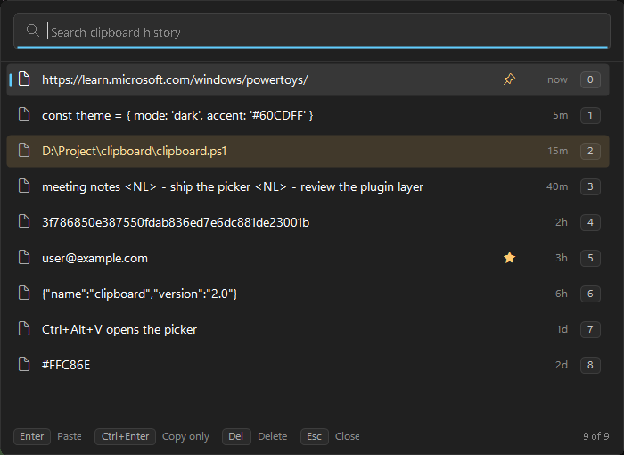
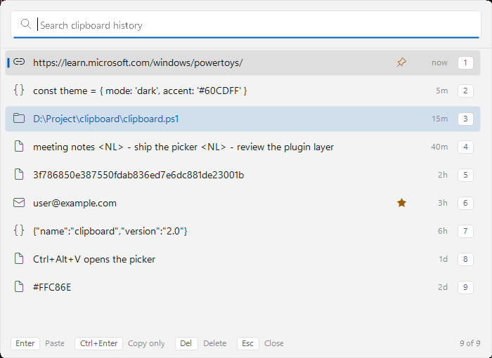

# Clipboard

Windows 10 / 11 上的轻量剪贴板历史工具，纯 PowerShell（零依赖，只用系统自带的 5.1），提供可搜索的历史面板与全局热键。

程序是 `src\clipboard.ps1`（入口）+ `src\lib\`（18 个必需模块 + 4 个可选加载层）：分发时要把整个文件夹一起拷，链接/快捷方式仍指向 `clipboard.ps1` 就行。

数据保存在脚本目录内，不依赖 Windows 剪贴板历史服务（`cbdhsvc`），不联网，也不需要管理员权限。

[](LICENSE)

| 深色 | 浅色 |
|---|---|
|  |  |

> 截图里是示例数据，不是真实剪贴板内容。

## 功能

- Win11 Fluent 自绘界面：40 px 行高、分层底色、圆角行高亮 + 强调色指示条、带描边的按键胶囊、搜索框聚焦下划线、悬停变宽的细滚动条
- 行图标由类型插件提供（[`entry-actions`](src/plugins/entry-actions.md) 按链接 / 路径 / 代码 / 多行等给图标）；不启用插件时行首没有图标，文字从行首开始
- 后台轮询剪贴板，保存最近 N 条文本（默认 300 条 / 单条 200 KB / 合计 4 MB）
- 全局热键呼出搜索面板（默认 `Ctrl+Alt+V`），边打字边过滤，回车直接粘贴回原窗口
- Explorer 里复制的**文件列表**也能捕获（CF_HDROP），可原样粘回
- 全键盘操作：`↑` `↓` `Home` `End`、`Ctrl+1..9` / `Ctrl+0` 按**当前可见行**快速选取、`Del` 删除、`Ctrl+Z` 撤销、`Esc` 清空搜索
- 长文本按行宽省略（`…`），悬停时用提示显示全文；搜索命中的关键词高亮
- 每条带类型图标与相对时间（`now` / `5m` / `3h` / `2d` / `10-24`）
- 右键菜单作用于**鼠标下的那一行**，带快捷键提示，插件可向菜单、面板按键与行样式注册自己的条目
- 列表可滚动（滚轮步长跟随系统设置 / `PageUp` `PageDn`），面板可拖动、可缩放、支持高 DPI，尺寸与位置可选记住
- 空状态与无结果状态分别给出图标 + 标题 + 说明；托盘图标提供显示 / 暂停 / 恢复 / 清空 / 退出
- 深浅两套主题，`ExcludePattern` 正则可以把密码类内容挡在历史之外
- 可选的置顶 / 收藏 / 高亮 / 类型分析 / 按类型打开 / 粘贴改写 / 过期清理以插件形式提供，见 [插件](#插件)

## 环境要求

- Windows 10 / 11
- PowerShell 5.1（系统自带，无需安装 .NET 或模块）
- 需要 **STA** 线程模型：启动器与快捷方式均带 `-Sta`，直接调用脚本时需自行加上

## 快速开始

```powershell
# 在项目目录里（程序本体是 src\clipboard.ps1 + src\lib\，两个都要）
powershell -NoProfile -ExecutionPolicy Bypass -Sta -File .\src\clipboard.ps1 diag     # 检查运行环境
powershell -NoProfile -ExecutionPolicy Bypass -Sta -File .\src\clipboard.ps1 serve    # 前台运行常驻进程
```

Git Bash / MSYS2 下直接 `./src/clipboard`，CMD 下 `src\clipboard.cmd`。

常驻运行：

```powershell
.\src\clipboard.cmd install     # 建开机自启 + 桌面快捷方式
.\src\clipboard.cmd uninstall   # 只删快捷方式，保留历史与配置
.\src\clipboard.cmd uninstall purge   # 连历史、配置、日志一起删
```

`install` 生成的快捷方式以 `-ExecutionPolicy RemoteSigned` 运行脚本，可覆盖目标机 `Restricted` / `AllSigned` 的评估结果；需要更宽松的策略时用 `install bypass`。

## 命令一览

| 分组 | 命令 | 说明 |
|---|---|---|
| **daemon** | `serve` | 运行常驻进程（捕获 + 热键 + 托盘） |
| | `stop` | 停止常驻进程 |
| | `ui` | 打开历史面板（常驻进程没跑会自动拉起） |
| | `status` | 常驻状态、自启状态、生效热键、存储路径、各标记数量 |
| | `pause` / `resume` | 暂停 / 恢复捕获 |
| **history** | `list [-Count N]` | 列出条目，最新在前（相对时间，排在最前的标记带 `*`） |
| | `get` | 输出剪贴板文本 |
| | `put "text"` | 写入剪贴板（省略文本时读 stdin） |
| | `pick N` | 把第 N 条放回剪贴板 |
| | `del N` | 删除第 N 条（受保护的行要先由插件取消标记） |
| | `clear [-All]` | 清空历史（受保护标记的行永远保留；`-All` 连“标记保留”的行一起删） |
| **config** | `config` | 全部配置项与生效值（基础项 + 按插件分组，标注 ini / 默认值） |
| | `config get KEY` | 单个键的生效值与 ini 原始值 |
| | `config set KEY VAL` | 校验并写入单个键，常驻进程在跑时自动重启生效 |
| | `config edit` / `config init` | 用记事本编辑 / 写入带默认值的模板 |
| | `themes` | 列出可用主题（`*` = 当前生效） |
| **setup** | `diag` | 检查运行环境 |
| | `restore` | 尝试恢复系统原生剪贴板历史的相关设置 |
| | `install [bypass]` / `uninstall [purge]` | 增删快捷方式（`purge` 连数据一起删） |
| | `help` | 帮助（插件命令按插件名分组列在后面） |

`clipboard help` 的分组与之对应：`[daemon]` `[history]` `[config]` `[setup]`，加上每个已加载插件的 `[plugin: <name>]`；没有设置类的命令行开关，所有取值都在 `clipboard.ini`。

### 面板快捷键

| 按键 | 作用 |
|---|---|
| 直接输入 | 过滤（空格分隔多关键词，需全部命中） |
| `↑` `↓` / 滚轮 / `PgUp` `PgDn` | 移动选中 / 滚动（滚轮后选中项会跟随可见区） |
| `Home` / `End` | 跳到第一条 / 最后一条 |
| `Enter` | 把选中条目粘到原来的窗口 |
| `Ctrl+Enter` | 只写入剪贴板，不自动粘贴 |
| `Ctrl+1..9` / `Ctrl+0` | 选取**当前可见**的第 1~9 / 10 行；编号显示在行尾，与小键盘位置一致（第 10 行是 `0`），滚动后从 `1` 重新编号 |
| `Del` / `Ctrl+Z` | 删除选中项 / 撤销上一次删除 |
| `Esc` | 有搜索词时清空搜索，空搜索时关闭面板 |
| 拖动标题区 / 右下角手柄 | 移动面板 / 缩放面板（手柄悬停时才显示） |

插件可以自己往面板里加按键（`PanelKeys`）：`item-marks` 加 `Ctrl+P` / `Ctrl+S` / `Ctrl+H`，`entry-actions` 加 `Ctrl+O`，按键会出现在 `clipboard help` 的 Panel keys 里并标明来源插件。

底部提示做成带描边的按键胶囊，并且会随状态切换：默认是 `Enter` Paste · `Ctrl+Enter` Copy only · `Del` Delete · `Esc` Close，按住 `Ctrl` 变成 `1-9,0` Pick · `Enter` Copy only · `Z` Undo（启用 `item-marks` 时额外有 `P` Pin / `S` Star / `H` Mark）；列表为空时只保留 `Esc` Close。删除 / 置顶 / 清空后短暂显示操作结果。

## 配置

配置**只读**：脚本启动时只读取脚本旁的 `clipboard.ini`，**不创建、不改写、不删除**它（`status`、`config`、`serve`、`ui` 都不会产生文件）。文件不存在或某个键缺失时，直接用内置默认值运行。

需要一份带全部键与注释的模板时执行 `clipboard config init`（已存在则报错，不覆盖）；只想改单个键用 `clipboard config set <key> <value>`。整个 ini 结构是扁平 `key=value`，`#` 或 `;` 开头是注释，`[section]` 行会被忽略。

| 键 | 默认值 | 说明 |
|---|---|---|
| `DataDir` | 空 | 写入位置；空 = 脚本旁的 `data/`（即 `src\data\`）。相对路径相对脚本目录 |
| `Hotkey` | `Ctrl+Alt+V` | 全局热键；`Win+V` 在多数系统上被占用，注册失败会自动回退 |
| `HotkeyFallbacks` | 空 | 逗号分隔的回退链，按顺序尝试；空 = 内置 Ctrl+Alt+V / Win+V / Alt+反引号 / Win+Shift+V |
| `PasteKeys` | `^v` | 选定后用 SendKeys 发送的按键（`^+v` = Ctrl+Shift+V） |
| `ModReleaseTimeout` | `1200` | 最多等多久（毫秒）让修饰键松开再注入粘贴 |
| `PasteSettle` | `80` | 切回原窗口后、发 `PasteKeys` 前等待的时长（毫秒）；目标应用响应较慢时可增大 |
| `MaxItems` | `300` | 最多保留条数（置顶条目不受裁剪影响） |
| `MaxBytes` | `204800` | 单条上限，超出不入库 |
| `MaxTotal` | `4194304` | 总容量上限，超出丢最旧的（置顶条目保留） |
| `Interval` | `300` | 剪贴板轮询间隔（毫秒） |
| `NoPaste` | `0` | `1` = 只写剪贴板，不自动粘贴 |
| `Balloon` | `1` | `1` = 启动时弹托盘气泡 |
| `Theme` | `win11-dark` | 主题名 = `themes/` 里的 `.ini` 文件名；`dark` / `light` 可作别名 |
| `ExcludePattern` | 空 | 正则，匹配到的文本永远不会入库 |
| `WindowWidth` / `WindowHeight` | `700` / `510` | 面板基准尺寸（96 dpi，高 DPI 会按比例缩放；510 = 10 行 × 40 px + 搜索栏 + 底栏） |
| `WindowLeft` / `WindowTop` | 空 | 面板位置；空 = 在呼出窗口所在显示器的中上部 |
| `SaveWindowSize` | `0` | `1` = 关闭面板时把缩放后的尺寸写回 ini |
| `SaveWindowPos` | `0` | `1` = 关闭面板时把当前位置写回 ini |
| `ShowTime` | `1` | `1` = 显示相对时间列 |
| `ShowTypeIcon` | `1` | `1` = 显示插件给的行图标；没有插件时本来就没有图标 |
| `Highlight` | `1` | `1` = 高亮搜索命中 |
| `HighlightMaxBytes` | `8192` | 超过该大小的条目不参与高亮（`0` = 总是高亮） |
| `ShowNewlineMarker` | `1` | `1` = 换行显示为 ` <NL> `，`0` = 折成空格 |
| `Undo` | `1` | `1` = 面板内 `Ctrl+Z` 撤销上一次删除 |
| `DpiAware` | `1` | `1` = 按系统 DPI 渲染，`0` = 旧渲染方式 |
| `ScrollLines` | `0` | 滚轮步长（行），`0` = 跟随系统设置 |
| `Autostart` | `1` | `1` = `install` 创建登录自启快捷方式（`serve`） |
| `DesktopShortcut` | `1` | `1` = `install` 创建桌面快捷方式（`ui`） |
| `Plugins` | 空 | 逗号分隔的插件**文件名**（不含 `.ps1`）。空 = 只加载基础功能（默认）；例如 `Plugins=item-marks` |

命令行**不接受**设置开关：所有设置只能写在 `clipboard.ini` 里，或用 `clipboard config set <key> <value>` 改（`clipboard put hi -MaxItems 50` 会直接被参数绑定拒绝）。`config set` 先按上表的类型与范围校验，写回时只改那一行（注释与其他键原样保留），常驻进程在跑时自动重启生效。`config get <key>` 同时显示生效值与 ini 里的原始值，`config` 每行标注来源（`<- ini` / `<- default`）。

> 命令行只处理位置参数与 `list -Count N`（列表长度），数据位置同样由 `clipboard.ini` 的 `DataDir=` 决定。

> 唯一会写 ini 的设置是 `SaveWindowSize=1` / `SaveWindowPos=1`：关闭面板时只回写 `WindowWidth` / `WindowHeight` / `WindowLeft` / `WindowTop` 四个键，其余行原样保留。

## 主题

界面配色与字体不写在脚本里：每个主题是 `themes/<name>.ini`（纯 ini，不执行任何代码），`clipboard.ini` 的 `Theme=` 只写主题名。

| 主题 | 简单介绍 | 说明页 |
|---|---|---|
| `win11-dark` | Windows 11 Fluent 深色，**默认**（也是参考布局） | [win11-dark.md](src/themes/win11-dark.md) |
| `win11-light` | Windows 11 Fluent 浅色，布局相同、底色反相 | [win11-light.md](src/themes/win11-light.md) |

```powershell
clipboard themes                        # 列出可用主题（* = 当前生效）
clipboard config set Theme win11-light  # 校验 + 写入 + 重启常驻
```

主题文件怎么写、有哪些 token、如何给插件的 `ThemeSettings` 换色，全部在本节。两条最容易踩的线：

- **主题色不是 `clipboard.ini` 的键**，用户侧只能选主题名（`config set Theme.Accent` 会报 unknown key）；换色靠改主题文件。
- 未知 token、非法颜色、越界字号只写日志，不影响其它项；`Theme=` 写错会回退 `win11-dark`。

### 主题文件格式

```ini
# 注释用 # 或 ;
name=my-theme
description=my colours
# 空 = 自动（Segoe UI Variable Text → Segoe UI）
font_family=
# 空 = 自动（Segoe Fluent Icons → Segoe MDL2 Assets）
icon_family=

[palette]          # #RRGGBB 或 #AARRGGBB（alpha 在前）
Surface=#101418
Text=#E8EAED
Accent=#5AC8FA
Border=#18FFFFFF

[fonts]            # 字号（pt）
Body=10.5
Title=13

[metrics]          # 可选，96 dpi 设计度量
RowHeight=40

[item-marks]       # 段名 = 插件名：重写该插件的 ThemeSettings
StarColor=#FFD700
```

| 段 | 说明 |
|---|---|
| 顶层 | `name` / `description` / `font_family` / `icon_family` |
| `[palette]` | 颜色 token，未知 token 忽略并写日志 |
| `[fonts]` | `Body` `Small` `Tiny` `Title` `Icon` `IconSmall` `IconBig` |
| `[metrics]` | `RowHeight` `HeadHeight` `FootHeight` `Margin` … |
| `[<插件名>]` | 重写该插件的 **ThemeSettings**（只对这个主题生效） |

可用颜色 token（全部可选，缺省沿用内置 dark 值）：

```
Surface Field FieldBorder Text Dim Faint Accent AccentSoft Border SelBg HoverBg
BadgeBg BadgeText KeyCapBg KeyCapBorder Mark Warn
```

> 叠层色（`SelBg` / `HoverBg` / `Border` / `BadgeBg` / `AccentSoft` / `KeyCapBorder`）请保留 alpha：面板是把它们半透明地叠在 `Surface` 上，不透明就失去了 Fluent 的层次感。

加载规则：

- 只有 `themes/*.ini` 参与，名字 = 文件名（忽略大小写）；`dark` / `light` 是别名。
- 解析名字只读文件名，不解析内容，所以坏主题不会影响 `config` / `status`；名字不存在或文件读不了 → 回退 `win11-dark` / 内置配色并写日志。
- 主题切换后需重启常驻进程生效（`config set Theme` 会自动重启；手工改 ini 则 `clipboard stop` + `clipboard serve`）。

## 插件

插件是**显式开启**的：`Plugins=` 留空（默认）时只跑基础功能，`plugins/` 下的文件连执行都不会执行。启用方式是在 `clipboard.ini` 里列出插件名（逗号分隔，**顺序即加载顺序**，不是文件名顺序）：先加载的插件在右键菜单里更靠前，也优先赢得 `TypeGlyph` / `Transform` 这类“只有一个插件生效”的钩子。

| 插件 | 简单介绍 | 启用 |
|---|---|---|
| [`item-marks`](src/plugins/item-marks.md) | 置顶 / 收藏 / 高亮：`pin` `unpin` `star` `unstar` `highlight` `unhighlight` `marks`，面板 `Ctrl+P` `Ctrl+S` `Ctrl+H`，右键三个菜单项；高亮改文字与背景色，不改左侧选择条 | `Plugins=item-marks` |
| [`entry-actions`](src/plugins/entry-actions.md) | 看清条目再动手：`kind` / `kinds` 分析类型与格式，`open` 按类型打开，面板 `Ctrl+O`，右键“Open link or path”；行图标也由它提供 | `Plugins=entry-actions` |
| [`transform`](src/plugins/transform.md) | 粘贴前改写文本：纯文本 / 全大写 / 小写 / 驼峰 / 蛇形 / 烤肉串 / 标题式；右键按 `transform.Modes` 逐个列出 `Transform as <模式>` | `Plugins=transform` |
| [`retention`](src/plugins/retention.md) | 过期清理：按天数自动删除旧条目，受保护标记的行永不清理 | `Plugins=retention` |

点插件名进各自的说明页（命令、设置项、主题项、注意事项）。

```ini
# 启用多个：逗号分隔，顺序即加载顺序
Plugins=item-marks,entry-actions
```

| 层 | 位置 | 职责 |
|---|---|---|
| 入口 | `clipboard.ps1` | 参数绑定、`$Root`、必需模块清单、运行时路径（ini / store / log 位置）、`Invoke-Main` |
| 装配 | `lib/dispatch.ps1` | `Invoke-Main`：先 `Apply-Config`，再按 `Plugins=` 装配插件，最后执行一个命令 |
| 场景 | `lib/picker.ps1`、`lib/picker-draw.ps1`、`lib/serve.ps1`、`lib/config.ps1`、`lib/diag.ps1`、`lib/shortcut.ps1`、`lib/usage.ps1` | 面板窗与交互、可复用的绘制件、常驻进程、设置命令面、诊断恢复、快捷方式、帮助 |
| 领域 | `lib/clip.ps1`、`lib/store.ps1`、`lib/entry.ps1`、`lib/hotkey.ps1`、`lib/picker-geom.ps1` | 剪贴板读写、历史记录与标记存储、条目分类与文案、热键解析、面板纯计算 |
| 基础 | `lib/ini.ps1`、`lib/values.ps1`、`lib/util.ps1` | schema 与原始读取、单个键的校验/解析/写入、日志 / 程序集 / DPI / 像素与时间 |
| 底 | `lib/base.ps1`、`lib/theme-stub.ps1` | 常量与全部默认值；内置配色与主题空实现（`lib/themes.ps1` 覆盖它们） |
| 加载层 | `lib/plugins.ps1`、`lib/plugin-settings.ps1`、`lib/plugin-marks.ps1` | 插件运行时（白名单 / 命令 / 右键项 / 按键 / 行图标 / 钩子）、插件设置面、标记含义（保护 / 置顶 / `clear` 保留 / 打印用词） |
| 加载层 | `lib/themes.ps1` | 主题发现 / 校验 / 颜色解析 / `Apply-Theme`（缺失时 `theme-stub` 的内置配色接管） |
| 扩展 | `plugins/*.ps1` | 每个文件返回一个哈希表，声明命令、右键项、面板按键、行图标、标记与设置 |

插件契约：一个 `.ps1` 文件 `return` / 直接输出一个哈希表。

| 键 | 必填 | 说明 |
|---|---|---|
| `Name` | 是 | 插件名，必须与文件名（去扩展名）一致（不一致会写一行警告） |
| `Description` | 否 | 一句话说明，`clipboard config` 会展示 |
| `Commands` | 否 | `@{ 'open' = { param($value) ... } }` → 变成 `clipboard open <值>` |
| `CommandHelp` / `CommandOrder` | 否 | 每个命令的一行说明（`clipboard help` 用）/ 打印顺序 |
| `ContextMenu` | 否 | `@( @{ Label = '...'; Test = { param($rec) ... }; Invoke = { param($rec) ... } } )`，右键菜单项；`Test` 返回 `$false` 时不显示。**按插件分组**：每组开头一行灰字插件名（不可点），组与组之间一条分隔线，组内不加线也不插标题（顺序 = `Plugins=` 加载顺序）；整组被隐藏时标题与分隔线一起消失。也可以写成**返回同样数组的脚本块**，让项数跟随自己的设置（`transform` 就是这样按 `transform.Modes` 生成多项）。项里可加 `After = 'paste'`：点完把结果**直接粘贴到原来的窗口**（`transform` 用），不加这个键就是老行为（只写进历史，点条目时才粘贴） |
| `PanelKeys` | 否 | `@( @{ Key = 'O'; Ctrl = $true; Label = '...'; Test = ...; Invoke = ... } )`，面板按键；不会覆盖基础按键 |
| `TypeGlyph` | 否 | `{ param($payload) ... }`，条目 → 行图标（返回空 = 该行不画图标）；第一个给出非空值的插件胜出 |
| `Settings` | 否 | 自己的配置项（`clipboard.ini`），`[ordered]@{ Key = @{ Kind = 'bool'; Default = 0; Desc = '...' } }` |
| `ThemeSettings` | 否 | 外观项，**不是 ini 键**：主题用同名段（如 `[item-marks]`）重写 |
| `Tick` / `Transform` | 否 | 常驻循环任务（`@{ Seconds; Action }`，`Seconds` 可写脚本块，所以间隔能跟随自己的设置）/ 粘贴前改写 |
| `RowDecor` | 否 | `{ param($rec) @{ Marks = @( @{ Glyph = '..'; Color = '#..' } ); TextColor = '#..'; BackColor = '#..' } }`，行尾标记字形与整行文字/背景色 |
| `Marks` | 否 | `[ordered]@{ x = @{ Set = 'on'; Unset = 'off'; Word = 'marked'; Hint = 'Ctrl+X'; Protected = $false } }`，声明本插件用的标记字符 |
| `SortMark` | 否 | 带该标记的行浮到列表最前（只能有一个） |
| `ClearKeeps` | 否 | 数组或脚本块，`clear` 默认保留的标记 |
| `Init` | 否 | 每个进程只跑一次的初始化（设置全部解析完之后） |

### 标记（mark）

记录的 `flags` 由一个类型字符（`t` 文本 / `f` 文件列表）加若干单字符标记组成。**基础层不认识任何一个具体标记**：它只存字符、按声明排序/保护/统计，其余全由插件声明：

| 声明 | 基础层的行为 |
|---|---|
| `Marks` | 命令行收尾提示、`status`、`clear` 文案都用声明里的词；`Protected` 决定该标记是否保护行 |
| `Protected = $true` | `del` 拒绝、裁剪与 `clear` 跳过，直到插件用自己的 `Unset` 命令取消标记 |
| `SortMark` | 带该标记的行排到列表最前（置顶就是这么实现的） |
| `ClearKeeps` | `clear` 默认保留这些标记；`-All` 忽略它，但保护标记永远保留 |

因此新增一个标记不需要改基础层（`lib\store.ps1`）：写插件、声明标记、在 `RowDecor` 里画出来即可。多个标记可以同时存在同一行。

基础层调用 `Get-PluginActions` 时会给每个菜单项标上 `Plugin`（指向声明它的插件），画面才据此分组；插件自己声明的哈希表不会被改动。

钩子按触发时机看：

| 时机 | 钩子 |
|---|---|
| 加载完成一次 | `Init` |
| 命令行 | `Commands` + `CommandHelp` + `CommandOrder` |
| 面板加载 / 按键 | `PanelKeys`、`ContextMenu`、`RowDecor`、`TypeGlyph` |
| 粘贴前 | `Transform` |
| 常驻循环 | `Tick` |
| 配置 / 标记规则 | `Settings`（ini）、`ThemeSettings`（主题）、`Marks` / `SortMark` / `ClearKeeps`（标记） |

基础按键（`Enter` / `Ctrl+Enter` / `Ctrl+1..9` / `Ctrl+0` / `Del` / `Ctrl+Z` / `Esc` / 翻页）永远优先，插件按键只在都不匹配时才会被询问。

基础的 `Get-EntryKind` 只回答“文本还是文件列表”（存储、行内容与粘贴往返用），**基础层不画任何行图标**：图标完全由插件通过 `TypeGlyph` 提供，返回空就不画，文字也从行首开始。`entry-actions` 就是靠它按类型给图标的，所以要图标就启用它。

`Settings` 与 `ThemeSettings` 是两个不同通道，不要混：

| | `Settings` | `ThemeSettings` |
|---|---|---|
| 写在哪 | `clipboard.ini`（用户设置） | `themes/*.ini`（主题文件） |
| 键名 | `<插件名>.<Key>` | 段名 = 插件名，段内写 `<Key>` |
| 谁改 | 用户（`config set`） | 主题作者 |
| 适合 | 行为开关（模式、是否启用） | 颜色、字形、强调样式 |
| 读取 | `Get-PluginSetting 'x' 'Key'` | `Get-PluginTheme 'x' 'Key'` |

分界线很简单：**行为**进 `Settings`（`clipboard.ini`，用户可改），**外观**进 `ThemeSettings`（`themes/*.ini`，随主题走）。`item-marks` 的高亮色就是这样落的：高亮行的文字色与底色只有主题键 `[item-marks]` 的 `EmphasisInk` / `EmphasisFill`，`clipboard.ini` 里没有对应项，也没有“ini 覆盖主题”的影子键。

`ThemeSettings` 不会被写进 `clipboard.ini`，`config` 里也看不到（它不是用户可以改的东西）；优先级是插件 `Default` < 主题 ini 段（只对该主题生效），值同样按 `Kind` 校验。

### 插件自己的配置项

插件可以带零到多个设置，注册后与基础键共用一套校验/展示管线，键名为 `<插件名>.<Key>`：

```ini
Plugins=entry-actions
entry-actions.Browser=C:\Tools\browser.exe
entry-actions.Reveal=1
```

```powershell
clipboard config                          # 基础键之后按插件分组列出
clipboard config get entry-actions.Reveal
clipboard config set entry-actions.Reveal 0
```

- `Kind` 与基础 schema 一致：`bool` / `int`（配 `Min`/`Max`）/ `enum`（配 `Options`）/ `regex` / `hotkey` / `list` / `string`；
  非法值会被拒绝（`config set`）或在加载时回退默认并写日志。
- 插件代码里用 `Get-PluginSetting 'entry-actions' 'Reveal'` 读当前生效值（已合并 ini 与默认值）；外观项用 `Get-PluginTheme`。
- 插件未在 `Plugins=` 中启用时，它的这些键**不存在**：`config get` 会提示先启用插件，`config init` 也不会写出它的设置段。

注意事项：

- **默认不加载**：`Plugins=` 为空时，插件文件不会被执行；写错名字会提示 `[!] plugin not found: xxx`，基础功能照常。
- **脚本块必须自包含**：可以调用基础函数（`Get-Records`、`Get-EntryKind`、`Write-Log`、`Format-Item`），但**不能引用插件文件作用域里的变量** —— 那个作用域在命令执行时已经销毁，捕获到的变量是 `$null`。多个脚本块要共享一段逻辑时，把它作为哈希表的一个键（如 `KindOf = { ... }`），脚本块里用 `& (Get-PluginData '<插件名>' 'KindOf') $arg` 取回并调用。
- **一份逻辑只写一次**：钩子、命令、右键项、面板按键往往要同样的行为，把它们抽成插件的共享块再各自调用；内置的四个插件都是这个结构（`KindOf` / `CanOpen` / `OpenPayload` / `Sniff`、`Apply`、`Sweep`、`TrimPins`），所以规则不会两处走偏。
- **用基础层给的东西，别自己读内部状态**：行装饰用 `RowDecor`、图标用 `Get-IconGlyph`、标记用 `Test-Mark` / `Get-ProtectedMarks` / `Get-SortMark`、改多行用 `Update-Records`，都不需要知道基础层的变量或记录格式。
- 插件文件保持纯 ASCII：PowerShell 5.1 把无 BOM 的 UTF-8 当 ANSI 解码，中文会直接语法错误。
- 单个插件抛异常只在日志里记一行，不影响其它插件与基础命令。

写一个新插件的最小示例：

```powershell
# plugins/my-thing.ps1
@{
  Name     = 'my-thing'
  Commands = @{
    'upper' = {
      param($value)
      $i = 0
      if (-not [int]::TryParse([string]$value, [ref]$i)) { Write-Host 'usage: clipboard upper 3'; return }
      $recs = @(Get-Records)
      if ($i -lt 1 -or $i -gt $recs.Count) { Write-Host 'index out of range'; return }
      Write-Host ([string]$recs[$i - 1].Payload).ToUpper()
    }
  }
}
```

## 兼容性（Windows 10 / 11）

| 项 | 处理方式 |
|---|---|
| 图标字体 | 优先 `Segoe Fluent Icons`（Win11），缺失时回退 `Segoe MDL2 Assets`（Win10），字形码全部在两者中都存在 |
| 系统 DPI | `SetProcessDPIAware` + `GetDpiForSystem` 都放在 `try/catch` 里（Win10 1607 之前没有 `GetDpiForSystem`），失败时按 96 dpi 渲染 |
| 主题 | 深浅色由自绘调色板决定，不依赖 `DwmSetWindowAttribute` 之类的 Win11 专用 API |
| 全局热键 | `Win+V` 在 Win10/11 上被剪贴板历史占用，注册失败按 `HotkeyFallbacks` 回退 |
| 托盘 / 通知 | 只用 `NotifyIcon` 与气泡，不依赖 Win11 的 Toast 通道 |
| PowerShell | 只要求 5.1（系统自带），不使用 Core 专有语法 |

## 文件与数据

```
src/                    程序本体（打包只读这个目录）
  clipboard               Git Bash / MSYS2 启动器（sh 壳，负责把路径转成 Windows 形式）
  clipboard.cmd           CMD 启动器
  clipboard.ps1           入口：参数绑定 / $Root / 必需模块清单 / 运行时路径 / 调用 Invoke-Main
  clipboard.ini           配置（只读；不存在时用内置默认，config init 才生成）
  data/                   历史 / 日志 / 生效热键缓存（不入库）
  lib/base.ps1            常量、记录格式、运行时标识、度量/字形/时序与全部默认值
  lib/ini.ps1             clipboard.ini 读取 + 全部键的 schema（类型 / 范围 / 默认 / 说明）
  lib/values.ps1          单个键的校验与解析（Convert-IniValue / Get-CfgValue / Set-IniKey）
  lib/util.ps1            日志、程序集、DPI、像素换算、时间、圆角路径
  lib/theme-stub.ps1      内置配色与主题空实现（lib/themes.ps1 会覆盖它们）
  lib/clip.ps1            剪贴板读写（文本 + CF_HDROP 文件清单）
  lib/store.ps1           历史文件：CBHIST2 读写、加锁、标记存储、排序裁剪
  lib/hotkey.ps1          热键解析与修饰键状态
  lib/entry.ps1           条目分类（text / files / empty）、图标兜底与条目文案
  lib/picker-geom.ps1     面板纯计算：行数、数字快选、窗口位置、命中高亮
  lib/picker-draw.ps1     可复用绘制：按键胶囊、搜索命中着色（只要 Graphics + 参数）
  lib/picker.ps1          历史面板：窗体、过滤、列表、按键、右键菜单、粘贴
  lib/serve.ps1           常驻进程：捕获循环、热键、托盘、崩溃重启
  lib/diag.ps1            diag 报告与 restore
  lib/shortcut.ps1        开机自启 / 桌面快捷方式的安装与卸载
  lib/config.ps1          config 命令面：应用设置、打印有效值、写模板、重启常驻
  lib/usage.ps1           help 输出（基础命令分组 + 每个插件的分组）
  lib/dispatch.ps1        Invoke-Main：先 Apply-Config，再装配插件，最后执行一个命令
  lib/plugins.ps1         插件运行时（Load-Plugins / 命令 / 右键项 / 按键 / 行图标 / 钩子）
  lib/plugin-settings.ps1 插件设置面（Settings → ini 键，ThemeSettings → 主题段）
  lib/plugin-marks.ps1    标记含义（保护 / 置顶 / clear 保留 / 打印用词）
  lib/themes.ps1          主题加载层（发现 / 校验 / 颜色解析 / Apply-Theme）
  plugins/*.ps1           可选插件（item-marks / entry-actions / transform / retention；默认不加载）
  plugins/*.md            每个插件的说明页
  themes/*.ini            主题（win11-dark 默认 / win11-light）
  themes/*.md             每个主题的说明页
build/minify.ps1        压缩器（按语法树把语句接成 `;`、删注释/缩进、重命名内部函数与局部变量）
build.ps1               打包脚本（读 src\，输出 dist\clipboard-<版本>\）
build.ini               打包设置（版本 / 输出目录 / 压缩 / 重命名 / 验证 / 打哪些插件与主题）
dist/                   打包产物（不入库）
tests/run-tests.ps1     自测套件
```

分层顺序即依赖方向：`clipboard.ps1`（入口）→ `dispatch`（装配命令）→ `picker` / `serve` / `config` / `diag` / `shortcut` / `usage`（场景）→ `store` / `clip` / `entry` / `hotkey` / `picker-geom`（领域）→ `values` / `ini` / `util`（基础）→ `base` / `theme-stub`（常量、默认值与兜底配色）。只允许上层调用下层：`values` 单独一层是因为「校验一个值」要用到热键解析与主题名，把它放在 `config` 里会让 `config` 与 `plugin-settings` 互相依赖。

两条硬约束（违反任何一条，`struct` 组会直接报出来）：

- **`$Root` 只在入口文件里算。** 点源文件里 `$PSScriptRoot` 指向 `lib\`，用它拼路径会把 `themes\`、`plugins\`、`data\` 全部指错一层。
- **只有 `base.ps1` 与 `ini.ps1` 在加载时赋值**（默认值与设置 schema），其余模块只定义函数，所以点源顺序只对这两个文件敏感。

除 `lib/themes.ps1` 与插件三件套（`plugins.ps1` / `plugin-settings.ps1` / `plugin-marks.ps1`，要么全有要么全无）外，模块缺失会直接报 `missing: …\lib\<name>.ps1` 并以退出码 1 结束 —— 分发时必须整个文件夹一起给，不能只拷 `clipboard.ps1`。

写入位置由 `clipboard.ini` 的 `DataDir=` 决定，留空则用脚本旁的 `data/`（相对路径相对脚本目录）；`config` 的 `data dir` 与 `status` 的 `store file` 均显示实际生效位置。

不写入 `%LOCALAPPDATA%` 或其它用户目录：写入位置不可写时输出错误信息并以退出码 1 结束，不会回退到其它位置。除 `install`（两个快捷方式）与 `restore`（注册表项）外，脚本不写注册表。

### 历史文件格式

`src/data/history.dat` 是纯文本，不是 JSON，也不依赖数据库：

```
CBHIST2 RS <flags> US <epoch 秒> US <payload> RS <flags> US ...
```

- `flags` = 一个类型字符（`t` 文本 / `f` 文件列表）后面跟若干单字符标记；标记含义由插件声明，基础层只存不改，例如 `tps` = 文本条目 + `p` + `s` 两个标记
- 分隔符：`RS` = `0x1E`，`US` = `0x1F`；类型签名字符为 `0x01`
- 只认这一种格式：没有 `CBHIST2` 签名的旧版 `history.dat` 会被当成空库忽略（不迁移、不备份），首次写入时直接被新格式覆盖
- 入库前会把文本里的 `RS` / `US` 字符替换成空格，避免破坏记录结构

## 开机自启与桌面快捷方式

`install` 建两个快捷方式（`Autostart=0` / `DesktopShortcut=0` 可分别跳过），目标均为 `powershell.exe`，不使用代理进程包装；参数中的 `-ExecutionPolicy RemoteSigned` 用于覆盖目标机 `Restricted` / `AllSigned` 的本地策略：

| 快捷方式 | 参数 | 用途 |
|---|---|---|
| `Startup\clipboard.lnk` | `-NoProfile -ExecutionPolicy RemoteSigned -Sta -WindowStyle Hidden -File "...\clipboard.ps1" serve` | 登录时静默启动常驻进程 |
| `Desktop\clipboard.lnk` | `-NoProfile -ExecutionPolicy RemoteSigned -Sta -WindowStyle Hidden -File "...\clipboard.ps1" ui` | 双击打开历史面板 |

> 本工具不作为 Windows 服务运行：服务位于 Session 0，没有桌面与托盘，`RegisterHotKey` 收不到用户输入，剪贴板也按会话隔离。

## 测试

```powershell
powershell -NoProfile -ExecutionPolicy Bypass -Sta -File tests\run-tests.ps1
```

结构组没有开关，任何模式下都会先跑；其余三组默认全跑，也可以单独指定：

| 组 | 开关 | 覆盖内容 |
|---|---|---|
| 结构 | 无（总是执行） | 分层契约：16 个必需模块齐全、每个模块可解析、模块里不得出现 `param()` 与 `$PSScriptRoot`/`$PSCommandPath`、无重名顶层函数（`theme-stub` ↔ `themes` 的覆盖是唯一例外）、入口 ≤ 200 行且 `$Root` 只算一次、单模块 ≤ 1400 行。产物模式只校验可解析 / 无 param / 无自引用 / 无重名，因为尺寸与 `$Root` 那行已被改名 |
| 单元 | `-Unit` | 纯函数与存储层：`Parse-Hotkey`、`Format-Item`/`Get-ItemLabel`、`Read-Ini`/`Write-IniTemplate`/`Set-IniKey`、`Convert-IniValue`（类型与范围校验）、`Apply-Config`、记录往返与未知格式忽略、标记与保护规则、`Get-QuickKeyIndex` / 数字键位置、`Get-VisibleRowCount`、`Get-PickerBounds`、`Get-HitMarks`、`Get-EntryKind`（文本 / 文件列表）、行图标（无插件时为空、插件 `TypeGlyph` 生效）、主题（发现 / 别名 / 颜色解析 / 两套调色板 / 未知主题回退）、插件白名单与各个共享块。通过 `-Library` dot-source 主脚本（入口会先把 `lib\` 全部点源进来，所以函数都在），不触发命令分发 |
| 集成 | `-Integration` | 每条 CLI 能力都起子进程验证：`put`/`get`/`list`/`pick`/`del`/`clear`/`clear -All`/`pause`/`resume`/`status`/`themes`/`config get`/`config set`/`config init`/`diag`、主题切换与非法主题名拒绝、插件默认关闭与 `Plugins=` 开启、插件命令（`pin`/`star`/`kind`/`kinds`/`open`/`transform`/`sweep`/`marks`）、错误插件名提示、只读命令不生成 ini、设置开关被参数绑定拒绝；以及 `build.ps1` 用配置文件打包（进包内容、`Plugins=`/`Themes=` 裁剪、`Overwrite=0` 拒绝覆盖、未知插件名报错） |
| 端到端 | `-E2E` | 拉起真实常驻进程 → 校验热键注册 → 复制内容验证捕获链路 → 暂停后不再捕获 → `stop` 后干净退出且没有重启循环 |

全部在 `%TEMP%` 下的沙箱副本（脚本 + `lib` + `plugins` + `themes`）中运行，不修改 `data/` 与 `clipboard.ini`；真实剪贴板在开始前备份、结束后还原。任一项失败时退出码为 1。

> 检测到常驻进程时会临时 `pause`，跑完先恢复剪贴板再 `resume`（原本已处于 paused 则保持不动）。

> `-E2E` 在运行期间占用全局热键并接管剪贴板；已有常驻进程时这组自动跳过。
> 图形界面（面板绘制、粘贴注入）不在自动化范围内。

## 打包分发

`build.ps1` 读 `src\` 并输出 `dist\clipboard-<版本>\`：**目录结构不变、仍是 PowerShell**，但每个 `.ps1` 都按语法树重写（删注释与缩进、重命名内部函数与局部变量），所以既能用（功能不变）又更小。不编译、不生成 exe、默认也不打压缩包。**打包配置全部写在 `build.ini` 里，不走命令行参数**：

```powershell
powershell -NoProfile -ExecutionPolicy Bypass -File build.ps1                    # 用 build.ini
powershell -NoProfile -ExecutionPolicy Bypass -File build.ps1 -Config other.ini  # 换一份配置
```

`build.ini`（与 `clipboard.ini` 同一套写法：扁平 `key=value`，`#` 开头是注释）：

| 键 | 默认 | 说明 |
|---|---|---|
| `Version` | 空 | 目录名里的版本；空 = `git describe --tags --always --dirty`，没有 git 时用日期。只保留 `0-9 A-Z a-z . - _` |
| `OutDir` | `dist` | 输出目录；相对路径按本目录解析 |
| `Minify` | `1` | `1` = 按语法树压缩脚本（删注释 / 缩进 / 空行） |
| `Rename` | `1` | `1` = 同时重命名内部函数（全项目一套映射）与局部变量（每文件一套）；`0` = 只压缩不改名 |
| `Verify` | `1` | `1` = 打包后拿产物再跑一遍 `tests\run-tests.ps1 -Source <产物>`，不通过就删掉产物并失败 |
| `IncludeDocs` | `1` | `1` = 把 `README.md`、`LICENSE`、`docs\` 也放进产物 |
| `Overwrite` | `0` | `1` = 覆盖同版本已存在的目录 |
| `Plugins` | 空 | 只打这些插件（逗号分隔，名字 = `src\plugins\` 下的文件名去 `.ps1`）；空 = 全部 |
| `Themes` | 空 | 只打这些主题（同上）；空 = 全部 |
| `Zip` | `0` | `1` = 另外再打一个 `clipboard-<版本>.zip` |

```ini
# 只发一个精简包：两个插件 + 一套主题，不压缩不验证
Version=1.2.0
OutDir=D:\release
Minify=0
Rename=0
Verify=0
IncludeDocs=0
Overwrite=1
Plugins=item-marks,transform
Themes=win11-dark
```

**压缩是怎么做的**（`build\minify.ps1`，思路同前端 bundler，只是对象是 PowerShell 的 AST）：

| 阶段 | 做什么 |
|---|---|
| 语句 | 同一个语句块里两条语句之间的换行 → `;`。分界由解析器给出（`StatementBlockAst.Statements`），不靠猜：`if`/`else`、`try`/`catch`、`param()` 这些**跨行才合法**的位置属于不同节点，不会被碰 |
| 词法 | 删注释（`#Requires` 保留）、删行首缩进；token 之间只在**标点旁**丢掉空格（`(`、`[`、`@(`、`,`、`;`、`=`、`|`、`&`、`. `、`::` 等），其余一律保留一个空格或原本的换行 —— 猜错空格会静默改变含义（`- (x)` vs `-(x)`、`$h [$k]` vs `$h[$k]`） |
| 语法 | 内部函数名 → `a`、`b`…`z`、`a1`…（**全项目一套映射**，避开所有别名与 cmdlet 名，否则 `fl` 这类名字会被 `Format-List` 截胡）；局部变量 → 同一套短名的另一个编号空间（每文件一套） |
| 不改名 | `param()` 里的名字（按名传参：`-Library`、`-Count`、`-NoInject`，`$PSBoundParameters` 也按它查键 —— 改了名 `config set` 会认不出 `Arg`）、带作用域/驱动器前缀的变量（`$script:`、`$env:`）、PowerShell 自动变量、`Get-Command <名字>` 查过的函数、成员名与哈希键 |
| 校验 | 改名后、语句合并后、词法压缩后各解析一次；语法有任何错误就中止，不会产出坏包。`Verify=1` 再拿产物跑一遍真实 CLI 测试：101 项集成断言全过才算打包成功 |

两个踩过的 AST 坑（写在这里省得下次再撞）：

- 变量名必须从 `VariablePath.UserPath` 取。`VariablePath.UnqualifiedPath` 在本机运行时对 `$x` 和 `$script:x` **一律返回空串**，拿它做映射会“看起来改名了、实际一半没改”，结果 `$MaxItems` 与 `$script:MaxItems` 指向两个变量，历史写不进去。
- 函数返回 `HashSet` 之类的空集合时会被 PowerShell 展开成 `$null`，调用方 `.Contains()` 立刻炸 —— 用 `return , $set` 包一层，或者在调用处 `@()`。

实测（本仓库，拆分后）：`234171 → 140221` 字节，`40.1%` 更小（只压缩不改名是 30.6%）；`picker.ps1` −40%、`lib/store.ps1` −46%、`lib/plugins.ps1` −49%、`lib/theme-stub.ps1` −60%。

> `Verify=1` 的意义：包里的函数名与变量名都变了，**只有跑一遍真实 CLI 测试才能证明功能没变**；`-Source` 指向产物时单元组会跳过（它按名字调内部函数），集成与端到端照常跑。

产物里是什么、不是什么：

| 进包（来自 `src\`） | 不进包 |
|---|---|
| `clipboard.ps1`、`clipboard.cmd`、`clipboard`（Git Bash 壳） | `src\data\`（历史与日志） |
| `lib\`（22 个模块：18 必需 + `themes.ps1` 与插件三件套）、所选 `plugins\`（含 `.md`）、所选 `themes\`（ini 与 `.md`） | `src\clipboard.ini`（用户设置） |
| `README.md`、`LICENSE`、`docs\`（截图，`IncludeDocs=1` 时） | `tests\`、`build\`、`build.ini`、`dist\`、`.git` |

> `Plugins=` / `Themes=` 里写了不存在的名字会直接失败并指出是哪个；被选中的插件/主题会连同自己的 `.md` 一起进包（`lib\` 是基础层，永远随包走）。

> 拿到产物后：`clipboard.cmd config init` 生成带注释的 `clipboard.ini`，再 `clipboard.cmd install` 建开机自启与桌面快捷方式。`clipboard` 那个 Git Bash 启动器在 zip 里会丢可执行位，用 `sh ./clipboard` 即可（或 `chmod +x clipboard`）。

插件不用打包器操心：它就是 `plugins\` 目录 + `Plugins=` 白名单，目录跟着包走就能用；想分发自己写的插件，把 `.ps1` 放进产物里的 `plugins\` 也生效。

## 常见问题

### 安全软件把快捷方式判为 `Trojan/LNK.Runner`

`install` 生成的快捷方式目标为 `powershell.exe`，不带 `-ExecutionPolicy Bypass`（客户端默认策略 `RemoteSigned` 已允许运行本地无签名脚本）。部分安全软件的启发式规则会把「快捷方式 + 系统代理进程（`conhost` / `rundll32`）+ 隐藏窗口 + 执行策略绕过」的组合判为 `LNK.Runner`，因此本工具不使用代理进程包装。

### 快捷方式提示「在此系统上禁止运行脚本」

快捷方式默认带 `-ExecutionPolicy RemoteSigned`。若仍被拒绝，按顺序检查：

1. 脚本带网络来源标记（从压缩包或下载目录解出）—— 执行 `Unblock-File .\src\clipboard.ps1`
2. 需要更宽松的进程级策略 —— `clipboard install bypass`（改用 `-ExecutionPolicy Bypass`）
3. 组策略（`MachinePolicy` / `UserPolicy`）已指定执行策略 —— 此时 `-ExecutionPolicy` 参数不生效，`install` 会打印 `group policy defines the execution policy` 提示

### 热键无响应

`status` 的 `active key` 反映实际生效的按键：

- `poll:<键>` —— 候选热键全部注册失败，退化为 `GetAsyncKeyState` 轮询
- 与 `Hotkey` 不同的键名 —— 首选键被其它程序占用，已按 `HotkeyFallbacks` 回退
- `(stopped)` / `(daemon never started)` —— 常驻进程未运行

修改 `Hotkey` 后需要重启常驻进程。

### 恢复系统自带的 Win+V

`diag` 逐项列出环境检查结果；`restore` 针对注册表项（`EnableClipboardHistory`、策略 `AllowClipboardHistory`）与 `cbdhsvc` 实例执行恢复。文件层面的缺失（如 `TextInputHost.exe`）无法通过脚本修复。

## 许可

[MIT](LICENSE) © 2026 Xu22Web
