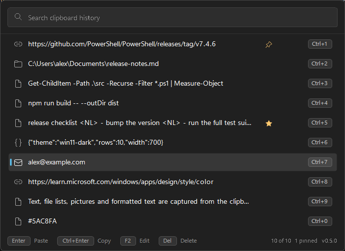
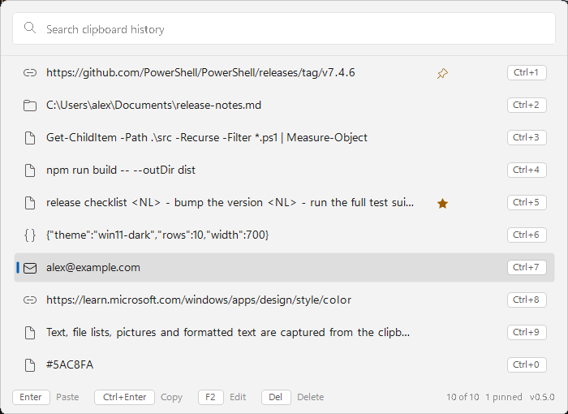
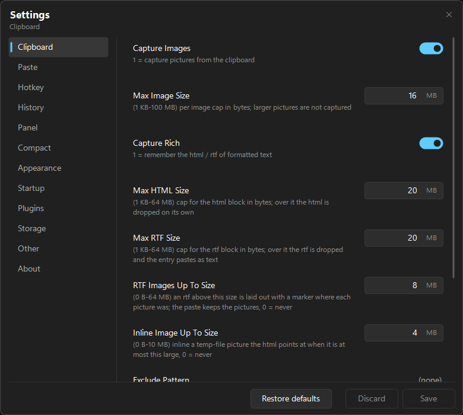
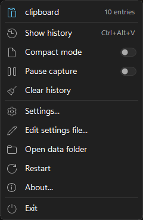
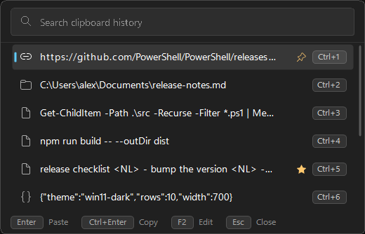
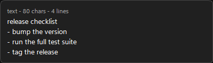
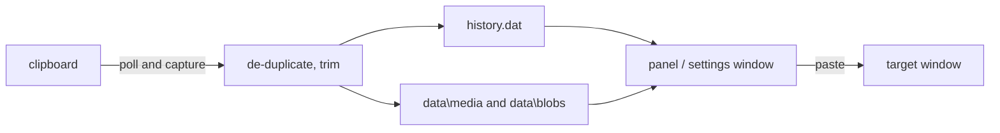
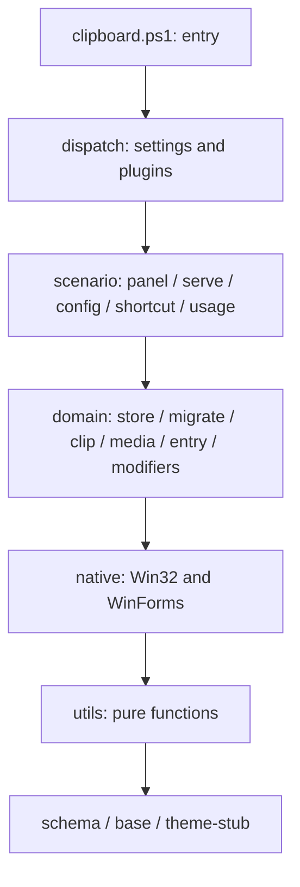

# Clipboard

English | [简体中文](README.zh-CN.md)

Clipboard history for Windows 10 / 11, written in plain PowerShell 5.1 with no third-party dependencies: a global hotkey, a searchable history panel and a resident capture loop.

The program is the entry point `src\clipboard.ps1` plus the modules under `src\main\`, `src\preload\`, `src\renderer\` and `src\shared\`; distribution copies the whole folder. Data stays inside the program folder, the Windows clipboard history service (`cbdhsvc`) is not used, nothing goes over the network and no administrator rights are needed.

[](LICENSE)

| Dark | Light |
|---|---|
|  |  |

> The screenshots show sample data.

## Contents

- Usage: [Features](#features) · [Requirements](#requirements) · [Quick start](#quick-start) · [Commands](#commands) · [Settings window](#settings-window) · [Tray menu](#tray-menu) · [Panel keys](#panel-keys) · [Search syntax](#search-syntax) · [Focus model](#focus-model) · [Panel shapes](#panel-shapes) · [Export, import and backup](#export-import-and-backup)
- Configuration: [Configuration](#configuration) · [INI conventions](#ini-conventions) · [schema files](#schema-files) · [Pictures and formatted text](#pictures-and-formatted-text) · [Per-application rules](#per-application-rules) · [Themes](#themes) · [Plugins](#plugins) · [Command proxy](#command-proxy) · [Compatibility](#compatibility)
- Data and upkeep: [Files and data](#files-and-data) · [Log](#log) · [History file format](#history-file-format) · [Data version and migration](#data-version-and-migration) · [Version number](#version-number) · [Autostart and desktop shortcut](#autostart-and-desktop-shortcut) · [FAQ](#faq)
- Contributing: [Tests](#tests) · [Development](#development) · [Packaging](#packaging) · [CI and release](#ci-and-release)

## Features

- A global hotkey opens the history panel (default `Ctrl+Alt+V`); typing filters as you go and `Enter` pastes back into the window you came from ([focus model](#focus-model)).
- Capture polls in the background and de-duplicates; text, file lists, pictures and formatted text (including mixed text and pictures) are supported. Content over a limit is skipped as configured, and clipboard content the source program marks as "do not record" is never stored ([pictures and formatted text](#pictures-and-formatted-text)).
- Four independent capacities: number of entries, size of one entry, total text size, media budget. Over a limit the oldest entries go first; a row protected by a mark is exempt ([configuration](#configuration)).
- The panel is a self-drawn Win11 Fluent surface: virtual list, frozen pinned rows, ellipsized long text, highlighted search hits, a hover preview card and two themes.
- Full keyboard operation: arrows and page keys, `Ctrl+1..0` quick pick, `Del` to delete, `Ctrl+Z` to undo, `F2` to edit in place, a context menu; see [panel keys](#panel-keys).
- The resident process carries a tray icon (a click shows the history) and a context menu ([tray menu](#tray-menu)), restarts itself after a crash, and can install an autostart entry and a desktop shortcut.
- Pinning, starring, highlighting, type analysis, open by type, paste rewriting and expiry are plugins, all enabled by default ([plugins](#plugins)).
- Every setting lives in `clipboard.ini`: `config init` writes a commented template, `config set` validates and writes one key ([configuration](#configuration)).
- The history file carries a format version; `clipboard migrate` upgrades an older file ([data version and migration](#data-version-and-migration)).

## Requirements

- Windows 10 / 11
- PowerShell 5.1 (part of Windows; no .NET install and no modules)
- STA: the launchers and shortcuts pass `-Sta`; calling the script yourself has to add it

## Quick start

The program runs on its own (`src\clipboard.ps1` plus `src\main\` / `src\preload\` / `src\renderer\` / `src\shared\`), and the repository root has `cli` for the commands `package.ini` declares.

```powershell
cli              # list the commands package.ini declares
cli dev          # start the resident process, restart it when a loaded file changes
cli test         # run every self test
cli build        # package into dist\clipboard-<version>\
cli client       # compile the optional native client src\preload\client.exe
cli assembly     # compile the optional type library src\main\clipboard.dll
cli bundle       # build one entry from builder.cli.config.ps1 (-Inspect lists what cannot be inlined)
```

`cli` has two entries: `cli.sh` (Git Bash / MSYS, `./cli.sh`) and `cli.cmd` (CMD, `cli`). Command names are case-insensitive; the remaining arguments are appended to the matching line of `package.ini`, for example `cli test -Unit`, `cli build -Config other.ini`.

The program itself is called directly (Git Bash: `./src/clipboard.sh <command>`; CMD: `src\clipboard.cmd <command>`):

```powershell
.\src\clipboard.cmd status              # resident state, entry count and the settings in effect
.\src\clipboard.cmd install             # create the autostart entry and the desktop shortcut
.\src\clipboard.cmd uninstall           # remove the shortcuts only; history and settings stay
.\src\clipboard.cmd uninstall purge     # remove history, settings and log as well
```

The shortcuts `install` creates run the script with `-ExecutionPolicy RemoteSigned`, which overrides a `Restricted` / `AllSigned` machine policy; use `install bypass` for a looser one.

The package carries two batch files next to `clipboard.ps1` (their sources live in `scripts\` and are copied unchanged):

| Script | What it does |
|---|---|
| `install.bat` | `config init` → `migrate` → `install` |
| `uninstall.bat` | `stop` → `uninstall purge` (removes `data\` and `clipboard.ini`) |

## Commands

| Group | Command | Purpose |
|---|---|---|
| **daemon** | `serve` | run the resident process (capture + hotkey + tray) |
| | `stop` | stop the resident process |
| | `ui` | open the history panel (starts the resident if needed) |
| | `settings [page]` | open the settings window (same theme and fonts as the panel); with a page name it opens on that page, e.g. `settings About` |
| | `status` | resident and autostart state, hotkey in effect, store path, mark counts |
| | `pause` / `resume` | pause / resume capture |
| **history** | `list [-Count N]` | list entries, newest first (relative time, the newest carries `*`) |
| | `get` | print the clipboard text |
| | `put "text"` | write the clipboard (reads stdin when the text is omitted) |
| | `pick N` | put entry N back on the clipboard (pictures and formatted text in their original formats) and move it to the front |
| | `edit N` | rewrite the text of entry N in Notepad (position, time and marks stay; formatting goes with the old text) |
| | `del N` | delete entry N (a protected row needs its mark removed first, by the plugin that set it) |
| | `clear [-All]` | clear the history (rows kept by a protected mark always stay; `-All` drops those too) |
| **config** | `config` | every key with its effective value (grouped by plugin, tagged ini / default) |
| | `config get KEY` | effective value and the raw ini value of one key |
| | `config set KEY VAL` | validate and write one key; the resident restarts when it is running |
| | `config edit` / `config init` | edit in Notepad / align with this version: add new keys, comment out retired ones, keep every value |
| | `config reset` | rewrite the whole ini with the defaults (the only path that loses settings) |
| **theme** | `themes` | list the available themes (`*` = in use) |
| **setup** | `export FILE` | export the history: `.json` holds everything, `.csv` / `.txt` only text; `-Media` puts pictures into the json |
| | `import FILE` | import an export; `-Replace` swaps the whole store (with a snapshot first) |
| | `backup [name]` / `restore [name]` | zip `data\` into `data\backup\` / restore a snapshot (the current history is backed up first) |
| | `migrate [-Purge]` | upgrade an older `history.dat`; `-Purge` archives a file that cannot be upgraded into `data\backup\` |
| | `install [bypass]` / `uninstall [purge]` | create or remove the shortcuts (`purge` removes the data too) |
| | `version` | print the program version and the data format version |
| | `help` | help (plugin commands follow, grouped by plugin name) |

The groups of `clipboard help` match this table: `[daemon]` `[history]` `[config]` `[theme]` `[setup]`, plus `[plugin: <name>]` for every loaded plugin.

One resident process per logon session: it holds the named mutex `Local\clipboard.daemon`. When one is already running, `serve` prints `clipboard already running`, asks the running instance to open the panel and exits without registering a hotkey or starting a capture loop. One panel exists at a time; the hotkey closes it when it is open. Writes to the history file are serialised by the `Local\clipboard.store` mutex, so a command-line process and the resident never write at the same time.

## Settings window

`clipboard settings` opens the settings window; the tray menu's `Settings...` opens it inside the resident process instead of starting a new one, and `About...` opens the same window on the `About` page. One window per session: another request brings the open window forward instead of opening a second one, and pressing the hotkey while it is open minimises it and opens the panel (a chord being recorded keeps the window in front, because those keys belong to the row being set). It is pointer-driven: a page on the left, each one drawn as an icon and its name, one control per row on the right; the header drags the window and carries `—` and `✕`, and `Esc` closes it. A minimised window listens for nothing, so a recording in progress ends there. The footer shows the result of the last action on the left and three buttons on the right. The window shows the tray icon in the taskbar and Alt-Tab, not the PowerShell host icon.



| Row | On a click |
|---|---|
| switch row | flips in place (the transition follows `Animations`) |
| number / text row | an input appears; `Enter` or a click elsewhere commits it, a refused value keeps it open and says why |
| `Theme` / `PasteKeys` | a list opens; one item per line |
| `Plugins` | multi-select: ticking keeps the list open and the row reads `All` or `n of m`; unticking everything is refused (an empty value means every plugin) |
| `Hotkey` | record a chord, `Esc` cancels |
| `HotkeyFallbacks` | one chord per line: `+` at the end records a new chord at the end of the chain, `Esc` or a click elsewhere cancels and restores `+`; `×` deletes that line; a chain holds three chords, and the `+` disappears once it is full |
| `DataDir` | the system folder picker; the history is not moved, the chosen folder starts empty |
| `Autostart` / `DesktopShortcut` | only `install` acts on them, and the help line says so |

A change stays inside the window until `Save`: a changed row carries an accent dot on its left, and the group with unsaved changes carries the same dot on its right. A value that goes back to what the file holds is no longer a change. A setting whose prerequisite is off (for example `MaxImageBytes` without `CaptureImages`) is greyed out with the reason. The footer buttons are `Restore defaults` (writable keys go back to the schema defaults; always enabled), `Discard` and `Save` (writes `clipboard.ini` once and applies it); the last two are disabled when nothing is staged and sit further right. The `About` page has no buttons. Closing a window that saved restarts the resident once, so the new values take effect (a language or a theme alone needs no restart: the panel and the tray menu read it when they open); closing with unsaved changes asks first.

Shortcuts are drawn as Win11 key caps in the order Win, Ctrl, Alt, Shift. A chord may use letters, digits, `F1`–`F24`, `Insert` `Delete` `Home` `End` `PgUp` `PgDn` `Space` and punctuation, which the file spells as a name (`BACKTICK` `MINUS` `EQUALS` `LBRACKET` `RBRACKET` `BACKSLASH` `SEMICOLON` `QUOTE` `COMMA` `PERIOD` `SLASH`, the literal character is accepted too); the cap shows the character itself (`` ` `` `-` `,`). A bare key without a modifier is accepted only for `F1`–`F24`. The wheel scrolls the list; the scroll bar drags and its track pages. The last page, `About`, lists the program version, the data format, the entry count, the store folder, the settings file and the loaded plugins, and ends with a link to the repository (accent value plus an external-link mark; a click opens `https://github.com/Xu22Web/clipboard` in the default browser).

## Tray menu

A left click opens the history panel, a right click opens the menu. The first row is the program name and the current entry count; beside `Show history` is the hotkey in effect.



| Row | Behaviour |
|---|---|
| `Show history` | opens the panel, the same as a click on the icon |
| `Compact mode` / `Pause capture` | switches, flipped in place; `Compact mode` also writes `clipboard.ini`, so the next panel opens in that shape |
| `Clear history...` | asks, then clears; rows kept by a protected mark stay |
| `Settings...` / `About...` | open the settings window inside the resident (the latter on the `About` page) |
| `Edit settings file...` | opens `clipboard.ini` in Notepad |
| `Open data folder` | opens the store folder |
| `Restart` | rebuilds the tray icon and the hotkey without exiting |
| `Exit` | exits the resident process |

The menu is drawn by the tool; its colours and fonts follow the theme.

## Export, import and backup

| File | What it carries | Use |
|---|---|---|
| `.json` | text, time, marks; with `-Media` also pictures and formatted-text blocks as base64 | moving to another machine, long-term archive |
| `.csv` | three columns, `text,time,marks` | filtering and counting in a spreadsheet |
| `.txt` | one paragraph per entry, separated by `---` | reading only; not importable |

- Import accepts this program's own format only: JSON needs `format: clipboard-history` and a matching `version`, CSV needs the three columns above, otherwise it fails.
- The default is a merge (`-Merge`): an entry already present is left as it is, the marks in the store win, only missing entries are added. `-Replace` swaps the whole store, with a snapshot first.
- Imported media is re-hashed from its bytes and stored under that name; the name in the file is not used.
- `backup` zips the whole `data\` (history, media, blobs); `restore` without a name takes the newest snapshot, with a name it matches exactly, otherwise by substring.

## Panel keys

| Key | Effect |
|---|---|
| typing | filters; the syntax is under [search syntax](#search-syntax) |
| `↑` `↓` / wheel / `PgUp` `PgDn` | move the selection / scroll (a notch is a quarter of the visible rows; the selection stays visible) |
| click the scroll bar track / drag the thumb | page / scroll continuously |
| `Home` / `End` | first / last entry |
| `Enter` | paste the selected entry into the window it came from and move it to the front of the history (marks, formatted text and media move with it) |
| `Ctrl+Enter` | write the clipboard only, no paste |
| `Ctrl+1..9` / `Ctrl+0` | pick the 1st–9th / 10th visible row; frozen pinned rows keep the first numbers and the scrolling part continues (the number follows the position on screen), the row shows its cap and highlights while `Ctrl` is held |
| `Ctrl+P` / `Ctrl+S` / `Ctrl+H` | pin / star / highlight the current row, again to undo (`item-marks`); `Ctrl+P` obeys the sticky pin limit |
| `Ctrl+O` | open the current row by type: link, path, file list or picture (`entry-actions`) |
| `Del` / `Ctrl+Z` | delete the selection / undo the last delete |
| `F2` | edit a plain-text entry in place: the panel turns into an edit card, `Enter` saves, `Shift+Enter` adds a line, `Esc` cancels (twice once the text changed); a failed save keeps the text and shows why; pictures, file lists and formatted entries do not respond |
| double click | the same as `Enter` |
| right click | the context menu for the row under the pointer (`Paste` / `Copy only` / `Edit` / `Delete` / `Clear history` and the plugin rows); same drawn style as the tray menu and themed — `Paste` in the accent colour, `Delete` and `Clear history` in the warning colour, plugin rows grouped under a caption |
| `Ctrl+click` / `Shift+click` / `Ctrl+A` | multi-select: add or remove / take a range / all current results |
| `Del` (multi) | delete every selected row; a protected row stays and the footer says why |
| `Ctrl+Enter` (multi) | copy the selection in list order, joined with line breaks |
| `Enter` / `Esc` while the clear question is up | `Enter` clears, `Esc` or any other key cancels |
| `Esc` | clears the search when there is one, otherwise closes the panel |
| drag the header | moves the panel |

The footer is built from what is available, not from a fixed list:

| State | Footer |
|---|---|
| plain-text row | `Enter` Paste · `Ctrl+Enter` Copy · `F2` Edit · `Del` Delete · `Esc` Close |
| picture / formatted row | the same without `F2` |
| multi-select | `Ctrl+Enter` Copy N · `Del` Delete N |
| `Ctrl` held | `Ctrl+1-9,0` Pick · `Ctrl+Enter` Copy · `Ctrl+Z` Undo (when `Undo=1`) · plugin keys |
| compact shape | `Enter` Paste · `Ctrl+Enter` Copy · `Esc` Close (with a multi-select: `Ctrl+Enter` Copy N · `Del` Delete N) |
| editing | `Enter` Save · `Shift+Enter` Newline · `Esc` Cancel |

Delete, pin and clear report their result, and their refusal, on that same line.

## Search syntax

The input is split on spaces and every word has to hit (only the first 4096 characters of an entry are searched).

| Form | Meaning | Example |
|---|---|---|
| `word` | contains the word, case-insensitive | `docker` |
| `"two words"` | a phrase with spaces | `"build failed"` |
| `-word` | does not contain the word | `docker -compose` |
| `type:text` `type:files` `type:image` `type:rich` | one kind only; a comma means or (`type:image,rich`), several `type:` terms mean and | `type:files .ps1` |
| `type:link` `type:mail` `type:path` `type:code` `type:multi` | the finer kinds `entry-actions` provides; unavailable without that plugin | `type:code parser` |
| `mark:p` / `-mark:p` | with / without a mark (the mark letters are under [marks](#marks)) | `mark:p type:image` |
| `age:7d` | older than 7 days (units `d` `h` `m` `s`, a bare number means days) | `age:7d type:text` |
| `newer:2026-11-01` / `older:2026-11-01` | a time range | `newer:2026-11-01 older:2026-11-06 report` |
| `re:^alpha\s` | regular expression, case-insensitive, 250 ms timeout | `re:^https?://` |

The forms combine freely, in any order, and only narrow the result. `-` negates plain words and `mark:` only; `type:` `age:` `newer:` `older:` `re:` have no negated form.

A malformed term is reported as "the search was not understood" instead of being searched as a word: an unknown `type:`, a regular expression that does not compile or an impossible date makes the search return nothing.

## Focus model

The panel takes the foreground when it opens and the keyboard lands on it. The list starts focused, so the filter row has no caret; typing a visible character moves the focus into the search box and enters that character, after which it is an ordinary input box and the IME composes as usual. A themed caret line is drawn in the search box, replaced by the system caret while an IME composes. Closing the panel (`Esc`, a paste, the hotkey again, a click outside, the Start menu or Windows Search) gives the foreground and focus back to the window that was in front before, as long as the panel still had the foreground.

The panel is a topmost window, so a topmost window with UIAccess and the Start menu (`StartMenuExperienceHost`) or Windows Search (Win11: `SearchHost`; Win10 1903–2004: `SearchApp`; older: `SearchUI`) still sit above it. The hotkey pressed while one of those is in front closes it first (at most three in a row) and opens the panel over the window behind it, or does not open it at all when it cannot be closed; opening one of them while the panel is up closes the panel.

Before pasting, the target window is brought to the front and confirmed, the keyboard focus goes back to the control that had it, and the recorded caret position is put back (Win32 edit controls through `EM_GETSEL` / `EM_SETSEL`, other windows through the UI Automation text selection); the caret is only restored when the panel still holds the foreground at close. When another process holds the foreground the panel attaches to its thread and asks once more, and if that also fails no key is injected: the panel stays and says to press `Ctrl+V`. Before injecting, the modifiers are given `ModReleaseTimeout` to come up.

When the target runs elevated and this process does not, Windows drops injected keys without an error: the panel then writes the clipboard only, stays open and says to press `Ctrl+V` there.

The target is the foreground window **at the moment of the key press**; a window of this process (the panel itself, the resident's console) is never the target, and the window that was in front before the panel opened is used instead.

The panel handles these itself: printable characters, the arrow and `PgUp` `PgDn` `Home` `End` keys, `Delete`, `F2`, `Backspace` `Tab` `Enter` `Esc`, and the `Ctrl` combinations (`Ctrl+A`, `Ctrl+Z`, `Ctrl+Enter`, `Ctrl+0..9` and the ones plugins register). `Home` `End` belong to the search box when it has the focus and to the list otherwise; other combinations are not handled, but they do not reach the window behind while the panel holds the keyboard.

Plugins register panel keys through `PanelKeys`: `item-marks` provides `Ctrl+P` / `Ctrl+S` / `Ctrl+H`, `entry-actions` provides `Ctrl+O`; `clipboard help` lists them under Panel keys with the plugin that owns them.

## Panel shapes

There are two shapes, drawn, keyed and pasted by the same code; they differ only in the values resolved when the window opens:

| | Full | Compact |
|---|---|---|
| width | `WindowWidth` | `CompactWidth` |
| visible rows | `Rows` | `CompactRows` |
| header / footer height | theme `[metrics]` | 60 / 32 |
| time column | follows `ShowTime` | not shown |
| right-hand count and version | shown | not shown |
| position | saved position → centred on the monitor with the pointer | below the caret, above it when it does not fit; fewer rows when neither side has room |

The width is fixed and the height follows from the rows; both are decided when the window opens, and the panel cannot be resized by dragging. `CompactMode` picks the shape, and the tray's `Compact mode` switch writes that key directly for the next opening.

The compact shape anchors to the caret: with no caret it is centred on the monitor under the pointer; an anchor taller than two rows counts as a whole control, which it covers (keeping one of its rows visible) only when neither side fits. Its left edge lines up with the anchor and a 4 px gap keeps off the text line; when the screen has no room the row count is reduced and the height recomputed. The full shape does not read the caret.

The hover card goes beside the panel, narrowing and switching sides when it does not fit, and below the panel when neither side does — never over the rows. It only follows a pointer that stops: scrolling or editing the filter restarts `PreviewDelay`, and the card appears over the row under the pointer once it rests.

| Compact shape | Hover preview card |
|---|---|
|  |  |

## Configuration

At startup the program reads only `clipboard.ini` next to the script; a missing file or a missing key falls back to the built-in default. Only `config init` / `config set` / `config reset`, the settings window's `Save`, the position written back while `SaveWindowPos` is on, and the tray's `Compact mode` switch (which writes `CompactMode`) ever write that file.

Every read validates the whole file: unknown keys, a wrong type or range, a theme name that does not exist and an illegal enum value are listed at the top of `clipboard config`, while `status` reports a count (`[!] N value(s) need attention`); a bad value keeps running on its default.

`config init` rewrites the file from the template: the same headings and order, one comment line above each key, every existing value kept (plugin settings included), keys this version does not know rewritten as `# [unknown] <original>` at the end of the file; nothing is written when the content would not change, so it can be run repeatedly. `config reset` rewrites the whole file with the defaults.

| Key | Default | Purpose |
|---|---|---|
| `DataDir` | `data` | write location; a relative path is relative to the script folder; required, an empty value is refused |
| `Hotkey` | `Ctrl+Alt+V` | global hotkey; `Win+V` is taken on most systems, in which case a fallback is used |
| `HotkeyFallbacks` | `Win+V, Alt+BACKTICK, Win+Shift+V` | the chain tried in order when `Hotkey` cannot be registered, at most three |
| `PasteKeys` | `^v` | the keys sent after picking: `^` = Ctrl, `%` = Alt, `+` = Shift, combinable (`^+v` = Ctrl+Shift+V); SendKeys notation is accepted too |
| `ModReleaseTimeout` | `1200` | longest wait for the modifiers to come up (ms); one still held afterwards is released |
| `PasteSettle` | `80` | wait between returning to the window and sending `PasteKeys` (ms) |
| `MaxItems` | `300` | entries kept (a row with a protected mark is exempt from trimming) |
| `MaxTextBytes` | `204800` | per-entry text cap in bytes; a larger payload is not stored |
| `MaxTextTotalBytes` | `4194304` | total size of the text entries in bytes; over it the oldest goes first (marked rows stay) |
| `BlobChars` | `32768` | a body longer than this many characters lives in `data/blobs/` and the history keeps a reference; `0` = always inline |
| `MaxMediaTotalBytes` | `134217728` | budget for the picture and formatted-text files in bytes, `0` = unlimited; counted apart from `MaxTextTotalBytes` |
| `CaptureImages` | `1` | `1` = capture pictures from the clipboard |
| `MaxImageBytes` | `16777216` | per-image cap in bytes; a larger picture is logged and skipped, never scaled |
| `CaptureRich` | `1` | `1` = remember the HTML / RTF of formatted text and its picture blocks |
| `MaxHtmlBytes` | `20971520` | cap for the HTML block in bytes; over it the HTML is dropped and the RTF is kept |
| `MaxRtfBytes` | `20971520` | cap for the RTF block in bytes; over it the RTF is not stored and the entry pastes as text |
| `RtfImagesUpToBytes` | `8388608` | preview only: an RTF above this size draws a placeholder at each picture (nothing is parsed); storage and paste are unaffected, `0` = never |
| `InlineImageUpToBytes` | `4194304` | a local picture the HTML points at, up to this size, is inlined as a `data:` URI; `0` = never |
| `PasteRich` | `1` | `1` = paste the formatting back, `0` = always plain text |
| `PasteFilesAsText` | `1` | `1` = a file entry also writes the paths as text (an address bar, a terminal or an editor then has something to paste) |
| `PasteTyping` | `0` | `1` = a plain-text entry is typed (`SendInput`) instead of using the paste key, which works in a target that ignores `Ctrl+V`; files and pictures still use the clipboard |
| `AppRules` | empty | per-program paste behaviour, see [per-application rules](#per-application-rules) |
| `Interval` | `300` | clipboard poll interval in ms |
| `NoPaste` | `0` | `1` = clipboard only, never paste |
| `Balloon` | `1` | `1` = tray balloon on startup |
| `Theme` | `win11-dark` | theme name = the `.ini` file name under `themes/`, aliases are not accepted; the window and its dropdown draw a theme with the language file's word (`settings.choice.Theme.<file name>`) and fall back to the file name. Saving it repaints the open window at once, and the panel and the tray menu (its rows and the mark in the notification area) read it again when they open, so a theme change never restarts the resident |
| `Language` | `en` | words and font family = the `.ini` file name under `lang/` (`en` / `zh-CN`); English unless switched by hand, and the window shows each language under the name its file gives itself. Saving it re-draws the open window at once (rows, buttons, title and font), and the panel and the tray menu read the code again when they open, so a language change never restarts the resident. A plugin file name and a command name come from the plugin and do not change with the language, but the window draws a plugin under its context-menu caption (`plugin.caption.<name>`); a language file may also name the value a dropdown or a list offers (`settings.choice.<Key>.<value>`), which is how a mode or a plugin goes by one word in the window and in the menu; a mark's word works the same way and falls back to the plugin's own word |
| `ExcludePattern` | empty | a regular expression; matching text is never stored |
| `WindowWidth` | `700` | panel width (96 dpi baseline, scaled by the system DPI) |
| `Rows` | `10` | visible rows, the only source of the panel height: rows × row height + header + footer + frame, capped by the work area |
| `CompactMode` | `0` | `1` = open the compact shape, `0` = the full one; the tray's `Compact mode` switch writes it |
| `CompactWidth` | `520` | compact width (96 dpi baseline), at least 360 |
| `CompactRows` | `6` | compact visible rows |
| `WindowLeft` / `WindowTop` | empty | full panel position (96 dpi baseline); empty = centred on the monitor with the pointer; unused by the compact shape |
| `SaveWindowPos` | `0` | `1` = write the position back when the panel closes (the compact shape never writes) |
| `ShowTime` | `1` | `1` = relative time column |
| `ShowTypeIcon` | `1` | `1` = show the row icon a plugin provides |
| `ShowThumbnails` | `1` | `1` = draw a thumbnail in the icon slot of a picture |
| `Highlight` | `1` | `1` = highlight search hits |
| `HighlightMaxBytes` | `8192` | an entry larger than this is not highlighted (`0` = always) |
| `ShowNewlineMarker` | `1` | `1` = show ` <NL> ` for a line break, `0` = fold it into a space |
| `PreviewHover` | `1` | `1` = hover card, `0` = none |
| `PreviewDelay` | `350` | how long the pointer rests on a row before the card appears (ms) |
| `PreviewChars` | `6000` | characters the card reads and shows at most |
| `Undo` | `1` | `1` = `Ctrl+Z` in the panel undoes the last delete |
| `DpiAware` | `1` | `1` = per-monitor DPI aware rendering, `0` = the old rendering |
| `ScrollLines` | `0` | rows per wheel notch, `0` = a quarter of the visible rows |
| `Animations` | `1` | `1` = hover, selection, scroll bar and search underline transitions, `0` = instant |
| `Autostart` | `1` | `1` = `install` creates the logon shortcut |
| `DesktopShortcut` | `1` | `1` = `install` creates the desktop shortcut |
| `Plugins` | every plugin (by name) | comma separated plugin file names (without `.ps1`), in load order; an empty value means every file under `plugins\`, and both `config init` and Restore defaults write the names |

Further rules:

- `config set` validates against the types and ranges above and rewrites only that line; a running resident restarts. `config get <key>` shows the effective value and the raw ini value, and every line of `config` is tagged with where it came from (`<- ini` / `<- default`).
- The command line handles positional arguments and `list -Count N` only; a setting passed to a command is refused by argument binding (for example `clipboard put hi -MaxItems 50`).
- `Rows` also bounds pinning: the sticky pins take at most `Rows - 1` rows, `config set` refuses a larger `item-marks.StickyRows` and lowering `Rows` lowers a value that no longer fits.
- Defaults are declared only in the `Default` of `src\shared\schema\clipboard.ps1`; the variables they drive live in `src\main\utils\base.ps1`.

### INI conventions

Every ini in the repository uses the same syntax (`package.ini`, `builder.ini`, `clipboard.ini`, `themes\*.ini`). The program side is `shared\utils\ini.ps1`, `shared\utils\inifile.ps1` and `shared\utils\schema.ps1`; the tooling carries its own copies (`packages\cli\utils\ini.ps1`, same parsing rules) and never loads anything under `src\`. A missing key means "unset, use the default" for the program, and an error for a tool's own schema.

- One `Key=Value` per line; a line starting with `#` or `;` is a comment, and a trailing comment is not a thing (a `#` inside a value belongs to it, as in `Accent=#5AC8FA`); values are not quoted, surrounding whitespace is trimmed, and a key written twice keeps the last value.
- `[section]` puts the keys that follow into that section: `Dev=...` under `[scripts]` is the same key as `scripts.Dev=...` at the top. A section header is a line holding nothing but `[name]`.
- Section names are lower case and keys are Pascal case; both compare case-insensitively.
- A parse is cached per file (keyed by path, compared by size and write time); a write changes that line and drops the cache.

| File | Purpose | Sections |
|---|---|---|
| `package.ini` | project metadata and commands, read by `cli` | `Name` / `Version` under `[package]`, the command names under `[scripts]` |
| `builder.cli.config.ps1` | what `cli build` / `cli bundle` build: one table per target | `Input` / `Scan` / `Output` / `Plugins` / `External` / `Ship` and the rewrite switches |
| `builder.ini` | what a release is: electron-builder's three keys | `Compression`, `[directories]`, `[files]` |
| `test.config.ps1` | which parts the suite runs | `Test.Groups` / `Test.Exclude` / `Test.Workers` / `Test.Reporter` / `Test.Bail` / `Test.Serial` |
| `clipboard.ini` | program settings, written by `config init` | base keys are ungrouped; plugin keys live in `[<plugin>]` (a flat `<plugin>.<Key>` still reads) |
| `themes\*.ini` | theme definition | `[palette]` `[fonts]` `[metrics]` `[<plugin>]` |
| `schema\*.ps1` | the schema of `clipboard.ini` and of a theme | — |
| `shared\schema\plugins\*.ps1` | one plugin's keys: `Properties` go into the plugin section of `clipboard.ini`, `ThemeProperties` into the theme | — |

### schema files

A schema is a `.ps1` file that returns a hashtable (it is dot-sourced, which is why `Ref` can point at a program variable):

| Field | Required | Meaning |
|---|---|---|
| `Name` | yes | schema identity, the same as the file name |
| `File` | no | the ini file it describes |
| `Description` | no | one line; a plugin schema leaves it out, because the plugin's own file carries its summary and `config` prints it |
| `Version` | no | bumped when keys are added or removed |
| `Properties` | yes | `[ordered]` key → spec; top-level keys and grouped keys both live here |
| `ThemeProperties` | no | appearance keys only a theme may rewrite |
| `Sections` | no | `[ordered]` section name → spec (a theme's `palette` / `fonts` / `metrics`) |
| `ExtraSections` | no | the spec of an unnamed section (a theme's plugin sections, the `<plugin>.<Key>` of plugin keys) |

A key spec:

| Field | Meaning |
|---|---|
| `Type` | `string` / `int` / `number` / `bool` / `list` / `enum` / `regex` / `color` / `hotkey` / `hotkeys` / `theme` / `apprule` / `any`; `hotkeys` is a chain of chords separated by `,` or `;`, each validated |
| `Default` | the spelling the file is written with; `config init` writes it and a failed read falls back to it |
| `Generated` | the default is a listing, not a constant: `plugin-list` = the names of the files in `plugins\`, in load order (`Plugins`, whose empty value also means all of them) |
| `Hint` | what an empty value means, shown by `config` in place of the blank |
| `Unit` | the unit a number is shown and typed in (`ms` / `px` / `rows` / `entries` / `chars` / `size`); `size` picks B, KB or MB itself |
| `Minimum` / `Maximum` | bounds of an `int` / `number` |
| `Enum` | the legal values of an `enum`; for a `list`, the tokens it accepts |
| `Suggest` | values the settings window offers for the key (the list that opens); typing is not restricted to them |
| `Pick` | the dialog the settings window opens instead of typing (`folder`) |
| `ReadOnly` | a reason string: the window shows the value and refuses to edit it (used for `DataDir`, which would move the store) |
| `Required` | `true` = an empty value is refused (`DataDir`) |
| `InstallOnly` | `true` = only `install` acts on it; saving does not restart the resident and the window's help line says when it takes effect (`Autostart` / `DesktopShortcut`) |
| `Pattern` | the shape of one item of a `list` (letters, digits, `_ . -` by default) |
| `Description` | one line, written as the comment above the key in `clipboard.ini` (base keys and plugin keys alike) |
| `Ref` | the variable the value drives (`[ref]$script:X`) |
| `Themeable` | `true` = an appearance key, not an ini key |
| `Target` | `Sections` only: which theme table the value lands in (`Palette` / `Fonts` / `Metrics` / `Plugin`) |

## Pictures and formatted text

Pictures and formatted text never go into `history.dat`: a picture is stored as `data\media\<sha1>.png`, and every block of formatted text gets a file of its own (`<sha1>.html` / `.rtf` / `.png` / `.dib` / `.emf`), named after a hash of the block's content — two entries sharing a picture store it once. The history keeps references only (a picture as `image:<sha1>:<w>x<h>:<bytes>:PNG`, formatted text as a block list `H:<sha1>:<bytes>|T:<sha1>:<bytes>|P:<sha1>:<bytes>`). Both are written from the bytes the clipboard provides: the `HTML Format` header records offsets inside its own buffer, and `Rich Text Format` is an 8-bit format that string conversion would corrupt (UTF-8 and its offsets).

- One copy grows the history file by a few dozen bytes; copying the same picture twice de-duplicates by content hash.
- Copying the same content again always re-enters the history and moves to the front, including content that was just deleted.
- Deleting, clearing or trimming an entry reclaims the media files only it uses, in the same save.
- Media has its own budget, `MaxMediaTotalBytes`: over it the oldest entries with media go first; rows with a protected mark stay.

`pick N` and `Enter` in the panel write every captured block back: plain text, `HTML Format`, `Rich Text Format`, and the `PNG` / device-independent bitmap / metafile the source also provided, so pasting into Word, Excel, PowerPoint, WordPad or a mail client keeps the layout and the pictures.

When the source program asks not to be recorded the whole capture is skipped (log: `capture skipped:`), and any one of the three markers is enough: `ExcludeClipboardContentFromMonitorProcessing` and `Clipboard Viewer Ignore` count on presence, `CanIncludeInClipboardHistory=0` on its value. Only the format markers are read, never the content — Windows' own clipboard history follows the same rule.

Mixed text and pictures rely on three rules:

| Case | Handling |
|---|---|
| the source points at a picture in a temporary folder, the HTML only carries the path | a picture up to `InlineImageUpToBytes` is read during capture and replaced by a `data:` URI, with the HTML offsets recomputed; a larger one is logged as `html image not inlined` |
| the target does not honour a `data:` URI | before pasting the picture is written to `%TEMP%\clipboard-paste\<sha1>.<ext>`, the `src` goes back to `file:///` and the offsets are recomputed; one file per picture, and leftovers older than 24 hours are removed on the next paste |
| the picture file is gone | that position becomes a dashed placeholder box keeping the original `width` / `height` (clamped to 96–360 px) with `[ image not saved ]` inside; the words and the layout stay complete. A remote `http(s):` picture is kept as it is |

A bitmap and a metafile the source provided alongside are stored too and restored on paste. Only an entry that has no RTF of its own uses its first picture as a thumbnail; an entry with RTF shows words only, even when its layout fails.

RTF has one storage rule: above `MaxRtfBytes` the RTF is not stored at all and the entry pastes as plain text (the HTML and picture blocks are unaffected; log: `formatted text rtf skipped`); below it the RTF is stored unchanged.

The preview card has three cases by RTF size, affecting the display only — storage and paste always use the original:

| RTF size | Card |
|---|---|
| ≤ `RtfImagesUpToBytes` | real layout; a single picture over 4 MB, or a run of them over 24 MB, falls back to a proportional placeholder |
| ≤ `MaxRtfBytes` | laid-out words and spacing, a placeholder at every picture |
| > `MaxRtfBytes` | the RTF is not stored, so the card shows the entry's text |

Tables are laid out from the RTF's own column widths (`\cellx`) and scaled to the card width as a whole, so cell text does not wrap because the card is narrow and the columns match the source; a page more than four card widths wide is still laid out at the card width. RTF without a table is laid out at the card width.

Layout never blocks the panel thread: the first hover shows a skeleton card and the page replaces it in place; results are cached in `%TEMP%\clipboard-preview\` and can be rebuilt after a restart.

The card follows the Win11 flyout: 8 px radius, 1 px border, 14 px body and 12 px caption text, 20 px line height, overflow ellipsized. It fades in over 140 ms, or appears at once with `Animations=0`.

Turning capture off piece by piece: `config set CaptureImages 0` / `config set CaptureRich 0`; plain text only: `config set PasteRich 0`. Selecting text in Word and similar puts a bitmap on the clipboard as well, which is why text and formatted text win over the picture.

## Per-application rules

`AppRules` changes what pasting does for the target program; capture is unaffected.

```ini
AppRules=windowsterminal.exe:plain;code.exe:rich;*:no-paste
```

| Action | Meaning |
|---|---|
| `plain` | paste plain text even when the entry carries formatting |
| `rich` | paste as `PasteRich` says (formatted by default) |
| `no-paste` | write the clipboard only, do not send `PasteKeys` |
| `*` | the fallback for a program no earlier rule matched |

- Name the process (`.exe` optional), case-insensitive, separated by `;` or `,`.
- The decision is made on the paste target (see the [focus model](#focus-model)).
- With `PasteRich=0` a `rich` rule pastes plain text as well.
- An illegal action is refused by `config set` as `unknown action`.

## Themes

Colours and fonts are not in the script: a theme is `themes/<name>.ini` (plain ini, no code), and `Theme=` in `clipboard.ini` holds the name only.

| Theme | Colours | Notes |
|---|---|---|
| `win11-dark` | Windows 11 Fluent dark, the default | [win11-dark.md](docs/en/theme/win11-dark.md) |
| `win11-light` | Windows 11 Fluent light, same layout | [win11-light.md](docs/en/theme/win11-light.md) |

Theme colours are not `clipboard.ini` keys and can only be changed in the theme file. An unknown token, an illegal colour or an out-of-range number is logged and ignored; an invalid `Theme=` falls back to `win11-dark`.

### Theme file format

```ini
# a comment takes the whole line, starting with # or ;
Name=my-theme
Description=my colours
# empty = the language file's font family, then Segoe UI Variable Text → Segoe UI
FontFamily=
# empty = automatic (Segoe Fluent Icons → Segoe MDL2 Assets)
IconFamily=

# a colour starts with # - that is part of the value, not a comment
[palette]
Surface=#101418
Text=#E8EAED
Accent=#5AC8FA

# point sizes
[fonts]
Body=10.5
Title=13

# optional 96 dpi design metrics
[metrics]
RowHeight=40

# section name = plugin name: rewrites that plugin's ThemeProperties
[item-marks]
StarColor=#FFD700
```

| Section | Contents |
|---|---|
| top level | `Name` / `Description` / `FontFamily` / `IconFamily` |
| `[palette]` | colour tokens; an unknown token is logged and ignored |
| `[fonts]` | `Body` `Small` `Tiny` `Title` `Icon` `IconSmall` `IconBig` `IconTiny` |
| `[metrics]` | row geometry overrides: `RowHeight` `HeadHeight` `FootHeight` `RowGap` `RowInset` `TextInset` `IconSlot` `TimeWidth` `CapWidth` `ChipHeight` and others, values 1–4000; an unknown key or an out-of-range value is logged and ignored, and every theme application starts again from the built-in table |
| `[<plugin>]` | rewrites that plugin's `ThemeProperties` for this theme only |

Colour tokens (all optional; a missing one keeps the built-in dark value):

```
Surface Field FieldBorder Text Dim Faint Accent AccentSoft Border SelBg HoverBg
BadgeBg BadgeText KeyCapBg KeyCapBorder Mark Warn
```

The overlay colours (`SelBg` / `HoverBg` / `Border` / `BadgeBg` / `AccentSoft` / `KeyCapBorder`) keep their alpha: the panel lays them over `Surface`.

Loading rules:

- Only `themes/*.ini` take part, and the name is the file name (case-insensitive); with no name or an unknown one, `win11-dark` is used and a log line written.
- Listing names reads file names only, never their content, so a broken theme cannot affect `config` or `status`.
- Switching a theme restarts the resident (`config set Theme` does it; an edited file needs `clipboard stop` then `clipboard serve`).

## Plugins

Every plugin is on by default: `Plugins=` lists the files under `plugins\` by name, in load order, and a file that is not listed never runs; an empty value means all of them as well, but `config init` and the window's Restore defaults write the names. A plugin loaded earlier sits earlier in the context menu and wins the hooks only one plugin may hold, such as `TypeGlyph` and `Transform`.

| Plugin | What it does | Enable |
|---|---|---|
| [`item-marks`](docs/en/plugin/item-marks.md) | pin / star / highlight: `pin` `unpin` `star` `unstar` `highlight` `unhighlight` `marks`, panel `Ctrl+P` `Ctrl+S` `Ctrl+H`, three context-menu rows. Sticky pins are on by default (pinned rows freeze on top, bounded by the row limit) | `Plugins=item-marks` |
| [`entry-actions`](docs/en/plugin/entry-actions.md) | type analysis and open: `kind` / `kinds` print the type, the format and a preview, `open` opens by type (link / path / file list / picture), panel `Ctrl+O`; the row icon comes from this plugin | `Plugins=entry-actions` |
| [`transform`](docs/en/plugin/transform.md) | rewrite text before pasting: plain / upper / lower / camel / snake / kebab / title; the context menu lists `Transform as <mode>` for each `transform.Modes` entry, one word per mode in the settings window and in the menu | `Plugins=transform` |
| [`retention`](docs/en/plugin/retention.md) | delete entries older than a number of days; a row with a protected mark is never cleaned | `Plugins=retention` |

Commands, settings and theme keys of each plugin are in `docs\<language>\plugin\<plugin>.md` (currently `docs\en\plugin\`).

```ini
# the default: every plugin by name, in load order
Plugins=entry-actions,item-marks,retention,transform

# only some of them
Plugins=item-marks,entry-actions
```

A plugin is one `.ps1` file returning a hashtable.

| Key | Required | Meaning |
|---|---|---|
| `Name` | yes | the plugin name, which has to match the file name (a mismatch logs one warning) |
| `Description` | no | one line, shown by `clipboard config` |
| `Commands` | no | `@{ 'open' = { param($value) ... } }` → `clipboard open <value>` |
| `CommandHelp` / `CommandOrder` | no | one line per command for `clipboard help` / the order they print in |
| `ContextMenu` | no | context-menu rows; each has `Label` (a language file may name the words under `plugin.<Name>.<slot>`, the plugin's own English is the fallback), `Test` (hidden when it returns `$false`), `Invoke` and an optional `After = 'paste'` (paste once the action ends). A script block returning the same shape is accepted, so the rows can follow the plugin's settings. A string `Invoke` returns becomes the footer note |
| `PanelKeys` | no | panel keys (`Key` / `Ctrl` / `Label` / `Test` / `Invoke`) that never override the base keys; a returned string lands in the footer |
| `TypeGlyph` | no | `{ param($payload) ... }`, entry → row icon (nothing is drawn on an empty answer); the first plugin with a non-empty answer wins |
| `QueryKinds` | no | extra `type:` names the plugin answers (`@{ code = { param($payload) ... } }`); the first declaration of a name wins |
| `Tick` / `Transform` | no | a resident loop task (`@{ Seconds; Action }`, `Seconds` may be a script block) / the rewrite before pasting |
| `RowDecor` | no | returns the mark glyph at the end of the row, plus the row's text and background colours |
| `Marks` | no | `[ordered]@{ x = @{ Set; Unset; Word; Hint; Protected } }`, the mark letters this plugin uses |
| `SortMark` | no | rows with this mark float to the top (one plugin only) |
| `StickyMark` | no | rows with this mark freeze on top (one plugin only) |
| `StickyRows` | no | frozen-row limit: `0` = off, a negative number = the panel decides from the visible rows; a plugin writing a pin action should call `Get-PluginStickyCap` first |
| `ClearKeeps` | no | the marks `clear` keeps by default |
| `Init` | no | one-time initialisation per process |

A plugin file declares no `Settings` / `ThemeSettings`: its keys live in `shared\schema\plugins\<plugin>.ps1` and are merged on load (see [a plugin's own settings](#a-plugins-own-settings)).

### Marks

An entry's `flags` are one kind letter (`t` text / `f` file list / `i` picture) plus single-character marks. The base layer knows no specific mark; it only sorts, protects and counts what a plugin declares:

| Declaration | What the base layer does |
|---|---|
| `Marks` | the words from the declaration appear in the command-line footer, in `status` and in `clear`; `Protected` says whether the mark protects a row |
| `Protected = $true` | `del` refuses, trimming and `clear` skip the row until the plugin drops the mark |
| `SortMark` | rows with the mark go to the front |
| `StickyMark` + `StickyRows` | rows with the mark freeze on top, taking `min(StickyRows, visible rows - 1)`; the same limit bounds the pin action |
| `ClearKeeps` | `clear` keeps these marks by default; `-All` ignores that, but a protected mark always stays |

A new mark needs no change to the base layer: write the plugin, declare the mark, draw it in `RowDecor`; several marks may share a row.

Hooks by the moment they run:

| Moment | Hooks |
|---|---|
| once after loading | `Init` |
| command line | `Commands` + `CommandHelp` + `CommandOrder` |
| panel load / key | `PanelKeys`, `ContextMenu`, `RowDecor`, `TypeGlyph` |
| search | `QueryKinds` |
| before pasting | `Transform` |
| resident loop | `Tick` |
| settings and mark rules | `Properties`, `ThemeProperties`, `Marks` / `SortMark` / `StickyMark` / `StickyRows` / `ClearKeeps` |

The base keys win (`Enter` / `Ctrl+Enter` / `Ctrl+1..9` / `Ctrl+0` / `Del` / `Ctrl+Z` / `Esc` / paging); a plugin key is asked only when none of them matched.

The base `Get-EntryKind` knows text, file lists and pictures only, and the base layer draws no row icon: every icon comes from a plugin's `TypeGlyph`, and an empty answer draws nothing.

A plugin may declare two kinds of key tables, in two files:

| | `Properties` | `ThemeProperties` |
|---|---|---|
| Where | the `[<plugin>]` section of `clipboard.ini` (user settings) | the same section of `themes/*.ini` (theme file) |
| Key name | `<plugin>.<Key>`, which `config set` uses | `<Key>` inside the section |
| Written by | the user | the theme author |
| Purpose | behaviour | colours, glyphs, emphasis |
| Read with | `Get-PluginSetting 'x' 'Key'` | `Get-PluginTheme 'x' 'Key'` |

`ThemeProperties` never reaches `clipboard.ini` and never shows up in `config`; the order is the schema `Default` < the theme's section, validated by `Type` like any other value.

### A plugin's own settings

A plugin's settings are declared in the `Properties` of `shared\schema\plugins\<plugin>.ps1` and merged into the settings schema on load, sharing validation and display with the base keys under the name `<plugin>.<Key>`.

```ini
Plugins=entry-actions

[entry-actions]
Browser=C:\Tools\browser.exe
Reveal=1
```

```powershell
clipboard config                          # the base keys, then one group per plugin
clipboard config get entry-actions.Reveal
clipboard config set entry-actions.Reveal 0
```

- `Type` is the same as in the base schema (`bool` / `int` / `color` / `enum` / `list` / `string`); an illegal value is refused by `config set`, or logged and replaced by the default on load.
- Plugin code reads the effective value with `Get-PluginSetting`, and appearance with `Get-PluginTheme`.
- A plugin that is not listed in `Plugins=` has no effect, and `config get` says to enable it first; `config init` still writes its keys so they can be read.

What a plugin does when it loads and fails:

- A wrong name prints `[!] plugin not found: xxx` and the base features are unaffected.
- A script block has to be self-contained: base functions (`Get-Records`, `Get-EntryKind`, `Write-Log`, `Format-Item`) are available, but a variable of the plugin file's own scope is gone by the time the block runs and reads as `$null`. Logic two blocks share goes in a hashtable key and is called with `& (Get-PluginData '<plugin>' 'KindOf') $arg`.
- An exception in one plugin logs one line and leaves the other plugins and the base commands alone.

## Command proxy

Every command starts a PowerShell process, and most of that time goes into parsing this program — which the resident has already done. Which commands may therefore run inside the resident by way of a named pipe is one file, `src\shared\ipc\channels.ini`: one `[channel.<name>]` section per built-in command with `Remote=1` (the resident answers it) or `Remote=0` (the command line runs it), and `[channels] Plugins=1` to let a verb without a section of its own cross. `main\utils\proxy.ps1` reads it for both halves and `preload\client.cs` reads it too, so nothing has to keep two lists in step; a missing file crosses nothing and every command simply takes the slow path.

| | |
|---|---|
| proxied | `get` / `list` / `put` / `pick` / `del` / `clear` / `status` / `pause` / `resume` / `version` and every plugin verb (`Remote=1`) |
| direct | `config` / `themes` / `settings` / `install` / `uninstall` / `serve` / `stop` / `ui` / `edit` / `export` / `import` / `backup` / `restore` / `migrate` / `help` — they change settings, swap the store, touch the registry or are the resident itself (`Remote=0`) |
| on failure | a connection timeout, a round trip over 2 s or a version mismatch silently falls back to a new process, exactly as without the feature |
| off | the `-NoProxy` switch, or `CLIPBOARD_NO_PROXY=1` |

A window does not call the store: it calls a channel, and `Handler=` in the same table says which function answers. `Invoke-Ipc 'list'` runs `Get-Records` in this process — one function call, no frame and no copy — and a name that is not a channel, or a channel without `Handler=`, throws instead of running something that happens to exist. That is the surface a panel is allowed to use; the panel's seven refreshes go through it, and a channel that has to answer a window is a row in this file rather than a function name buried in the drawing code.

Between a window and the channel sits the store, and the panel takes the rows from it: `Use-UiStore 'history'` answers the one object that owns them, `Refresh` reads the channel and keeps the result, `Rows` reads that state back (one array per read, since a property answers through the pipeline), and `Count` / `IsEmpty` are computed when they are read. A store is defined once, in `renderer\src\store\`, so a second window reads the same state instead of a copy. `Patch` writes several keys and notifies once, `Reset` goes back to the state the store was defined with, and `Get-UiStoreRefs` answers what a view binds to. The store also owns the delete: `Remove` calls the `del` channel and re-reads only when something was really removed.

### Precompiled parts (optional)

`cli client` and `cli assembly` each produce one optional file with the .NET Framework compiler that ships with Windows: `preload\client.exe` and `main\clipboard.dll`. Without them the program still runs: no `client.exe` means the script client, no `clipboard.dll` means `src\main\*.cs` is compiled on the spot.

`client.exe` is called only by `clipboard.cmd`, before PowerShell starts (source `preload\client.cs`): when taking over fails it returns `100` to fall back to the script, and passes any other exit code through. `clipboard.dll` is loaded by `main\utils\native.ps1` and ignored when a `.cs` is newer or the file is missing. `cli build` compiles both into `src\` first when the manifest carries the matching `.cs`, then packages them at the paths their entries name.

The `resident` line of `status`, and the restart after `config set`, only accept the resident serving the current data folder (judged by the `hotkey.txt` it writes into its own `data\`, `(stopped)` on exit), so a second install or a test sandbox is never mistaken for it.

## Compatibility

| Item | Approach |
|---|---|
| icon font | `Segoe Fluent Icons` (Win11) first, `Segoe MDL2 Assets` (Win10) as the fallback |
| system DPI | `GetDpiForSystem` does not exist before Win10 1607; when it cannot be read, rendering uses 96 dpi |
| themes | light and dark come from the drawn palette, never from Win11-only APIs such as `DwmSetWindowAttribute` |
| global hotkey | `Win+V` is taken by the clipboard history on Win10/11, and `HotkeyFallbacks` takes over when registration fails |
| tray and notifications | `NotifyIcon` and balloons only; the Win11 toast channel is not used |
| PowerShell | 5.1 only, no Core-only syntax |

## Files and data

The runtime data flow:



Layout, relative to the repository root:

```
package.ini             project metadata and commands (Name / Version / the [scripts] names); read by cli
cli.sh  cli.cmd  cli.ps1  the command entry points (sh / CMD / PowerShell) running package.ini
builder.cli.ps1         the assembly point: packages\cli, then bundler / builder / test
builder.cli.config.ps1  what a build produces: one table per target (Input / Scan / Output / Plugins / Ship)
builder.ini             what a release carries: electron-builder's Compression / [directories] / [files]
test.config.ps1         which parts the suite runs
scripts/install.bat     config init -> migrate -> install (copied to the package root)
scripts/uninstall.bat   stop -> uninstall purge (same)
packages/cli/           the vite half: command table, config loader, dev loop, bundle and build
packages/cli/index.ps1  the package's exports; every other file is internal
packages/cli/config.ps1 resolve builder.cli.config.ps1, presets and the package defaults
packages/cli/bundle.ps1 build one target or all of them, through packages\bundler
packages/cli/build.ps1  build, stage and pack a release through packages\builder
packages/cli/watch.ps1  `cli dev`: watch builder.ini's file list, restart the resident
packages/cli/assembly.ps1 / client.ps1  the two C# products (main\clipboard.dll, preload\client.exe)
packages/cli/bench.ps1  timing for capture, save, parse and filter
packages/cli/shot.ps1   regenerate the screenshots under docs\ (one folder per language)
packages/cli/plugins/presets.ps1  the renderer preset: its chain and its external modules
packages/cli/utils/*.ps1  the tooling's own copies of console, ini, schema, globs, minify, csc
packages/bundler/       the engine: resolve, treeshake, merge, render, verify, C# compile
packages/bundler/bundler.ps1  the entry: -TargetFile spec in, chunks out
packages/bundler/lib/*.ps1    ast, graph, emit, surface, chunk (the bit-set grouping)
packages/bundler/plugins/*.ps1  one file per stage
packages/builder/       staging and packing: package.ps1 + the asset table
packages/builder/assets.ps1   what happens to one file: which handler rewrites it
packages/builder/assets/*.ps1 one handler per kind of file: script, version, batch, shell, ini, copy
packages/test/          the suite runner: config.ps1 + index.ps1
tests/run.ps1           the test driver: discover parts, run them, merge results
tests/lib/harness.ps1   assertions, sandboxes and command calls shared by the parts
tests/lib/reporter.ps1  the printed output: part lines, failure blocks, live window, summary
tests/lib/cli-runner.ps1 runs commands in one process inside a part
tests/lib/fake-clip.ps1 the clipboard a sandbox carries
tests/unit/unit.ps1     structure and unit tests (dot-sourced in-process)
tests/cli/*.ps1         command-line parts
tests/pkg/build.ps1     packaging
tests/e2e/*.ps1         the real resident and the named pipe
docs/                   screenshots (en / zh-cn), the plugin and theme pages, and release-notes/ per release
dist/                   package output (not committed)

src/                    the program (the only folder packaging reads)
  clipboard.sh            Git Bash / MSYS2 launcher
  clipboard.cmd           CMD launcher
  clipboard.ps1           entry point: parameter binding / $Root / the module groups / runtime paths
  clipboard.ini           settings (built-in defaults until config init writes it)
  data/                   history / log / hotkey cache / media (not committed)
  client.exe              compiled client (not committed; cli client)
  main/utils/base.ps1            constants, version, record format, runtime identity, metrics, every default
  main/utils/native.ps1          platform layer: P/Invoke, WinForms types, assembly loading, fonts, DPI
  renderer/src/utils/theme-stub.ps1      built-in colours and the empty theme
  renderer/src/utils/themes.ps1          the theme loader
  main/utils/settings.ps1        the settings file: schema assembly, reading and writing one key
  main/utils/media.ps1           media files for pictures and formatted text: blocks, codecs, orphan cleanup
  main/utils/cfhtml.ps1          CF_HTML round trip: inline pictures, write back, trim and drop in the string form
  main/utils/clip.ps1            clipboard reading and writing (text / file list / picture / HTML+RTF)
  main/utils/blobs.ps1           large bodies: an entry over BlobChars becomes a file, the row keeps a reference
  main/utils/store.ps1           the history file: CBHIST, version field, locking, append / tombstone / fold, trim
  main/utils/transfer.ps1        export and import: records <-> text lines
  renderer/src/utils/text.ps1            the words: read lang\*.ini, lay the language over en, fall back per key
  main/utils/apprules.ps1        paste target -> paste behaviour
  main/utils/marks.ps1           reading and writing marks and their meaning
  main/utils/ordering.ps1        row order: the sort mark on top, how many sticky rows may freeze
  main/utils/migrate.ps1         data format migration: detect the version, back up, step up
  main/utils/modifiers.ps1       modifier state (the real keyboard, not the thread queue)
  main/utils/entry.ps1           entry kinds (text / files / image / empty) and their words
  main/utils/query.ps1           search syntax: fields, regular expressions, kind tests, matching (plain words are scanned by Cb.Search)
  main/utils/select.ps1          multi-select: Ctrl/Shift rules, copying and deleting a batch
  main/utils/serve.ps1           the resident: capture loop, hotkey, tray, restart after a crash
  main/utils/shortcut.ps1        installing and removing the autostart and desktop shortcuts
  main/utils/config.ps1          the config command: apply, print, restart the resident
  main/utils/config-template.ps1 the clipboard.ini that gets written: order, groups, rewrite, reset
  renderer/src/utils/settings-model.ps1  the rows of the settings window: groups, key to words, value and help
  renderer/src/utils/settings-types.ps1  the editor of each type: switches, chords, unit conversion, validation
  renderer/src/utils/settings-vm.ps1     what a change means: staged values, a flipped switch, a chord, a ticked name
  renderer/src/utils/anim.ps1            the animation numbers
  renderer/src/utils/focus.ps1           taking and returning the foreground, releasing held modifiers
  renderer/src/utils/tray-draw.ps1       the tray menu's rows, drawn for the tray and for the panel
  preload/utils/hotkey-record.ps1   handing a recording to the resident: two files, and the chords it holds
  main/utils/usage.ps1           the help output
  main/utils/dispatch.ps1        Invoke-Main: Initialize-Main (Apply-Config + plugins) -> Invoke-Dispatch
  main/utils/proxy.ps1           the command proxy
  main/utils/window.ps1          the frame every window is made with: create, content, events, show / hide
  preload/utils/ipc.ps1             Invoke-Ipc: the channel a window calls, mapped to a function by the table
  preload/utils/window-host.ps1     the actions a window answers, and the ask that reaches one

  preload/                the compiled client, beside its source
  preload/client.cs       the only source here (not committed output: preload\client.exe)

  shared/ipc/channels.ini        which commands the resident answers, read by main\utils\proxy.ps1 and client.cs

  renderer/src/store/     the state a window reads and writes
    define.ps1            Define-UiStore / Use-UiStore / Get-UiStoreRefs: one object per store,
                          state keys readable as properties, getters, actions, Patch, Reset
    history-store.ps1     the history: Rows, Count, IsEmpty, Refresh, Clear, Remove

  main/                   the type library, one folder per job, compiled through index.cs
  main/clipboard.dll      the compiled library (not committed; cli assembly)
  main/index.cs           the #part list that decides what is compiled: a source nothing reaches
                            is not compiled at all
  main/ui/win.cs            the win32 surface: entry points, the accessibility interface, the caret helpers
  main/ui/                  the forms, the row surface, the tray and its menu
  main/search/              Cb.Search, the row filter the search box runs
  main/reactivity/          Cb.ReactiveBag, Cb.Reactive and Cb.ComputedCell: the traps, the
                            scheduler that batches a write, and the derived value
  main/media/               Cb.Rtf and Cb.Rich: picture blocks, and a document laid into a device context

  renderer/src/core/      the framework the drawn windows run on
    draw.ps1              the brush cache, the colour at a fraction of its alpha, the string formats
    layout.ps1            cutting a box: inset, stack, columns, a scrollbar's thumb
    component.ps1         the tree around them: store and revision, lifecycle, keep-alive, a slot
                          that arrives later
    framework.ps1         what a surface is written as: a keyed tree, the patch that keeps only what
                          changed, and the walk that draws it
    reactive.ps1          the data half: signals with traps (Cb.ReactiveBag), effects, derived
                          values, and one flush per batch of writes
    setup.ps1             a control written as a declaration: props with defaults, the body that
                          returns its bindings, ambient lifecycle hooks, and named slots a caller
                          fills

  renderer/src/components/  the controls, and the parts of the three windows
    views.ps1             a control as a record: a kind draws it, a box places it, a state says how
                          it is, and a hover diff answers the rectangle that has to be repainted
    widgets.ps1           the controls: a switch, a scrollbar, a colour between two others
    pinlist.ps1           the self-drawn list control Cb.PinList
    preview.ps1           the hover preview card
    media-render.ps1      bitmaps and caches for pictures and formatted text
    picker-geom.ps1       the panel's arithmetic: rows, quick keys, placement, hit tests
    picker-live.ps1       the panel's behaviour while it is up: rows, thumb, caret, chrome, paste,
                          delete and undo, the row menu and the hover card, at file scope so one
                          open does not compile them again
    picker-draw.ps1       shared drawing: key caps, search hits
    picker-edit.ps1       the in-place editor (F2)
    settings-draw.ps1     drawing the settings window: side column, rows, switches, footer
    settings-edit.ps1     editing in place: the input over a row, writing back, validation

  renderer/src/windows/   the three windows, loaded only by commands that draw
    picker.ps1            the history panel: the window, its keys and the loop that serves it
    settings.ps1          the settings window: groups, rows, keys and mouse, reload after saving
    tray-menu.ps1         the tray menu: palette and fonts from the theme, rows drawn by Cb.TrayItem

  main/utils/plugin/             the plugin layer: all three files or none
  main/utils/plugin/plugins.ps1         the plugin runtime
  main/utils/plugin/plugin-settings.ps1 the settings surface
  main/utils/plugin/plugin-marks.ps1    what a mark means
  plugins/*.ps1           the plugins (item-marks / entry-actions / transform / retention)
  themes/*.ini            the themes (win11-dark / win11-light)
  lang/*.ini              the words (en is the base, a language is laid over it; [meta] names its font)

  shared/utils/ini.ps1           text -> document, and edits on a document (pure functions)
  shared/utils/inifile.ps1       import an ini file (cached by path) and write one key back
  shared/utils/schema.ps1        schema loading, validation and single-value conversion
  shared/utils/hotkey.ps1        a hotkey string -> modifiers and a virtual key
  shared/utils/fileio.ps1        primitives for reading and writing one file
  shared/utils/hash.ps1          content hash (SHA1 hex; the name is the content)
  shared/utils/image.ps1         read a picture's format from its bytes (PNG header, DIB to BMP)
  shared/utils/cfhtml.ps1        CF_HTML header and tag text handling (offsets, src, body, end)
  shared/utils/transfer.ps1      the shape of the exported text: lines <-> text
  shared/utils/apprules.ps1      parsing the text form of AppRules
  shared/utils/log.ps1           writing the log file
  shared/utils/time.ps1          epoch, relative time and time spans (7d / 12h)
  shared/utils/query-words.ps1   splitting a search line into words
  shared/utils/format.ps1        byte counts
  shared/utils/dpi.ps1           DPI scaling and rounded paths

  shared/schema/clipboard.ps1    the clipboard.ini schema
  shared/schema/theme.ps1        the themes\*.ini schema
  shared/schema/plugins/*.ps1    one key table per plugin
```

The layers are the dependency order: a lower layer is called by the one above, never the other way; a function in `utils` takes values and returns values, touches neither the clipboard nor the history, and knows no configuration key.



Apart from `renderer\src\utils\themes.ps1` and the three plugin files, a missing module prints `missing: ...` and exits with code 1.

Modules load per command: `$baseModules` holds the 19 files every command needs, and the six optional groups `store` / `transfer` / `config` / `panel` / `panelgeom` / `settings` are chosen by `$commandGroups`:

| Command | Optional groups |
|---|---|
| `version` `stop` | none |
| `list` `get` `put` `pick` `edit` `del` `clear` `pause` `resume` | `store` |
| `migrate` `export` `import` `backup` `restore` | `store` `transfer` |
| `config` `themes` `install` `uninstall` | `config` |
| `status` | `store` `config` `panelgeom` |
| `settings` | `config` `settings` |
| `serve`, `ui`, no argument | `store` `config` `panel` |

So `version` parses the base modules only, `list` adds the `store` group, and only the `panel` group loads the panel; `-Library` (the tests) loads everything.

The write location comes from `DataDir=`, `data` by default (a `data\` folder next to the script); `data dir` in `config` and `store file` in `status` show the resolved absolute path. Nothing is written to `%LOCALAPPDATA%` or another user folder: an unwritable location is an error and exit code 1. Nothing is written to the registry except by `install` (shortcuts) and `restore` (a registry entry).

### Log

`data\clipboard.log`, UTF-8, one event per line with a `MM-dd HH:mm:ss` prefix; a failed write never throws, and above 64 KB the newest half is kept.

Only state changes are logged (capture, first paint, paste, resident start and stop, a settings write), so the file does not grow with polling or hovering; a filter in the panel that took 40 ms or more leaves one `picker: filter` line, which is where a slow search is looked for. The prefixes are searchable: `capture:`, `picker:`, `card:`, `clipboard:`, `paste`, `tray`, `serve`, `store`, `theme`, `plugin`.

### History file format

`data\history.dat` is plain text:

```
CBHIST RS <data version> RS <flags> US <epoch seconds> US <extra> US <payload> RS <flags> US ...
```

- The header is the marker `CBHIST` and the data format version (currently `1`).
- Records are ordered oldest to newest and a capture appends one line. Reading walks backwards in time and de-duplicates by payload, so the last line written for a payload wins.
- Deleting appends as well: a record whose kind letter is `x` is a tombstone (`x US <epoch> US US <payload>`), and a tombstone at a newer position removes that payload and every older copy. The tombstone keeps the deleted record's `epoch`, so undoing a delete is another ordinary line with the same `epoch`.
- Changing marks and changing text append too: a mark change writes a new record with the same payload and time stamp; a text change writes a tombstone for the old payload and then the new text (time and marks stay, the formatted-text blocks are dropped).
- The time stamp is the sort key and increases on write: the current time, or the largest in the store plus one when that is not larger, so records within one second each have their own stamp and a clock going backwards cannot reorder them.
- When the rows exceed twice `MaxItems`, tombstones are a third of the file, or the file exceeds twice `MaxTextTotalBytes`, it folds once: the de-duplicated list is rewritten together with trimming and orphan cleanup. Clearing, importing and migrating rewrite the whole file as well.
- `flags` = one kind letter (`t` text / `f` file list / `i` picture) followed by single-character marks, e.g. `tps` is a text entry with `p` and `s`.
- `extra` is empty, or the block list of formatted text: `H:<sha1>:<bytes>`, `T:` (RTF), `P:` (PNG), `D:` (device-independent bitmap), `E:` (metafile), joined with `|`.
- Separators: `RS` = `0x1E`, `US` = `0x1F`; the kind signatures are `0x01` (file list) and `0x03` (picture).
- The body has three forms: ordinary text; a file list (`0x01` followed by newline-joined paths); a picture description (`0x03` followed by `image:<sha1>:<w>x<h>:<bytes>:PNG`).
- `RS` / `US` inside text become spaces before storing; pictures and formatted text live in `data\media\`, large text in `data\blobs\`.
- The reading path accepts the current version only: a file whose header does not match is neither parsed nor overwritten.

### Data version and migration

The data format version is `$script:DataVersion` in `src\main\utils\base.ps1`. A change to the record structure bumps it and adds one step to `$script:MigrationSteps` in `src\main\utils\migrate.ps1`: the key is the version it starts from, and the step takes the whole file text and returns the text of the next version.

`clipboard migrate` runs the steps for the file's version one after another, backing the original up to `data\backup\history-v<version>-<time>.dat` first. Only one layout has ever shipped, so the step table is empty and:

- version equal to the current one: nothing to do;
- an older version without a step: refused, with `migrate -Purge` offered to archive the file into `data\backup\`;
- a newer version: neither handled nor downgraded, the program asks to be updated.

`status` shows the current data version and the one on disk. The write path refuses to overwrite a file it cannot recognise as well. The package's `install.bat` runs `migrate` before `install`.

### Version number

The program version lives in `Version=` in `package.ini`, nowhere else:

- when run from source, `base.ps1` reads the repository's `package.ini` while loading;
- when packaging, `packages\builder\assets\version.ps1` replaces that read with a constant and the package carries no `package.ini`.

The value names the output folder (`dist\clipboard-<version>\`) and appears in the panel footer, in `clipboard version`, in `status` and in `help`. The data format version is a different value (`$script:DataVersion`) and only affects the storage format.

## Autostart and desktop shortcut

`install` creates two shortcuts (skip either with `Autostart=0` / `DesktopShortcut=0`), both targeting `powershell.exe`, with `-ExecutionPolicy RemoteSigned` to override a `Restricted` / `AllSigned` machine policy:

| Shortcut | Arguments | Purpose |
|---|---|---|
| `Startup\clipboard.lnk` | `-NoProfile -ExecutionPolicy RemoteSigned -Sta -WindowStyle Hidden -File "...\clipboard.ps1" serve` | start the resident silently at logon |
| `Desktop\clipboard.lnk` | the same, ending in `ui` | open the history panel |

The tool does not run as a Windows service: a service lives in Session 0, with no desktop and no tray, `RegisterHotKey` never sees the user's input and the clipboard is per session.

## Tests

### Running them

| Command | Effect |
|---|---|
| `cli test` | every part, in parallel by default |
| `cli test -Unit` | the unit part only |
| `cli test -Part transfer,history` | the named parts |
| `cli test -Changed` | only the parts this change can affect |
| `cli test -Serial` | one part at a time |
| `cli test -Workers N` | override the number of workers for this run |
| `cli test -Reporter verbose` | one line per assertion, no part lines (default `default`; anything else is `unknown reporter`) |
| `cli test -Bail` | stop starting new parts after the first failure |
| `cli test -Profile` | print the slowest command-line calls and the command-line time per part |
| `cli test -NoProgress` | no live window |
| `cli test -NoColor` | no colour, ASCII markers |
| `cli test -Source dist\clipboard-0.1.0` | run the command-line parts against a packaged copy |

`powershell -NoProfile -ExecutionPolicy Bypass -Sta -File tests\run.ps1` works as well.

One part is one file, one process and one sandbox. The worker count defaults to the number of logical processors and can be set by `Test.Workers` in `test.config.ps1` or by `-Workers`; `1` is serial. Which groups a plain `cli test` runs comes from `Test.Groups` (`unit` / `integration` / `e2e`, all three by default). The number of items in a run comes from the `Test Files` / `Tests` lines at the end of `cli test` and is not pinned here.

A command-line call inside a part goes through `tests\lib\cli-runner.ps1` by default: the part starts one child process and every command runs in its own runspace inside it, which saves an interpreter start per call. Commands involving plugin script blocks (`pin`, `star`, `highlight`, `transform`, `kind`, `list`…) still start a real child process, because a script block needs a real module scope.

### Output

It matches vitest's default reporter: a `RUN` header, then one line per finished part (marker, path relative to `tests\`, assertion count and time in brackets). The case tree is printed under a part line only while it is the only one running or when it has a failure (group lines carry their assertion count and time, assertion lines carry no time). Every failure and its reason are collected at the end in `Failed Tests N`, followed by four lines: `Test Files` / `Tests` / `Start at` / `Duration`.

```text
 RUN  clipboard v0.1.0  D:\Users\xzz\Desktop\Project\clipboard

 ok cli\settings.ps1 (13 tests) 30.5s
   ok int (13 tests) 27.8s
     ok ini MaxItems respected
     ok config set writes
     ok a preview setting is restorable

 Test Files  1 passed (1)
      Tests  13 passed (13)
   Start at  21:14:23
   Duration  30.8s (slowest cli\settings.ps1 30.5s)
```

An interactive terminal gets the marks `✓` / `❯` / `×` / `↓`, the divider `⎯` and colour; with redirected output or `-NoColor` the same lines use `ok` / `FAIL` / `skip` and `-`, which greps easily and needs no font. A failed print never changes an assertion's result, and its reason goes to `%TEMP%\clipboard-tests-error.log`.

While the run is going, a live window sits at the bottom of the terminal: the parts still running are listed under the finished lines, each made of `❯`, the relative path and `done/total`, followed by a blank line and the `Test Files` / `Tests` / `Start at` / `Duration` block in the same shape as the final one. Redirected output gets none of it.

### Writing cases

Cases use vitest's shape:

```powershell
Describe 'int' {
  AfterAll { Stop-CliRunner $cli }

  It 'star command' {
    $o = Run @('star', '1') -Cold
    Expect-Match $o 'starred:' $o.Trim()
  }
  It 'value %s doubled' -Cases @(1, 2) { param($v) Expect-Equal ($v * 2) ($v * 2) '' }
}
```

| API | Meaning |
|---|---|
| `Describe` | nests; group names are joined with ` > ` |
| `It` | one result; `-Skip 'reason'` marks it skipped; `-Cases` expands the `%s` in the name into several cases |
| `Expect` / `Expect-Match` / `Expect-Equal` / `Expect-Contains` | boolean / regular expression / string equality / substring |
| `Expect-Throws` | the block has to throw, optionally matching the message |
| `Expect-Greater` / `Expect-Not` | numeric comparison / negation |
| `Expect-HasAssertions` / `Expect-Assertions N` | fail when a case asserts nothing, or not that many times |
| `BeforeAll` / `AfterAll` / `BeforeEach` / `AfterEach` | written inside a `Describe`; `AfterAll` runs when the block ends, failures included |
| `Wait-Until { condition } -Timeout ms` | poll until the condition holds |
| `Skip-Test 'reason'` | mark the case skipped when the machine cannot run it |

An exception in the block or any failed assertion fails the case, and the first assertion's message is the reason. `tests\lib\harness.ps1` provides these APIs and no `Check` / `Skip`; cases are collected first and run in the order they were written, so a plain statement inside a `Describe` runs during collection.

### Parts and lanes

The parts fall into three lanes: `unit` and `e2e` drive the real clipboard and exclude each other; the command-line parts each carry a fake clipboard and are limited only by the worker count. In a packaged copy the fake clipboard is unavailable, so those parts run serially; when `-Source` points at a package the unit group is skipped (it calls internal functions by name) and the integration and end-to-end parts still run.

| Part | Where | Covers |
|---|---|---|
| structure | `tests/unit/unit.ps1` (always) | the layering contract: the modules `$requiredLib` names and 2 schema files are present, every module parses, no module carries `param()` or `$PSScriptRoot` / `$PSCommandPath`, no duplicate top-level function names, payload kinds only through the `base.ps1` predicates, row geometry only from the constant table, `$Root` computed once; in source mode also the toolchain files, the commands `package.ini` declares and the ini casing rules |
| unit | the same file, dot-sourced | pure functions and the store: hotkey parsing, entry words, ini reading, writing and validation, `Apply-Config`, records and version detection, the migration engine, picture and formatted-text codecs with media cleanup, CF_HTML parsing, a real clipboard round trip, marks and protection, panel geometry and hit tests, theme discovery and the `[metrics]` reset, the plugin allow-list |
| command line | `tests/cli/*.ps1` (parallel) | every CLI capability (most commands run inside the part's process, plugin script-block commands in a child), including theme switching and the refusal of an unknown theme, the plugin allow-list, read-only commands not creating an ini, a setting passed to a command being refused by binding, and the `cli` command list |
| packaging | `tests/pkg/build.ps1` | what goes into the package, `install.bat`, the version being a constant in the package, `Includes=` / `Excludes=` trimming, `Overwrite=0` refusing to overwrite, a manifest without an entry point failing, and exactly one of the compiled part and its source |
| end to end | `tests/e2e/serve.ps1` (owns the clipboard) | start the resident → hotkey registration → the capture chain → nothing captured while paused → a clean exit after `stop` |
| proxy | `tests/e2e/proxy.ps1` (same lane) | the proxied result is byte-identical to `-NoProxy`, not slower than a direct run, `status` reports it, both `put` and stdin, direct commands never proxied, a silent fallback after `stop` |

Everything runs in a sandbox copy under `%TEMP%` and never touches the repository's `data/` or `clipboard.ini`; the real clipboard is saved before and restored afterwards. Any failure exits with code 1. When a resident is detected it is paused for the run, and the clipboard is restored before it is resumed. `-E2E` holds the global hotkey and takes over the clipboard, so that group skips itself when a resident is already running; panel drawing and paste injection are outside automation.

## Development

| Command | Effect |
|---|---|
| `cli dev` | stop a leftover resident, start `src\clipboard.ps1 serve`, restart it when a loaded file changes; the resident it started is stopped when `dev` exits |
| `cli test` | the self tests (see above) |
| `cli bench` | time capture, save, parse and filter in a temporary copy |
| `cli shot` | regenerate the screenshots under `docs\<language>\`: both panel themes, the compact shape, the hover card, the tray menu, the settings window |
| `cli build` | package into `dist\` |
| `cli client` | compile `preload\client.cs` into `src\preload\client.exe` (optional) |
| `cli assembly` | compile the `#part` list in `src\main\index.cs` into `src\main\clipboard.dll` (optional) |
| `cli bundle` | build one target declared in `builder.cli.config.ps1`; `-All` builds every one of them; `-Inspect` lists the modules a bundle cannot inline and why |

`cli.sh` / `cli.cmd` / `cli.ps1` behave the same: they change to the repository root and append the remaining arguments to the matching line of `package.ini`.

`cli dev` keeps the resident running and restarts it when a file changes; it ends when the resident is stopped from outside (the tray's Exit, `clipboard stop`) or when you press `Ctrl+C`, and the restart after a `config set` does not count as an exit. A terminal killed outright needs a manual `clipboard stop`. What it watches is the `[files] Files` list of `builder.ini` (a `!` prefix excludes), plus `packages\**\*.ps1`, `builder.ini`, `builder.cli.config.ps1` and `package.ini`:

- `BaseUrl` (`[directories]` of `builder.ini`): the folder the globs are relative to, `.` = the repository root (the default); an absolute path works.
- `Files`: globs under `BaseUrl`, written in minimatch's language: `*` and `?` stay inside one name, `**` as a path portion recurses (`src/**` is every file under it), `[abc]` is a character class and `{a,b}` a choice. A `!pattern` removes what it reaches and the list applies in order, so a later pattern can put a file back. A new or deleted file counts as a change, and a missing file a dot-source line points at prints `[!] missing:`.
- A `.cs` in the list is compiled once before the start, and afterwards only the side that changed: `src/main/*.cs` → `src\main\clipboard.dll`, `src/preload/*.cs` → `src\preload\client.exe`; taking it out of the list stops the compile. The resident is stopped before compiling, or the dll is locked.
- `Interval` (`Watch` of `builder.cli.config.ps1`): the poll interval in ms (600 by default). The restart waits for one quiet interval, so a save that writes in several steps restarts once.

`cli bench` copies `src\` into `%TEMP%` and points `DataDir` at a temporary folder, so capture, save, parse and filter can be measured while a resident is running (`-Records` changes the store size, `-Json` / `-Out` make runs comparable); panel opening and paste injection need a real desktop and are not part of it. `cli shot` copies `src\` into `%PUBLIC%`, seeds an example history and starts the copy's resident to capture the panel, the tray menu and the settings window. The copy carries its own named objects (`Local\clipboard.shot.*`), so a resident already running is unaffected and neither the real history nor the real settings reach a screenshot; `-Part` picks the surface, `-Theme` the theme and `-PreviewRow` the row the card is taken from.

Nothing under `packages\` dot-sources a file in `src\`: each package carries the functions it needs.

Every tool prints through `packages\cli\utils\console.ps1`: `[..]` a step (cyan), `[ok]` done with its time (green), `[!]` a warning (yellow), `[x]` a failure (red), with detail lines indented and dimmed; under a second the time is shown in ms. The levels are `silent < error < warn < info`: `-Quiet` keeps only `[!]` and `[x]`, `-Silent` only `[x]`, and `CLIPBOARD_LOG_LEVEL` sets a level for the whole shell (a switch wins). `cli dev -Timestamp` prefixes every line with `HH:mm:ss`. Redirected output, or `NO_COLOR`, leaves plain text and `FORCE_COLOR=1` keeps the colour; `cli nosuchcmd` suggests the closest command name.

`README.md` and `README.zh-CN.md` are the documents for users; the plugin and theme pages live under `docs\<language>\`, and `docs\release-notes\` holds one file per release, named after its tag (`v0.5.0.md`). A release note is written in Chinese only, and the same text is what the GitHub release shows.

## Packaging

`cli build` runs every target `builder.cli.config.ps1` declares and writes into `dist\clipboard-<version>\` (the version comes from `package.ini`). The window layer is built the way a bundler splits one: each entry is resolved on its own, every module carries the set of entries that reach it, and modules with the same set form one chunk. A window's own chunk lands as `renderer\<name>.<hash>.ps1`, the chunks several windows load land under `renderer\assets\<name>-<hash>.ps1`, and `renderer\manifest.ini` lists them in load order together with the modules each one carries. `clipboard.ps1` dot-sources that list when a command opens a window. Only the modules the window layer owns leave the package: a module the base layer or a command like `status` needs keeps its own file, and a module an entry declares as external is never bundled. The two C# products land the same way: `main\clipboard.dll` and `preload\client.exe`, one folder per process. Each target owns one folder under `out\` (`OutDir=`, `out` by default), and a run empties that folder before it writes: a chunk named after an earlier build never stays beside the new one. An absolute `Output=` or `-Out` names a file outside that rule and is left alone.

`cli bundle` is the second half of that tooling and is independent of it: it builds the targets `builder.cli.config.ps1` declares with the stages named in each target's `Plugins` chain (`resolve`, `treeshake`, `merge`, `render`, `verify`) and the plugin files under `packages\bundler\plugins\`. `Input` is one path, a list of files, or a table of `key = @{ Entry = '<path>' }`; a table of entries takes the modules from the call graph instead of a written list. A module boundary is always a parser node, never a line of text: a bundle is emitted statement by statement through each node's extent, then read back and compared with the modules it was built from. `cli bundle -Inspect` lists, for every file under `src\`, whether a bundle could inline it (a `param` block, a `begin`/`process`/`end` block or a `trap` cannot be glued into a larger script) and which modules call a name nothing can follow. `cli build` runs every target marked `Ship` itself: the chunks are merged there, then minified and renamed by the same tables as the files beside them, so a package carries the window layer as `renderer\<name>.<hash>.ps1` plus `renderer\assets\` and leaves the modules it merged out of the copy.

A module can state its own edges with two directives at the top of the file: `#@use <module id>, ...` for the modules it calls and `#@export <function>, ...` for what the rest of the program may call. They are comments on purpose - they describe the build, not the program, so the shipped copy runs the same file with no cost and nothing at run time has to understand them. With them the bundler checks the entry *before* building: a call to a function its module does not export, a call into a module the entry does not list (the mistake that otherwise only shows up as "module group too small"), an export naming a function that does not exist, and the same name exported twice. Modules without directives are left unchecked and only make the "would drop" answer unknown. `cli bundle -Inspect -Suggest` prints, for every module, the `#@use` and `#@export` lines its real calls imply.

`cli bundle -All` builds every target the file declares, one Windows PowerShell process per target, up to `Workers` in its `Bundler` section at a time (`0` = one per logical processor, capped at the number of targets). Each worker writes its own output and its own temp folder, and the logs are printed in the order the file declares the targets, so a parallel run reads like a serial one.

```powershell
cli build                          # builder.cli.config.ps1 + builder.ini
cli build -Config other.ps1        # another target table
cli build -BuilderConfig other.ini # another release description
```

A target in `builder.cli.config.ps1` (a PowerShell expression returning one ordered table):

| Key | Meaning |
|---|---|
| `Preset` | one of the shapes `packages\cli\plugins\presets.ps1` defines; the keys below override it, an empty value included |
| `Plugins` | the bundler chain, in order: each name is one file under `packages\bundler\plugins\` |
| `Kind` | `cs` compiles C#, `script` bundles `.ps1` files (the default) |
| `Input` | one path, a list of files, a glob, or a table of `key = @{ Entry = '<path>' }`; a table takes the modules from the call graph, so no file is listed twice |
| `Scan` | the glob the module ids are resolved against |
| `Output` | where it lands, relative to the repository root; for a C# target the path doubles as the package path |
| `ChunkOutput` | the template for the chunks an entry-driven target splits into (`[name]` and `[hash]`) |
| `External` | modules the target does not carry: a `#@use` edge into one is a file boundary, not a missing list entry |
| `Ship` | `$true` puts the output in the release: `cli build` merges it and `builder.ini` leaves its sources out of `Files` |
| `Target` | `library` (default) or `exe`, for a C# target |
| `Append` | further globs added to a C# target's file list, after the declared ones |
| `Keep` | names the bundle must not rename |
| `Minify` `Rename` `Treeshake` | per-target overrides of `Bundler` in `builder.cli.config.ps1` |

`builder.ini` holds electron-builder's three keys and nothing else:

| Key | Default | Meaning |
|---|---|---|
| `Compression` | `maximum` | `store` packs every file as it is, `normal` rewrites each `.ps1` from its syntax tree, `maximum` also shortens internal functions and local variables |
| `directories.Output` | `dist` | the folder a release is written to; the package folder inside it is named after `package.ini` `Version` |
| `directories.BaseUrl` | `.` | the folder `Files` and the output folder are relative to; `.` = the repository root, an absolute path works |
| `files.Files` | see below | the file list of the package, in electron-builder's pattern language (minimatch): `*` and `?` stay inside one name, `**` recurses as a path portion, `{a,b}` is a choice; a `!` prefix removes and the list applies in order |

`cli build` also writes `builder-effective-config.ini` into `directories.output`, beside the package folder: the settings the build resolved and the version it packed. It is electron-builder's `builder-effective-config.yaml` in the format this repository reads.

`cli bundle -Entry <name>` builds one target and `-All` builds every one. `cli client` and `cli assembly` compile the `Preload` and `Main` targets, and `cli build` compiles both through the same call, so no tool spells out a compiler flag of its own.

`[files] Files` defaults to `src/**/*.ps1,src/**/*.cs,src/**/*.ini,src/**/*.cmd,src/**/*.sh,scripts/**/*.bat`. What a release leaves out is expressed with `!`, and because the list applies in order a pattern after it can name a file back; the folders no pattern reaches - `src\data\`, `tests\`, `dist\`, `.git` - never enter it.

```ini
# a lean release: one theme, with the documents, no renaming
Compression=normal

[directories]
Output=D:\release

[files]
Files=src/**/*.ps1,src/**/*.cs,src/**/*.cmd,src/**/*.sh,src/themes/win11-dark.ini,src/lang/en.ini,scripts/**/*.bat,README.md,LICENSE,docs/**/*,!src/plugins/item-marks.ps1
```

What happens to a file comes from one table in `packages\builder\assets.ps1`: `.ps1` is written as `Compression` says, `.cmd` / `.bat` compressed, `.sh` compressed, `.ini` stripped of comments and blank lines, everything else copied; a `.cs` under `src\preload` becomes `preload\client.exe`, one under `src\main` becomes `main\clipboard.dll`, the compiled part goes into the package and its source does not, and without a compiler the source goes in instead. Each row names a handler, and a handler is one file under `packages\builder\assets\`: a table with a `Convert` block, plus `Next` when it hands its result on - the `version` row replaces the version block of `main\utils\base.ps1` and passes the result to `script`. A file keeps its path under `src\`, keeps its repository-relative path outside `src\`, and `scripts\` is flattened to the package root.

A packaged `.ps1` loses its comments and indentation, and with `Compression=maximum` its internal functions and local variables are renamed; a `.ini` keeps key and value only (the theme format is in [themes](#themes)). Every step re-parses the result, and a syntax error stops the build.

Outside the default list: `src\data\`, `src\clipboard.ini`, `tests\`, `packages\`, `builder.ini`, `builder.cli.config.ps1`, `test.config.ps1`, `package.ini`, `dist\`, `.git`. A release that carries the documents adds `README.md,LICENSE,docs/**/*` to the list, and they keep their repository-relative paths.

## CI and release

Two workflows under `.github\workflows\`, both on `windows-latest`.

| Workflow | Trigger | Steps |
|---|---|---|
| `ci.yml` | push to `master`, a pull request, manual (the end-to-end job only manually) | print the PowerShell version → `cli test -Unit -Integration`; no packaging |
| `release.yml` | a `v*` tag, manual | check the tag against `package.ini` → run the tests → package → write `SHA256SUMS.txt` → publish the release |

- The structure group checks the layout and the ASCII rule, the unit group calls internal functions by name, and the integration group starts child processes and checks the CLI capability by capability.
- The end-to-end group needs a real desktop and a hosted runner has no interactive session, so it only runs when triggered by hand; verify locally with `cli test -E2E`.
- One run per branch (`concurrency`), and the `test` job is capped at 20 minutes.
- A release changes `Version=` in `package.ini` only, then tags `v<version>` and pushes; a tag that disagrees with the version fails the workflow in its first step. A manual `release.yml` publishes a release named after `package.ini` and overwrites the assets when it already exists.

## FAQ

### Security software flags the shortcut as `Trojan/LNK.Runner`

The shortcut `install` creates targets `powershell.exe` without `-ExecutionPolicy Bypass`. Some heuristics read "shortcut + a system proxy process + a hidden window + a policy bypass" as `LNK.Runner`, which is why this tool never wraps itself in a proxy process.

### The shortcut says running scripts is disabled on this system

The shortcut passes `-ExecutionPolicy RemoteSigned`. If that is still refused, check in order:

1. The script carries the mark of the internet (it was unpacked from a zip or a download folder) — run `Unblock-File .\src\clipboard.ps1`.
2. A looser process-level policy is acceptable — run `clipboard install bypass`.
3. Group policy (`MachinePolicy` / `UserPolicy`) pins the policy — the `-ExecutionPolicy` argument has no effect then, and `install` prints `group policy defines the execution policy`.

### The hotkey does nothing

`active key` in `status` is the key actually in effect:

- `poll:<key>`: every candidate failed to register, so it fell back to polling `GetAsyncKeyState`.
- a key other than `Hotkey`: the first choice was taken by another program and a `HotkeyFallbacks` entry took over.
- `(stopped)` / `(daemon never started)`: the resident is not running.

A changed `Hotkey` needs the resident restarted.

### Getting the built-in Win+V back

The tool offers no probe and no repair: whether Win+V works depends on `EnableClipboardHistory` under `HKCU`, the `AllowClipboardHistory` policy and the per-user service instance of `cbdhsvc`. `clipboard status` adds a `win+v : [!] <reason>` line when it is unavailable and prints nothing when it is fine. A missing file (such as `TextInputHost.exe`) cannot be repaired from a script.

## License

MIT — see [LICENSE](LICENSE).


