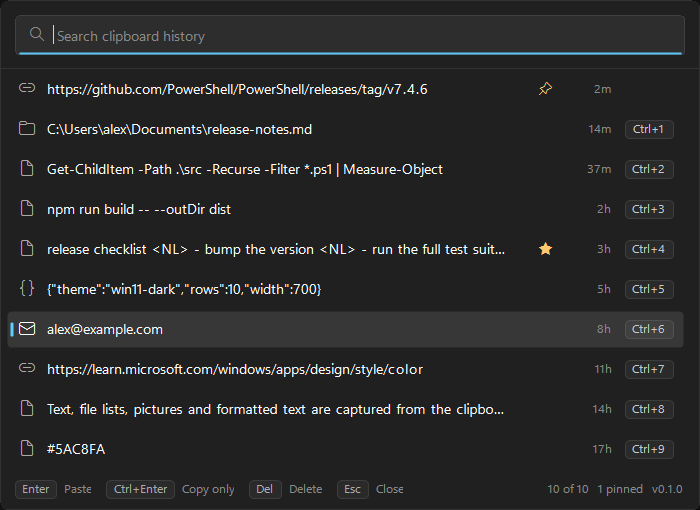
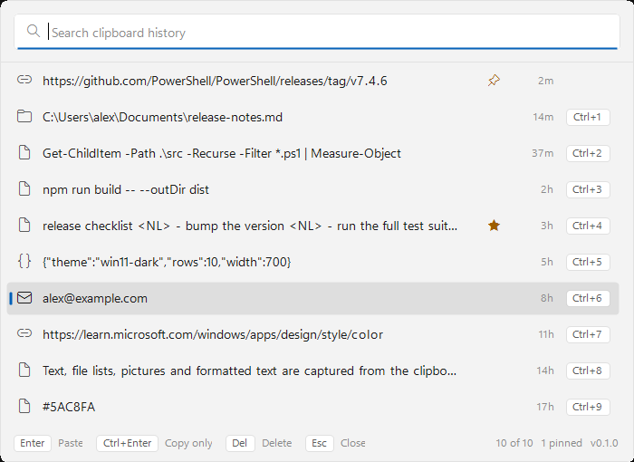

# Clipboard

Windows 10 / 11 的剪贴板历史工具，纯 PowerShell 5.1 实现，无第三方依赖。提供全局热键、可搜索的历史面板与常驻捕获。

程序由入口 `src\clipboard.ps1` 与 `src\lib\` 下的模块组成，分发时需整个目录一起复制。数据保存在脚本目录内，不依赖 Windows 剪贴板历史服务（`cbdhsvc`），不联网，不需要管理员权限。

[](LICENSE)

| 深色 | 浅色 |
|---|---|
|  |  |

> 截图为示例数据。

## 功能

- 全局热键呼出历史面板（默认 `Ctrl+Alt+V`），输入即过滤，回车粘回原窗口（[焦点模型](#焦点模型)）
- 后台轮询捕获并去重，支持文本、文件列表、图片与带格式文本（含图文混排）；超出限制的内容按配置跳过（[图片与带格式文本](#图片与带格式文本)）
- 容量分四项独立计算：条数、单条大小、文本总量、媒体预算；超出时由旧到新丢弃，受保护标记的行不参与裁剪（[配置](#配置)）
- 面板为 Win11 Fluent 风格自绘界面：虚拟列表、置顶行冻结、长文本省略、搜索命中高亮、悬停预览卡片，深浅两套主题
- 完整键盘操作：方向键与翻页、`Ctrl+1..0` 数字快选、`Del` 删除、`Ctrl+Z` 撤销、`F2` 就地编辑、右键菜单；面板快捷键见[面板快捷键](#面板快捷键)
- 常驻进程带托盘菜单（显示历史、暂停捕获、清空、打开配置与数据目录、重启、退出），崩溃后自动重启；可选开机自启与桌面快捷方式
- 置顶、收藏、高亮、类型分析、按类型打开、粘贴改写、过期清理由插件提供，默认全部启用（[插件](#插件)）
- 全部设置集中在 `clipboard.ini`：`config init` 写出带注释的模板，`config set` 校验后写入（[配置](#配置)）
- 历史文件带格式版本号，`clipboard migrate` 负责升级（[数据版本与迁移](#数据版本与迁移)）

## 环境要求

- Windows 10 / 11
- PowerShell 5.1（系统自带，无需安装 .NET 或模块）
- STA 线程模型：启动器与快捷方式均带 `-Sta`，直接调用脚本时需自行加上

## 快速开始

源码目录不是安装包。可直接运行程序本体（`src\clipboard.ps1` + `src\lib\` / `utils\` / `schema\`），也可在仓库根用 `cli` 执行 `package.ini` 中声明的命令。

```powershell
cli              # 列出 package.ini 中的命令
cli dev          # 启动常驻进程，被加载的文件变化后自动重启
cli test         # 运行全部自测
cli build        # 打包到 dist\clipboard-<version>\
cli client       # 编译可选的原生客户端 src\client.exe
cli assembly     # 编译可选的类型库 src\lib\assembly\clipboard.dll
```

`cli` 有两个入口：`cli.sh`（Git Bash / MSYS，`./cli.sh`）与 `cli.cmd`（CMD，`cli`）；命令名不区分大小写，其余参数追加到 `package.ini` 对应行，例如 `cli test -Unit`、`cli build -Config other.ini`。

程序本身可直接调用（Git Bash：`./src/clipboard.sh <命令>`；CMD：`src\clipboard.cmd <命令>`）：

```powershell
.\src\clipboard.cmd status              # 常驻进程状态、条目数与生效配置
.\src\clipboard.cmd install             # 建开机自启 + 桌面快捷方式
.\src\clipboard.cmd uninstall           # 只删快捷方式，保留历史与配置
.\src\clipboard.cmd uninstall purge     # 连历史、配置、日志一起删
```

`install` 生成的快捷方式以 `-ExecutionPolicy RemoteSigned` 运行脚本，可覆盖目标机 `Restricted` / `AllSigned` 的评估结果；需要更宽松的策略时用 `install bypass`。

打包产物含两个批处理，与 `clipboard.ps1` 同层（源文件在仓库的 `scripts\`，打包时原样复制）：

| 脚本 | 做的事 |
|---|---|
| `install.bat` | `config init` → `migrate` → `install` |
| `uninstall.bat` | `stop` → `uninstall purge`（删除 `data\` 与 `clipboard.ini`） |

## 命令一览

| 分组 | 命令 | 说明 |
|---|---|---|
| **daemon** | `serve` | 运行常驻进程（捕获 + 热键 + 托盘） |
| | `stop` | 停止常驻进程 |
| | `ui` | 打开历史面板（常驻进程未运行时自动拉起） |
| | `status` | 常驻状态、自启状态、生效热键、存储路径、各标记数量 |
| | `pause` / `resume` | 暂停 / 恢复捕获 |
| **history** | `list [-Count N]` | 列出条目，最新在前（相对时间，最前一项带 `*`） |
| | `get` | 输出剪贴板文本 |
| | `put "text"` | 写入剪贴板（省略文本时读 stdin） |
| | `pick N` | 把第 N 条放回剪贴板（图片与带格式文本按原格式写回），并移到历史最前 |
| | `edit N` | 用记事本改写第 N 条的文本（位置、时间、标记不变；格式随旧文本一起丢弃） |
| | `del N` | 删除第 N 条（受保护的行需先由插件取消标记） |
| | `clear [-All]` | 清空历史（受保护标记的行始终保留；`-All` 连同标记保留的行一起删） |
| **config** | `config` | 全部配置项与生效值（按插件分组，标注 ini / 默认值） |
| | `config get KEY` | 单个键的生效值与 ini 原始值 |
| | `config set KEY VAL` | 校验并写入单个键；常驻进程在运行时自动重启 |
| | `config edit` / `config init` | 用记事本编辑 / 与当前版本对齐：补新增键、注释掉已失效的键，不改动已有值 |
| | `config reset` | 用默认值重写整个 ini（唯一会丢配置的路径） |
| **theme** | `themes` | 列出可用主题（`*` = 当前生效） |
| **setup** | `export FILE` | 导出历史：`.json` 全量、`.csv` / `.txt` 仅文本；`-Media` 把图片写进 json |
| | `import FILE` | 导入导出文件；`-Replace` 整库替换（替换前自动备份） |
| | `backup [name]` / `restore [name]` | 把 `data\` 打成 zip 放到 `data\backup\` / 恢复某个快照（当前历史先备份） |
| | `migrate [-Purge]` | 升级旧格式 `history.dat`；`-Purge` 把无法升级的文件归档到 `data\backup\` |
| | `install [bypass]` / `uninstall [purge]` | 增删快捷方式（`purge` 连数据一起删） |
| | `version` | 输出程序版本与数据格式版本 |
| | `help` | 帮助（插件命令按插件名分组列在后面） |

`clipboard help` 的分组与此对应：`[daemon]` `[history]` `[config]` `[theme]` `[setup]`，加上每个已加载插件的 `[plugin: <name>]`。

### 导出、导入与备份

| 文件 | 带什么 | 用于 |
|---|---|---|
| `.json` | 文本、时间、标记；`-Media` 时含图片与富文本块的 base64 | 迁移到另一台机器、长期归档 |
| `.csv` | 三列 `text,time,marks` | 表格筛选与统计 |
| `.txt` | 每条一段，以 `---` 分隔 | 只读，不能导回 |

- 导入只接受本程序的格式：JSON 必须带 `format: clipboard-history` 与同名 `version`，CSV 必须为上述三列表头，否则报错。
- 默认合并（`-Merge`）：已有条目按文本比对保持不变，标记以库中为准，只补充缺失项。`-Replace` 替换整库，替换前先做快照。
- 导入的媒体按字节重算 sha1 后落盘，不使用文件中的名字。
- `backup` 打包整个 `data\`（历史、媒体、blob），`restore` 不带名字时取最新一份，带名字时精确匹配，否则按子串匹配。

### 面板快捷键

| 按键 | 作用 |
|---|---|
| 直接输入 | 过滤，语法见[搜索语法](#搜索语法) |
| `↑` `↓` / 滚轮 / `PgUp` `PgDn` | 移动选中 / 滚动（滚轮后选中项跟随可见区） |
| `Home` / `End` | 跳到第一条 / 最后一条 |
| `Enter` | 粘贴选中条目到原窗口，并把该条移到历史最前（标记、富文本与媒体随之移动） |
| `Ctrl+Enter` | 只写入剪贴板，不自动粘贴 |
| `Ctrl+1..9` / `Ctrl+0` | 选取当前可见的第 1~9 / 10 行；行尾显示对应键帽（按住 `Ctrl` 时高亮），滚动后从 `1` 重新编号 |
| `Ctrl+P` / `Ctrl+S` / `Ctrl+H` | 置顶 / 收藏 / 高亮当前行，再按一次取消（`item-marks` 提供）；`Ctrl+P` 受粘性置顶行数上限约束 |
| `Ctrl+O` | 按类型打开当前行：链接、路径、文件列表或图片（`entry-actions` 提供） |
| `Del` / `Ctrl+Z` | 删除选中项 / 撤销上一次删除 |
| `F2` | 就地编辑纯文本条目：面板换成编辑卡片，`Enter` 保存、`Shift+Enter` 换行、`Esc` 取消（改动过文本时需按两次 `Esc`）；保存失败时保留编辑内容并显示原因；图片、文件列表与带格式条目不响应 |
| 双击一行 | 与 `Enter` 相同 |
| 右键一行 | 打开右键菜单，作用于光标下的行（`Paste` / `Copy only` / `Edit` / `Delete` / `Clear history` 与插件项） |
| `Ctrl+点击` / `Shift+点击` / `Ctrl+A` | 多选：逐个加减 / 取一段 / 全选当前结果 |
| `Del`（多选） | 删除所有选中项；带保护标记的行保留并说明原因 |
| `Ctrl+Enter`（多选） | 按列表顺序以换行拼接后复制 |
| 清空确认中的 `Enter` / `Esc` | `Enter` 确认清空，`Esc` 或其它键取消 |
| `Esc` | 有搜索词时清空搜索，否则关闭面板 |
| 拖动标题区 | 移动面板 |

底部提示按当前可用操作生成，不是固定表：纯文本行显示 `Enter` Paste · `Ctrl+Enter` Copy · `F2` Edit · `Del` Delete · `Esc` Close；图片与带格式行没有 `F2`；多选时换成 `Ctrl+Enter` Copy N · `Del` Delete N；按住 `Ctrl` 时换成 `Ctrl+1-9,0` Pick · `Ctrl+Enter` Copy · `Ctrl+Z` Undo（`Undo=1` 时）与插件快捷键；紧凑形态只列 `Enter` Paste · `Ctrl+Enter` Copy · `Esc` Close（多选时换成 `Ctrl+Enter` Copy N · `Del` Delete N）；编辑中只列 `Enter` Save · `Shift+Enter` Newline · `Esc` Cancel。删除、置顶、清空的结果与被拒绝的原因显示在同一行。

### 搜索语法

输入按空格切分，每个词都需命中（只看每条记录的前 4096 个字符）。

| 写法 | 含义 | 示例 |
|---|---|---|
| `word` | 包含该词（不区分大小写） | `docker` |
| `"two words"` | 短语，含空格 | `"build failed"` |
| `-word` | 不包含该词 | `docker -compose` |
| `type:text` `type:files` `type:image` `type:rich` | 只看某一类；逗号表示或（`type:image,rich`），多个 `type:` 之间为且 | `type:files .ps1` |
| `type:link` `type:mail` `type:path` `type:code` `type:multi` | `entry-actions` 提供的细分类型，未启用该插件时不可用 | `type:code parser` |
| `mark:p` / `-mark:p` | 带 / 不带某个标记（标记字符见[标记](#标记mark)） | `mark:p type:image` |
| `age:7d` | 早于 7 天（单位 `d` `h` `m` `s`，纯数字按天） | `age:7d type:text` |
| `newer:2026-11-01` / `older:2026-11-01` | 时间范围 | `newer:2026-11-01 older:2026-11-06 周报` |
| `re:^alpha\s` | 正则表达式（忽略大小写，250 ms 超时） | `re:^https?://` |

几种写法可任意组合，顺序无关，结果只会更窄。`-` 只能否定普通词与 `mark:`；`type:` `age:` `newer:` `older:` `re:` 没有否定写法。

写错字段时面板提示「搜索无法理解」而非按普通词搜索：未知的 `type:`、编译失败的正则、非法时间都使本次搜索无结果。

### 焦点模型

面板打开时取前台（普通激活窗口，无键盘钩子），键盘因此落在面板上。初始焦点在列表上，所以筛选行没有光标；敲下任意可见字符即把焦点移到搜索框并写入该字符，之后它就是普通输入框：方向键、`Home` `End`、`Shift` 选区、`Ctrl` 加方向键按词跳转与 `Ctrl`+`Backspace` `Delete` 删词、输入法组字全部由系统提供。搜索框内画的是一条主题色竖线并隐藏系统光标（系统光标无法改色），输入法组字期间恢复系统光标。关闭面板（`Esc`、回车粘贴、再按热键、点击面板外部、呼出开始菜单或 Windows 搜索）时，若面板仍在前台则把前台与焦点还给打开它之前的窗口。

面板以置顶方式显示，因此激活着的置顶窗口仍会压在它上面：开始菜单与 Windows 搜索的唤出窗口就是这样压住面板的（`SetWindowPos`、先取消置顶再置顶、`BringWindowToTop`、`HWND_TOP` 都无法逆转，已逐一实测）。层级本身查不到：`GetWindowBand` 未导出，按序号调用会让调用方崩溃；`TokenUIAccess` 只能覆盖带 UIAccess 的窗口，开始菜单与搜索并不带。因此判据为：前台窗口是置顶窗口、带 UIAccess，或属于开始菜单/搜索（开始菜单为 `StartMenuExperienceHost`，搜索在 Win11 为 `SearchHost`、Win10 1903–2004 为 `SearchApp`、更早为 `SearchUI`，另认 shell 的 UX 帧类名）。这类窗口在前台时按下热键：属于开始菜单/搜索的先 `Esc` 关掉，`Esc` 无效时把其下层窗口切到前台（浮层失去前台即关闭），关掉搜索可能露出开始菜单，所以最多连关三个；仍关不掉或不是它们则不开。面板打开期间呼出开始菜单或搜索，则关闭面板。

取前台靠 `SetForegroundWindow`；前台被别的进程占住时（前台锁）先用 `AttachThreadInput` 附加那个线程再取一次，最多三次，并读取实际结果而不是假定成功。编辑窗口打开时，回车与 `Esc` 都由它先拿到。

粘贴前把目标窗口切回前台并确认，再把键盘焦点还给该窗口原先的控件；前台被别的进程占住时用 `AttachThreadInput` 附加后再取一次，仍失败则不注入按键，保留面板并提示按 `Ctrl+V`。面板隐藏后重新确认前台，被别的窗口抢走时再取回。注入前按 `ModReleaseTimeout` 等待修饰键松开，超时后仍按住的修饰键会被松开，避免 `Ctrl+V` 变成 `Ctrl+Alt+V` 之类的别的快捷键。

目标窗口是**按键那一刻**的前台窗口（`Alt+Tab` 之后换到别的程序，文本就落在新窗口）；属于本进程的窗口（面板本身、常驻进程的控制台）不算目标，此时用打开面板前的那个窗口。

面板自己处理这些键：可打印字符、方向键与 `PgUp` `PgDn` `Home` `End`、`Delete`、`F2`、`Backspace` `Tab` `Enter` `Esc`，以及 `Ctrl` 组合（`Ctrl+A`、`Ctrl+Z`、`Ctrl+Enter`、`Ctrl+0..9` 与插件注册的键）。`Home` `End` 在搜索框有焦点时归文本、否则归列表；其余组合不是面板的（如 `Ctrl+Space`、`Ctrl+Shift+Esc`、`Alt` / `Win` 组合、`F1` 与 `F3`–`F12`、`Insert`）面板不响应，但面板持有键盘时它们不再回到原窗口。

插件通过 `PanelKeys` 注册面板按键：`item-marks` 提供 `Ctrl+P` / `Ctrl+S` / `Ctrl+H`，`entry-actions` 提供 `Ctrl+O`，均列在 `clipboard help` 的 Panel keys 中并标注来源插件。

### 面板形态

面板有两种形态，走同一份绘制、按键与粘贴代码，区别只在开窗时解析的一组值：

| | 完整 | 紧凑 |
|---|---|---|
| 宽度 | `WindowWidth` | `CompactWidth` |
| 可见行数 | `Rows` | `CompactRows` |
| 头部 / 页脚高度 | 主题 `[metrics]` | 60 / 32 |
| 时间列 | 跟随 `ShowTime` | 不显示 |
| 右侧计数与版本 | 显示 | 不显示 |
| 位置 | 保存位置 → 呼出窗口 → 显示器居中 | 插入符下方，放不下时在其上方 |

窗口宽度固定，高度由行数得出，两者都在开窗时定下，面板不能拖动改变尺寸。形态由 `CompactMode` 选择，托盘菜单的 `Compact mode` 勾选项直接改写该键，下一次打开生效。

插入符锚点依次取：控件自己的 `rcCaret`（Win32 编辑控件）；附加目标线程后读到的 `GetCaretPos`（仅当该线程报告了光标窗口时读，只给点不给高度，按一行文本补高）；UI Automation 的文本选区矩形（Electron、浏览器、RichEdit）；焦点元素的矩形（命令面板的一行、一个输入框）；焦点控件的窗口矩形。宽高为 0 或覆盖整个窗口的矩形判为无效，都取不到时依次退到呼出窗口与显示器居中。面板左边缘对齐锚点，与文本行留 4 px 间距。完整模式默认不贴插入符，`PlaceAtCaret=1` 可打开；紧凑形态不读保存的位置。

悬停预览卡放在面板两侧：放不下整张卡时先收窄，换到另一侧，两侧都不够时放在面板下方，不覆盖行。

卡片只跟随停住的光标：滚动列表或改变过滤词都会让行在光标下换掉，此时重新读光标下的行、收起已有的卡片，并重新计 `PreviewDelay`，所以滚轮扫过列表不会闪出卡片，停住后弹出的是光标下的那一行。

## 配置

程序启动时只读取脚本旁的 `clipboard.ini`，文件或某个键缺失时按内置默认值运行。只有 `config init` / `config set` / `config reset`、开启 `SaveWindowPos` 时的位置回写，以及托盘勾选 `Compact mode` 时写入 `CompactMode`，会写入该文件。

读取时做一次全量校验：未知键、类型或范围不符、主题名不存在、枚举项非法，都在 `clipboard config` 顶部逐条列出，`status` 只给出计数（`[!] N value(s) need attention`）；出错项按默认值继续运行。

`config init` 按模板重写文件：同样的标题与顺序、每个键上方一行说明，已有的值全部保留（含插件设置），本版本不认识的键改写成 `# [unknown] 原内容` 放在文件末尾；内容没有变化时不写盘，可重复执行。`config reset` 用默认值重写整个文件。

| 键 | 默认值 | 说明 |
|---|---|---|
| `DataDir` | 空 | 写入位置；空 = 脚本旁的 `data/`。相对路径相对脚本目录 |
| `Hotkey` | `Ctrl+Alt+V` | 全局热键；`Win+V` 在多数系统上被占用，注册失败时回退 |
| `HotkeyFallbacks` | 空 | 逗号分隔的回退链；空 = Ctrl+Alt+V / Win+V / Alt+反引号 / Win+Shift+V |
| `PasteKeys` | `^v` | 选定后用 SendKeys 发送的按键（`^+v` = Ctrl+Shift+V） |
| `ModReleaseTimeout` | `1200` | 最多等待修饰键松开的时间（毫秒）；超时后仍按住的修饰键会被松开 |
| `PasteSettle` | `80` | 切回原窗口后到发送 `PasteKeys` 之间的等待（毫秒） |
| `MaxItems` | `300` | 最多保留条数（带保护标记的行不受裁剪影响） |
| `MaxTextBytes` | `204800` | 单条纯文本上限（字节），超出不入库 |
| `MaxTextTotalBytes` | `4194304` | 纯文本条目总容量（字节），超出丢最旧的（带保护标记的行保留） |
| `BlobChars` | `32768` | 正文超过该字符数时存到 `data/blobs/`，历史文件只留引用；`0` = 始终内联 |
| `MaxMediaTotalBytes` | `134217728` | 图片与富文本附件总容量（字节），`0` = 不限；与 `MaxTextTotalBytes` 分开计算 |
| `CaptureImages` | `1` | `1` = 捕获剪贴板中的图片 |
| `MaxImageBytes` | `16777216` | 单张图片上限（字节）；超出则记日志后跳过（不缩放） |
| `CaptureRich` | `1` | `1` = 保存带格式文本的 HTML / RTF 及其图片块 |
| `MaxHtmlBytes` | `20971520` | HTML 块上限（字节）；超出丢弃 HTML，RTF 不受影响 |
| `MaxRtfBytes` | `20971520` | RTF 块上限（字节）；超出不保存 RTF，条目按纯文本粘贴 |
| `RtfImagesUpToBytes` | `8388608` | 预览卡片用：RTF 超过该大小时每个图位画占位块（不解析图片），存储与粘贴不受影响；`0` = 不限 |
| `InlineImageUpToBytes` | `4194304` | HTML 引用的本机图片单张不超过该字节数时内联为 `data:` URI；`0` = 不内联 |
| `PasteRich` | `1` | `1` = 粘贴时同时写回格式，`0` = 只粘纯文本 |
| `PasteFilesAsText` | `1` | `1` = 文件条目同时写入路径文本（地址栏、终端、编辑器才有内容） |
| `PasteTyping` | `0` | `1` = 纯文本条目用逐字输入（`SendInput`）代替粘贴键，目标不接受 `Ctrl+V` 时仍能粘贴；文件与图片仍走剪贴板 |
| `AppRules` | 空 | 按应用修改粘贴行为，格式见[按应用规则](#按应用规则) |
| `Interval` | `300` | 剪贴板轮询间隔（毫秒） |
| `NoPaste` | `0` | `1` = 只写剪贴板，不自动粘贴 |
| `Balloon` | `1` | `1` = 启动时弹托盘气泡 |
| `Theme` | `win11-dark` | 主题名 = `themes/` 下的 `.ini` 文件名，不接受别名 |
| `ExcludePattern` | 空 | 正则，匹配到的文本不入库 |
| `WindowWidth` | `700` | 面板宽度（96 dpi 基准，高 DPI 按比例缩放） |
| `Rows` | `10` | 可见行数，面板高度的唯一来源：高度 = 行数 × 行高 + 头部 + 底栏 + 边框；受屏幕工作区限制 |
| `CompactMode` | `0` | `1` = 打开紧凑形态，`0` = 完整形态；托盘勾选项改写该键 |
| `CompactWidth` | `520` | 紧凑形态宽度（96 dpi 基准），最小 360 |
| `CompactRows` | `6` | 紧凑形态可见行数 |
| `WindowLeft` / `WindowTop` | 空 | 面板位置（96 dpi 基准）；空 = 按 `PlaceNearForeground` 放置；紧凑形态不使用 |
| `SaveWindowPos` | `0` | `1` = 关闭面板时把位置写回 ini（紧凑形态不写） |
| `PlaceNearForeground` | `0` | 没有保存位置时的落点：`1` = 呼出它的窗口上（水平居中、纵向三分之一处，限制在该窗口所在显示器内）；`0` = 该显示器的中上部 |
| `PlaceAtCaret` | `0` | `1` = 完整形态也贴在插入符下方；紧凑形态始终如此 |
| `ShowTime` | `1` | `1` = 显示相对时间列 |
| `ShowTypeIcon` | `1` | `1` = 显示插件提供的行图标 |
| `ShowThumbnails` | `1` | `1` = 图片条目在图标槽内绘制缩略图 |
| `Highlight` | `1` | `1` = 高亮搜索命中 |
| `HighlightMaxBytes` | `8192` | 超过该大小的条目不参与高亮（`0` = 总是高亮） |
| `ShowNewlineMarker` | `1` | `1` = 换行显示为 ` <NL> `，`0` = 折成空格 |
| `PreviewHover` | `1` | `1` = 鼠标停留时弹出预览卡片，`0` = 不弹 |
| `PreviewDelay` | `350` | 停留在该行多久（毫秒）后弹出 |
| `PreviewChars` | `6000` | 卡片最多读取与显示的字符数 |
| `Undo` | `1` | `1` = 面板内 `Ctrl+Z` 可撤销上一次删除 |
| `DpiAware` | `1` | `1` = 按系统 DPI 渲染，`0` = 旧渲染方式 |
| `ScrollLines` | `0` | 滚轮步长（行），`0` = 跟随系统设置 |
| `Animations` | `1` | `1` = 悬停、选中切换、滚动条与搜索框下划线带过渡，`0` = 全部瞬时 |
| `Autostart` | `1` | `1` = `install` 创建登录自启快捷方式 |
| `DesktopShortcut` | `1` | `1` = `install` 创建桌面快捷方式 |
| `Plugins` | 全部插件 | 逗号分隔的插件文件名（不含 `.ps1`），顺序即加载顺序 |

补充规则：

- `config set` 按上表类型与范围校验，写回时只改对应行；常驻进程运行时自动重启。`config get <key>` 同时显示生效值与 ini 原始值，`config` 每行标注来源（`<- ini` / `<- default`）。
- 命令行只处理位置参数与 `list -Count N`；向命令传设置开关会因参数绑定失败被拒绝（如 `clipboard put hi -MaxItems 50`）。
- `Rows` 同时约束置顶：粘性置顶最多占 `Rows - 1` 行，`item-marks.StickyRows` 超过该上限时 `config set` 拒绝，调小 `Rows` 时已设值自动下调。
- 默认值只在 `src\schema\clipboard.ps1` 的 `Default` 中定义，值驱动的变量在 `src\lib\base.ps1`。

### INI 约定

仓库内的 ini 使用同一套语法（`package.ini`、`cli.ini`、`clipboard.ini`、`themes\*.ini`）。程序侧由 `utils\ini.ps1`、`utils\inifile.ps1`、`utils\schema.ps1` 实现；工具侧（`tools\`）自带 `tools\utils\ini.ps1`（同一套解析规则）与 `tools\utils\schema.ps1`（校验 `cli.ini` 与 `package.ini`），不加载 `src\` 下的文件。两套校验器语义不同：程序侧缺键等于未设置、回退默认；工具侧缺键即错误。

- 一行一个 `Key=Value`；`#` 或 `;` 开头整行为注释，不支持行尾注释（值中的 `#` 属于值本身，如 `Accent=#5AC8FA`）；值不加引号，两端空白被去掉；同一个键写两次以最后一次为准。
- `[section]` 把后续键归入该段：`[scripts]` 下的 `Dev=...` 与顶层的 `scripts.Dev=...` 是同一个键。段头必须整行只有 `[名字]`。
- 段名小写，键名大驼峰；两者都不区分大小写。
- 解析结果按文件缓存（键为路径，比较大小与写入时间）；写入只改对应行并作废该文件的缓存。

| 文件 | 用途 | 段 |
|---|---|---|
| `package.ini` | 项目元数据与命令，`cli` 读取 | `[package]` 的 `Name` / `Version`，`[scripts]` 的命令名 |
| `cli.ini` | 工具配置，`cli dev` / `cli build` / `cli test` 读取 | `[dev]` `[build]` `[test]` |
| `clipboard.ini` | 程序设置，由 `config init` 生成 | 基础键不分组；插件键写在 `[<插件名>]` 段（平铺的 `<插件名>.<Key>` 仍可读） |
| `themes\*.ini` | 主题定义 | `[palette]` `[fonts]` `[metrics]` `[<插件名>]` |
| `schema\*.ps1` | `clipboard.ini` 与主题的 schema | — |
| `schema\plugins\*.ps1` | 各插件的键表：`Properties` 进 `clipboard.ini` 的插件段，`ThemeProperties` 进主题 | — |

### schema 文件

一个 schema 就是一个 `.ps1` 文件，直接输出哈希表（被点源，因此 `Ref` 可指向程序变量）：

| 字段 | 必填 | 说明 |
|---|---|---|
| `Name` | 是 | schema 标识，也是文件名 |
| `File` | 否 | 描述的 ini 文件 |
| `Description` | 否 | 一句话说明；插件 schema 不写它，插件简介写在插件文件里，由 `config` 显示 |
| `Version` | 否 | 键增删时递增的版本 |
| `Properties` | 是 | `[ordered]` 键 → 键规格；顶层键与段内键都在这里 |
| `ThemeProperties` | 否 | 只能由主题重写的外观键 |
| `Sections` | 否 | `[ordered]` 段名 → 段规格（主题的 `palette` / `fonts` / `metrics`） |
| `ExtraSections` | 否 | 未列名段的规格（主题的插件段、插件键的 `<插件名>.<Key>`） |

键规格：

| 字段 | 说明 |
|---|---|
| `Type` | `string` / `int` / `number` / `bool` / `list` / `enum` / `regex` / `color` / `hotkey` / `theme` / `apprule` / `any` |
| `Default` | 默认写法；`config init` 写它，读取失败时也回退到它 |
| `Minimum` / `Maximum` | `int` / `number` 的上下界 |
| `Enum` | `enum` 的合法值；`list` 时是允许的 token |
| `Pattern` | `list` 中单个 token 的形状（默认字母、数字、`_ . -`） |
| `Description` | 一句话说明，写成 `clipboard.ini` 中该键上方的注释（基础键与插件键都是） |
| `Ref` | 值驱动的变量（`[ref]$script:X`） |
| `Themeable` | `true` = 外观键，不是 ini 键 |
| `Target` | 仅用于 `Sections`：段内值落到主题的哪张表（`Palette` / `Fonts` / `Metrics` / `Plugin`） |

## 图片与带格式文本

图片与富文本不写入 `history.dat`：图片存为 `data\media\<sha1>.png`，富文本每个块各存一个文件（`<sha1>.html` / `.rtf` / `.png` / `.dib` / `.emf`），文件名为块内容的哈希，因此两条记录共用同一张图只存一份。历史文件只保留引用（图片为 `image:<sha1>:<宽>x<高>:<字节>:PNG`，富文本为 `H:<sha1>:<字节>|T:<sha1>:<字节>|P:<sha1>:<字节>` 形式的块清单）。两者均按剪贴板给出的原始字节落盘：`HTML Format` 头部记录自身缓冲区内的字节偏移，`Rich Text Format` 是 8 位格式，经字符串编解码会破坏 UTF-8 与偏移。

- 单次复制只让历史文件增长几十字节，重复复制同一张图按内容哈希去重。
- 再次复制同一内容总会重新入历史并置顶，包括刚删除过的内容。
- 记录被删除、清空或裁剪时，其独占的媒体文件在同一次保存中回收。
- 媒体有独立预算 `MaxMediaTotalBytes`：超出时由旧到新丢弃带媒体的行，受保护标记的行不动。

`pick N` 与面板中回车会把捕获到的块全部写回剪贴板：纯文本、`HTML Format`、`Rich Text Format`，以及源应用同时提供的 `PNG` / 设备无关位图 / 图元文件，因此粘回 Word / Excel / PowerPoint / WordPad / 邮件客户端可保留排版与图片。

图文混排依赖三条处理：

| 情形 | 处理 |
|---|---|
| 源应用把图片放在临时目录，HTML 只写路径 | 不超过 `InlineImageUpToBytes` 的图片在捕获时读入并换成 `data:` URI，HTML 头部偏移重算；超过的记录 `html image not inlined` 日志 |
| 目标程序不认 HTML 中的 `data:` URI | 粘贴前把图片解出写成 `%TEMP%\clipboard-paste\<sha1>.<ext>`，HTML 的 `src` 换回 `file:///` 并重算偏移；同一张图只写一份，超过 24 小时的残留文件在下次粘贴时清理 |
| 图片文件已不存在 | 该图位换成虚线占位框，宽高沿用原图 `width` / `height`（限制在 96–360 px），框内显示 `[ image not saved ]`；文字与版式仍完整。远程 `http(s):` 图片原样保留 |

同一次复制中源应用额外提供的位图与图元文件一并保存并在粘贴时还原。只有本来没有 RTF 的条目才用第一张图片作缩略图；带 RTF 的条目即使排版失败也只显示文字。

RTF 只有一条存储规则：超过 `MaxRtfBytes` 时完全不保存 RTF，条目退化为纯文本粘贴（HTML 与图片块不受影响，日志 `formatted text rtf skipped`）；小于该值一律原样保存。

预览卡片按 RTF 大小分三档，只影响显示，存储与粘贴始终为原内容：

| RTF 大小 | 卡片 |
|---|---|
| ≤ `RtfImagesUpToBytes` | 真实排版；单张超过 4 MB 或一次累计超过 24 MB 的图退化为按图片比例的占位块 |
| ≤ `MaxRtfBytes` | 排版文字与版式，每个图位绘制占位块 |
| > `MaxRtfBytes` | RTF 不保存，卡片显示条目文字 |

表格按 RTF 自带的列宽（`\cellx`）排版，再整体缩放到卡片宽度，单元格文字不因卡片较窄而换行，列宽与源文档一致；页面超过卡片宽度 4 倍时仍按卡片宽度排版。不含表格的 RTF 仍按卡片宽度排版。

排版不占用面板线程：首次悬停先显示骨架卡片（标题带 `- rendering`，正文区显示占位条），页面算完后就地换入。结果按模式、引用与尺寸缓存到 `%TEMP%\clipboard-preview\<sha1>.png`，再次悬停直接读取。缓存可随时重建：一周未使用的文件会被删除，目录限制为 200 个 / 32 MB，每次写入与每次打开面板各整理一次；文件名带渲染版本标签，绘制方式变更后旧图被忽略。

卡片尺寸与外观按 Win11 Flyout 对齐：8 px 圆角、1 px 描边、正文 14 px / 题注 12 px、行高 20 px，文字溢出用省略号。出现时做 140 ms 淡入（alpha 画在绘制层，不改变窗口 `Opacity`，否则会变成 layered window 并破坏不激活行为）；`Animations=0` 时直接显示。

分别关闭捕获：`config set CaptureImages 0` / `config set CaptureRich 0`；只粘纯文本：`config set PasteRich 0`。在 Word 等程序中选中文字时，剪贴板同时包含一张位图，因此捕获以文本与富文本优先。

## 按应用规则

`AppRules` 按粘贴目标修改行为，只影响粘贴，捕获行为不变。

```ini
AppRules=windowsterminal.exe:plain;code.exe:rich;*:no-paste
```

| 动作 | 含义 |
|---|---|
| `plain` | 即使记录带格式也只粘纯文本 |
| `rich` | 按 `PasteRich` 处理（默认带格式） |
| `no-paste` | 只写回剪贴板，不发送 `PasteKeys` |
| `*` | 兜底，未被前面规则命中的程序使用 |

- 程序名写进程名，`.exe` 可省略，大小写不敏感；`;` 或 `,` 分隔。
- 判断依据是粘贴目标窗口（含义见「焦点模型」）。
- `PasteRich=0` 时 `rich` 规则同样不粘格式。
- 非法动作在 `config set` 时报 `unknown action`。

## 主题

界面配色与字体不写在脚本中：每个主题是 `themes/<name>.ini`（纯 ini，不执行代码），`clipboard.ini` 的 `Theme=` 只写主题名。

| 主题 | 配色 | 说明页 |
|---|---|---|
| `win11-dark` | Windows 11 Fluent 深色，默认主题 | [win11-dark.md](docs/theme/win11-dark.md) |
| `win11-light` | Windows 11 Fluent 浅色，布局相同 | [win11-light.md](docs/theme/win11-light.md) |

主题颜色不是 `clipboard.ini` 的键，只能在主题文件中修改。未知 token、非法颜色与越界数值仅写日志，不影响其它项；`Theme=` 无效时回退 `win11-dark`。

### 主题文件格式

```ini
# 注释必须独占一行：# 或 ; 开头
Name=my-theme
Description=my colours
# 空 = 自动（Segoe UI Variable Text → Segoe UI）
FontFamily=
# 空 = 自动（Segoe Fluent Icons → Segoe MDL2 Assets）
IconFamily=

# 颜色值以 # 开头，那是值的一部分，不是注释
[palette]
Surface=#101418
Text=#E8EAED
Accent=#5AC8FA

# 字号（pt）
[fonts]
Body=10.5
Title=13

# 可选的 96 dpi 设计度量
[metrics]
RowHeight=40

# 段名 = 插件名：重写该插件的 ThemeProperties
[item-marks]
StarColor=#FFD700
```

| 段 | 说明 |
|---|---|
| 顶层 | `Name` / `Description` / `FontFamily` / `IconFamily` |
| `[palette]` | 颜色 token，未知 token 忽略并写日志 |
| `[fonts]` | `Body` `Small` `Tiny` `Title` `Icon` `IconSmall` `IconBig` |
| `[metrics]` | 行几何覆盖：`RowHeight` `HeadHeight` `FootHeight` `RowGap` `RowInset` `TextInset` `IconSlot` `TimeWidth` `CapWidth` `ChipHeight` 等，取值 1–4000，未知键或越界值写日志后忽略；每次应用主题都从内置表重新叠加 |
| `[<插件名>]` | 重写该插件的 `ThemeProperties`，只对该主题生效 |

可用颜色 token（全部可选，缺省沿用内置深色值）：

```
Surface Field FieldBorder Text Dim Faint Accent AccentSoft Border SelBg HoverBg
BadgeBg BadgeText KeyCapBg KeyCapBorder Mark Warn
```

叠层色（`SelBg` / `HoverBg` / `Border` / `BadgeBg` / `AccentSoft` / `KeyCapBorder`）需保留 alpha：面板把它们半透明叠在 `Surface` 上。

加载规则：

- 只有 `themes/*.ini` 参与，名字即文件名（忽略大小写）；未写主题名或名字不存在时回退 `win11-dark` 并记日志。
- 解析名字只读文件名，不读内容，因此坏主题不影响 `config` 与 `status`。
- 切换主题需重启常驻进程（`config set Theme` 会自动重启；手工改 ini 则 `clipboard stop` 后 `clipboard serve`）。

## 插件

插件默认全部启用：`Plugins=` 逐名列出 `plugins\` 下的文件，顺序即加载顺序，未列出的文件不执行。加载靠前的插件在右键菜单中更靠前，并优先获得 `TypeGlyph` / `Transform` 这类只允许一个插件生效的钩子。

| 插件 | 功能 | 启用 |
|---|---|---|
| [`item-marks`](docs/plugin/item-marks.md) | 置顶 / 收藏 / 高亮：`pin` `unpin` `star` `unstar` `highlight` `unhighlight` `marks`，面板 `Ctrl+P` `Ctrl+S` `Ctrl+H`，右键三项。粘性置顶默认开启（置顶行冻结在列表顶部，受行数上限约束） | `Plugins=item-marks` |
| [`entry-actions`](docs/plugin/entry-actions.md) | 类型分析与打开：`kind` / `kinds` 输出类型、格式与预览，`open` 按类型打开（链接 / 路径 / 文件列表 / 图片），面板 `Ctrl+O`；行图标由该插件提供 | `Plugins=entry-actions` |
| [`transform`](docs/plugin/transform.md) | 粘贴前改写文本：纯文本 / 全大写 / 小写 / 驼峰 / 蛇形 / 烤肉串 / 标题式；右键按 `transform.Modes` 列出 `Transform as <模式>` | `Plugins=transform` |
| [`retention`](docs/plugin/retention.md) | 按天数删除旧条目，受保护标记的行不清理 | `Plugins=retention` |

各插件的命令、设置项与主题项见 `docs\plugin\<插件名>.md`。

```ini
# 默认值：全部插件逐个列出，顺序即加载顺序
Plugins=entry-actions,item-marks,retention,transform

# 只启用部分插件
Plugins=item-marks,entry-actions
```

插件契约：一个 `.ps1` 文件输出一个哈希表。

| 键 | 必填 | 说明 |
|---|---|---|
| `Name` | 是 | 插件名，必须与文件名一致（不一致时写一行警告） |
| `Description` | 否 | 一句话说明，`clipboard config` 展示 |
| `Commands` | 否 | `@{ 'open' = { param($value) ... } }` → `clipboard open <值>` |
| `CommandHelp` / `CommandOrder` | 否 | 每个命令的一行说明（`clipboard help` 用）/ 打印顺序 |
| `ContextMenu` | 否 | 右键菜单项数组；每项含 `Label`、`Test`（返回 `$false` 时不显示）、`Invoke`、可选的 `After = 'paste'`（动作结束后直接粘贴）。也可写成返回同构数组的脚本块，使项数跟随插件设置。`Invoke` 返回字符串时作为底部提示显示 |
| `PanelKeys` | 否 | 面板按键数组（`Key` / `Ctrl` / `Label` / `Test` / `Invoke`），不覆盖基础按键；`Invoke` 返回的字符串显示在底部提示行 |
| `TypeGlyph` | 否 | `{ param($payload) ... }`，条目 → 行图标（返回空则不画）；第一个给出非空值的插件胜出 |
| `Tick` / `Transform` | 否 | 常驻循环任务（`@{ Seconds; Action }`，`Seconds` 可写脚本块）/ 粘贴前改写 |
| `RowDecor` | 否 | 返回行尾标记字形与整行文字、背景色 |
| `Marks` | 否 | `[ordered]@{ x = @{ Set; Unset; Word; Hint; Protected } }`，声明本插件使用的标记字符 |
| `SortMark` | 否 | 带该标记的行浮到列表最前（只能有一个） |
| `StickyMark` | 否 | 带该标记的行冻结在列表顶部（只能有一个） |
| `StickyRows` | 否 | 冻结行数上限：`0` = 关闭，负数 = 由面板按可见行数决定；插件写置顶动作时应先调用 `Get-PluginStickyCap` |
| `ClearKeeps` | 否 | `clear` 默认保留的标记 |
| `Init` | 否 | 每个进程执行一次的初始化 |

插件文件不写 `Settings` / `ThemeSettings`：键表在 `schema\plugins\<插件名>.ps1`，加载时合并（见[插件自己的配置项](#插件自己的配置项)）。

### 标记（mark）

记录的 `flags` 由一个类型字符（`t` 文本 / `f` 文件列表 / `i` 图片）加若干单字符标记组成。基础层不认识任何具体标记，只按声明排序、保护与统计：

| 声明 | 基础层的行为 |
|---|---|
| `Marks` | 命令行收尾提示、`status` 与 `clear` 文案使用声明中的词；`Protected` 决定该标记是否保护行 |
| `Protected = $true` | `del` 拒绝，裁剪与 `clear` 跳过，直到插件取消该标记 |
| `SortMark` | 带该标记的行排到列表最前 |
| `StickyMark` + `StickyRows` | 带标记的行固定在列表顶部，冻结行数取 `StickyRows` 与 `可见行数 - 1` 的较小值；该上限同时约束置顶动作 |
| `ClearKeeps` | `clear` 默认保留这些标记；`-All` 忽略它，但保护标记始终保留 |

新增标记不需要修改基础层：写插件、声明标记、在 `RowDecor` 中绘制即可，多个标记可同时存在于一行。

钩子按触发时机分类：

| 时机 | 钩子 |
|---|---|
| 加载完成一次 | `Init` |
| 命令行 | `Commands` + `CommandHelp` + `CommandOrder` |
| 面板加载 / 按键 | `PanelKeys`、`ContextMenu`、`RowDecor`、`TypeGlyph` |
| 粘贴前 | `Transform` |
| 常驻循环 | `Tick` |
| 配置与标记规则 | `Properties`、`ThemeProperties`、`Marks` / `SortMark` / `StickyMark` / `StickyRows` / `ClearKeeps` |

基础按键（`Enter` / `Ctrl+Enter` / `Ctrl+1..9` / `Ctrl+0` / `Del` / `Ctrl+Z` / `Esc` / 翻页）优先，插件按键只在都不匹配时才被询问。

基础的 `Get-EntryKind` 只区分文本、文件列表与图片；基础层不绘制行图标，图标完全由插件的 `TypeGlyph` 提供，返回空则不画。

插件可以声明两类键表，分别落在两个文件：

| | `Properties` | `ThemeProperties` |
|---|---|---|
| 位置 | `clipboard.ini` 的 `[<插件名>]` 段（用户设置） | `themes/*.ini` 的同名段（主题文件） |
| 键名 | `<插件名>.<Key>`，`config set` 用该名 | 段内直接写 `<Key>` |
| 修改者 | 用户 | 主题作者 |
| 用途 | 行为开关 | 颜色、字形、强调样式 |
| 读取 | `Get-PluginSetting 'x' 'Key'` | `Get-PluginTheme 'x' 'Key'` |

`ThemeProperties` 不写入 `clipboard.ini`，也不在 `config` 中显示；优先级为 schema 的 `Default` < 主题 ini 段，值同样按 `Type` 校验。

### 插件自己的配置项

插件设置声明在 `schema\plugins\<插件名>.ps1` 的 `Properties` 中，加载时合并进设置 schema，与基础键共用校验与展示流程，键名为 `<插件名>.<Key>`。

```ini
Plugins=entry-actions

[entry-actions]
Browser=C:\Tools\browser.exe
Reveal=1
```

```powershell
clipboard config                          # 基础键之后按插件分组列出
clipboard config get entry-actions.Reveal
clipboard config set entry-actions.Reveal 0
```

- `Type` 与基础 schema 相同（`bool` / `int` / `color` / `enum` / `list` / `string`）；非法值被 `config set` 拒绝，或在加载时回退默认并写日志。
- 插件代码用 `Get-PluginSetting` 读取生效值，外观项用 `Get-PluginTheme`。
- 插件未在 `Plugins=` 中列名时其键不生效，`config get` 会提示先启用该插件；`config init` 仍会写出其设置键以便查看。

编写插件时的约束：

- 插件名写错时提示 `[!] plugin not found: xxx`，基础功能不受影响。
- 脚本块必须自包含：可以调用基础函数（`Get-Records`、`Get-EntryKind`、`Write-Log`、`Format-Item`），但不能引用插件文件作用域的变量（该作用域在命令执行时已销毁，捕获到的值为 `$null`）。多个脚本块需共享逻辑时，把逻辑作为哈希表的一个键，通过 `& (Get-PluginData '<插件名>' 'KindOf') $arg` 调用。
- 使用基础层接口，不直接读取内部状态：行装饰用 `RowDecor`、图标用 `Get-RowGlyph`、标记用 `Test-Mark` / `Get-ProtectedMarks` / `Get-SortMark`、批量修改用 `Update-Records`。
- 插件文件保持纯 ASCII：PowerShell 5.1 将无 BOM 的 UTF-8 按 ANSI 解码，中文会导致语法错误。
- 单个插件抛出异常时只记录一行日志，不影响其它插件与基础命令。

## 命令代理

每条命令都要启动一个 PowerShell 进程，其中大部分时间用于解析本程序；常驻进程已完成这部分解析。可代理的命令因此通过命名管道交给常驻进程执行：

| 项 | 说明 |
|---|---|
| 代理的命令 | `get` / `list` / `put` / `pick` / `del` / `clear` / `status` / `pause` / `resume` / `version` / `help`，以及所有插件动词 |
| 直连的命令 | `config` / `themes` / `install` / `uninstall` / `serve` / `stop` / `ui` / `edit` / `export` / `import` / `backup` / `restore` / `migrate`，它们改设置、换存储、动注册表或本身就是常驻进程 |
| 管道名 | `\\.\pipe\clipboard-cmd-<hash>`，hash 由当前用户 SID 算出，客户端因此不必读 ini 或计算数据目录 |
| 隔离 | 请求携带工具根目录，只在与本进程一致时执行；另一份拷贝（含测试沙箱）得到 `wrong root` 后静默走慢路径 |
| 传输内容 | 命令名、四个位置参数、`-Count`、四个开关；服务端只接受白名单内的命令 |
| 失败处理 | 连接超时（编译客户端 40 ms、脚本客户端 120 ms）、往返超过 2 s 或版本不一致时静默回退到新进程，行为与没有该功能时一致 |
| 关闭 | `-NoProxy` 开关，或环境变量 `CLIPBOARD_NO_PROXY=1` |
| 并发 | 命令在常驻进程的 UI 线程执行，与捕获循环、面板同一线程，不并发改状态 |

### 提前编译的产物（可选）

`cli client` 与 `cli assembly` 用系统自带的 .NET Framework 编译器各产出一个可选文件：`client.exe` 与 `lib\assembly\clipboard.dll`。两者缺失时程序照常运行：缺 `client.exe` 回退到脚本客户端，缺 `clipboard.dll` 时按 `lib\assembly\*.cs` 现场编译。

`client.exe` 由 `clipboard.cmd` 在启动 PowerShell 之前调用（源码 `lib\client\client.cs`）：

| 项 | 说明 |
|---|---|
| 调用方 | 只有 `clipboard.cmd`；`clipboard.ps1` 内部不调用 |
| 回退约定 | 退出码 `100` = 未接管（无常驻进程、工具根不符、该命令不代理），此时批处理继续执行 `powershell -File clipboard.ps1`；其它退出码原样透传 |
| 参数 | 只发命令名与位置参数；`-Count` / `-Purge` / `-All` / `-Media` / `-Replace` 会被识别，其余开关回退给脚本解析 |
| 编码 | 进程之间使用 UTF-8 的 JSON 帧；`put` 无文本时从 stdin 读 |
| 生成 | `cli client` 写入 `src\client.exe`（不入库）；`cli build` 在清单含 `src/lib/client/*.cs` 时先编到同一路径，再以 `client.exe` 入包；`cli dev` 同样由清单决定启动前是否编译 |

`clipboard.dll` 由 `Add-Native`（`lib\native.ps1`）通过 `Assembly.LoadFrom` 载入，载入成功即不再编译源码：

| 项 | 说明 |
|---|---|
| 何时不使用 | 文件不存在，或 `lib\assembly` 下任一 `.cs` 的修改时间晚于它 |
| 生成 | `cli assembly` 写入 `src\lib\assembly\clipboard.dll`（不入库）；`cli build` 在清单含 `src/lib/assembly/*.cs` 时先编到同一路径，再以 `lib\assembly\clipboard.dll` 入包；`cli dev` 同样由清单决定。编译器不可用时改为带上 `lib\assembly\*.cs`，运行时现编 |
| 布局无关性 | 只读取文件，不依赖 GAC 或安装路径 |

`status` 的 `resident` 行与 `config set` 之后的自动重启只认服务于当前数据目录的常驻进程（依据是它写在自身 `data\` 下的 `hotkey.txt`，退出时写成 `(stopped)`），另装一份或运行测试沙箱时不会误报。

## 兼容性

| 项 | 处理方式 |
|---|---|
| 图标字体 | 优先 `Segoe Fluent Icons`（Win11），缺失时回退 `Segoe MDL2 Assets`（Win10） |
| 系统 DPI | `SetProcessDPIAware` 与 `GetDpiForSystem` 均在 `try/catch` 中（Win10 1607 之前没有后者），失败时按 96 dpi 渲染 |
| 主题 | 深浅色由自绘调色板决定，不依赖 `DwmSetWindowAttribute` 之类的 Win11 专用 API |
| 全局热键 | `Win+V` 在 Win10/11 上被剪贴板历史占用，注册失败时按 `HotkeyFallbacks` 回退 |
| 托盘与通知 | 只用 `NotifyIcon` 与气泡，不依赖 Win11 的 Toast 通道 |
| PowerShell | 只要求 5.1，不使用 Core 专有语法 |

## 文件与数据

```
package.ini             项目元数据与命令：Name / Version / [scripts] 下的命令名（cli 读取）
cli.sh  cli.cmd  cli.ps1   命令入口（sh / CMD / PowerShell），执行 package.ini 中的命令
cli.ini                 工具配置：[dev] 监听与轮询、[build] 打包选项、[test] 并行度与分组
scripts/install.bat     安装脚本：config init → migrate → install（打包时复制到产物根目录）
scripts/uninstall.bat   卸载脚本：stop → uninstall purge（同上）
tools/build.ps1         打包脚本（按 cli.ini 的 [build] 段打包到 dist\clipboard-<version>\）
tools/build-client.ps1  编译 client.exe（可选）
tools/build-assembly.ps1 编译 lib\assembly\clipboard.dll（可选）
tools/dev.ps1           开发运行：启动常驻并监视被加载的文件
tools/test.ps1          自测入口（转发 tests\run.ps1 的开关）
tools/bench.ps1         性能测量（捕获、保存、解析、过滤）
tools/shot.ps1          重新生成 docs\ 下的界面截图
tools/utils/ini.ps1     工具自带的 ini 解析（与 src\utils 同一套规则）
tools/utils/schema.ps1  工具自带的 schema 校验（cli.ini 与 package.ini）
tools/schema/cli.ps1    cli.ini 的 schema：键、类型、范围
tools/schema/package.ps1 package.ini 的 schema：名称、版本、命令表
tools/utils/globs.ps1   Includes / Excludes 的通配展开
tools/utils/pipeline.ps1 文件处理表：按路径决定压缩 / 复制 / 编译产物
tools/utils/console.ps1 输出前缀与失败退出（Write-Step / Fail），打包与开发共用
tools/utils/csc.ps1     定位 .NET Framework 的 csc.exe
tools/utils/minify.ps1  压缩器（语法树重写）
tests/run.ps1           自测驱动：按目录发现分件、并行执行、合并结果（打印在 tests\lib\reporter.ps1）
tests/lib/harness.ps1   分件共用的断言、沙箱与命令调用
tests/lib/reporter.ps1  测试打印：分件行、失败块、实时窗口与汇总
tests/lib/cli-runner.ps1 分件内的命令执行器：一个进程内按请求调用命令行
tests/lib/fake-clip.ps1 沙箱自带的剪贴板
tests/unit/unit.ps1     结构与单元测试（进程内 dot-source）
tests/cli/*.ps1         命令行分件
tests/pkg/build.ps1     打包
tests/e2e/*.ps1         真实常驻进程与命名管道
docs/                   界面截图与插件、主题说明页
dist/                   打包产物（不入库）

src/                    程序本体（打包只读这个目录）
  clipboard.sh            Git Bash / MSYS2 启动器
  clipboard.cmd           CMD 启动器
  clipboard.ps1           入口：参数绑定 / $Root / 模块分组表 / 运行时路径 / 调用 Invoke-Main
  clipboard.ini           配置（不存在时用内置默认，config init 才生成）
  data/                   历史 / 日志 / 生效热键缓存 / 媒体（不入库）
  client.exe              编译版客户端（不入库；cli client 生成）
  lib/base.ps1            常量、版本读取、记录格式、运行时标识、度量与全部默认值
  lib/native.ps1          平台层：P/Invoke、WinForms 类型、程序集加载、字体探测、DPI
  lib/theme-stub.ps1      内置配色与主题空实现
  lib/themes.ps1          主题加载层
  lib/settings.ps1        设置文件层：schema 装配、读写单键
  lib/media.ps1           图片与富文本的媒体文件：块存储、载荷编解码、孤儿回收
  lib/cfhtml.ps1          CF_HTML 往返：内联图片、写回文件、字符串回退的裁剪与丢弃（头部解析与标签处理在 utils/cfhtml.ps1）
  lib/clip.ps1            剪贴板读写（文本 / 文件清单 / 图片 / HTML+RTF）
  lib/blobs.ps1           大正文块：超过 BlobChars 的条目落成文件，行内只留引用
  lib/store.ps1           历史文件：CBHIST 格式、版本字段、加锁、追加 / 墓碑 / 折叠、裁剪
  lib/transfer.ps1        导入导出：记录 ↔ 文本行
  lib/apprules.ps1        粘贴目标程序 → 粘贴方式
  lib/marks.ps1           标记的读写与含义查询
  lib/ordering.ps1        行序规则：排序标记置顶、粘性置顶的可冻结行数
  lib/migrate.ps1         数据格式迁移：检测版本、备份、逐级升级
  lib/modifiers.ps1       修饰键状态（真实键盘状态，不看线程队列）
  lib/entry.ps1           条目分类（text / files / image / empty）与条目文案
  lib/query.ps1           搜索语法：字段含义、正则编译、类型判定、匹配
  lib/select.ps1          批量选择：Ctrl/Shift 规则、批量复制与删除
  lib/serve.ps1           常驻进程：捕获循环、热键、托盘、崩溃重启
  lib/shortcut.ps1        开机自启与桌面快捷方式的安装与卸载
  lib/config.ps1          config 命令面：应用设置、打印有效值、重启常驻
  lib/config-template.ps1 写进文件的 clipboard.ini：行序与分组、按模板重写、reset
  lib/usage.ps1           help 输出
  lib/dispatch.ps1        Invoke-Main：Initialize-Main（Apply-Config + 装配插件）→ Invoke-Dispatch
  lib/proxy.ps1           命令代理
  lib/client/client.cs    编译版客户端源码
  lib/assembly/*.cs       类型库源码（cb.native.cs）
  lib/assembly/clipboard.dll 类型库产物（不入库；cli assembly 生成）

  lib/panel/              面板栈：只在绘制命令中加载
  lib/panel/picker.ps1      历史面板：窗体、过滤、列表、按键、右键菜单、粘贴
  lib/panel/picker-geom.ps1 面板纯计算：行数、数字快选、窗口位置、命中
  lib/panel/picker-draw.ps1 可复用绘制：按键胶囊、搜索命中着色
  lib/panel/picker-edit.ps1 就地编辑（F2）
  lib/panel/pinlist.ps1     自绘列表控件 Cb.PinList
  lib/panel/preview.ps1     悬停预览卡片
  lib/panel/anim.ps1        过渡动画的数值层
  lib/panel/focus.ps1      取前台与交还前台、松开仍按住的修饰键
  lib/panel/media-render.ps1 图片与富文本的位图与缓存

  lib/plugin/             插件层：三个文件要么全有要么全无
  lib/plugin/plugins.ps1         插件运行时
  lib/plugin/plugin-settings.ps1 插件设置面
  lib/plugin/plugin-marks.ps1    标记含义
  plugins/*.ps1           插件（item-marks / entry-actions / transform / retention）
  themes/*.ini            主题（win11-dark / win11-light）

  utils/ini.ps1           文本 → 文档与文档上的增删改查（纯函数，含按模板重写）
  utils/inifile.ps1       导入 ini 文件（按路径缓存）与写回单个键
  utils/schema.ps1        schema 的加载 / 校验 / 单值转换
  utils/hotkey.ps1        热键字符串 → 修饰键 + 虚拟键码
  utils/fileio.ps1        单个文件的读写原语
  utils/hash.ps1          内容哈希（SHA1 十六进制，文件名即内容）
  utils/image.ps1         图片字节的格式读取（PNG 头宽高、DIB 补 BMP 头）
  utils/cfhtml.ps1       CF_HTML 头与标签的文本处理（偏移重算、取 src、取正文、取结束位置）
  utils/transfer.ps1      导出文本的形状：行 ↔ 文本
  utils/apprules.ps1      AppRules 的文本形式解析
  utils/log.ps1           日志文件写入
  utils/time.ps1          epoch、相对时间与时间串（7d / 12h）解析
  utils/query-words.ps1   把一行搜索切成词
  utils/format.ps1        字节计数
  utils/dpi.ps1           DPI 缩放与圆角路径

  schema/clipboard.ps1    clipboard.ini 的 schema
  schema/theme.ps1        themes\*.ini 的 schema
  schema/plugins/*.ps1    各插件的键表
```

分层顺序即依赖方向：`clipboard.ps1`（入口）→ `dispatch`（装配命令）→ 场景层（面板、常驻、config、快捷方式、help）→ 领域层（`store` / `migrate` / `clip` / `media` / `entry` / `modifiers`）→ `native` → `utils` → `schema` / `base` / `theme-stub`。只允许上层调用下层；`utils` 中的函数只接受值、返回值，不访问剪贴板与历史，也不认识具体配置键。

结构约束：`$Root` 只在入口文件中计算（点源文件中 `$PSScriptRoot` 指向 `lib\`，据此拼接路径会使 `themes\`、`plugins\`、`data\` 错一层）；只有 `base.ps1` 与 `config.ps1` 在加载时赋值，其余模块只定义函数。除 `lib\themes.ps1` 与插件三件套外，模块缺失会报 `missing: …` 并以退出码 1 结束。

模块按命令加载：`$baseModules` 是每条命令都需要的 18 个文件，五个可选组 `store` / `transfer` / `config` / `panel` / `panelgeom` 由 `$commandGroups` 按命令决定（`panelgeom` 只有面板尺寸的纯计算，`status` 打印面板形状时用它），因此 `version` 只解析 18 个文件，`list` 约 30 个，只有绘制命令才加载面板；`-Library`（测试用）加载全部。

写入位置由 `DataDir=` 决定，留空则使用脚本旁的 `data\`；`config` 的 `data dir` 与 `status` 的 `store file` 显示实际位置。程序不写入 `%LOCALAPPDATA%` 或其它用户目录：位置不可写时报错并以退出码 1 结束。除 `install`（快捷方式）与 `restore`（注册表项）外不写注册表。

### 日志

`data\clipboard.log`，UTF-8，一行一个事件（`MM-dd HH:mm:ss` 前缀），写失败不抛异常；超过 64 KB 时保留最新一半。

| 关键字 | 含义 |
|---|---|
| `capture:` | 每次成功捕获：形状（文本字符数 / 图片尺寸 / html + rtf + 各图片块大小）与读取耗时 |
| `picker: open` | 面板打开耗时及分段：`records`、`widgets`、`bind`、`items` |
| `picker: warm` | 常驻进程启动后的面板预建，分段同上 |
| `card:` | 预览卡片渲染完成：模式、尺寸与耗时 |
| `clipboard:` | 一次粘贴实际写回的内容：正文字符数与各块大小 |
| `store: folded` | 历史折叠：折叠后行数与耗时 |
| `formatted text rtf skipped` / `html image not inlined` | 命中尺寸限制而被丢弃的块 / 未内联的图 |
| `html fallback dropped` | 剪贴板被其他程序占用时只能按字符串读回，读到的字节有丢失即丢弃该 html（文本与 RTF 照常保存） |
| `paste target:` | 每次粘贴的目标窗口：句柄、进程名与标题；`(switched, was …)` 表示按键那一刻前台已不是打开面板时的窗口 |
| `picker: dismissed (Windows Start / search came up)` | 面板打开期间呼出了开始菜单或 Windows 搜索，面板已关闭 |
| `picker: closed the flyout in front (it cannot be covered)` | 热键按下时开始菜单或 Windows 搜索在前台，已用 `Esc` 关闭它并在其后的窗口上打开面板 |
| `picker: not opened (the window in front cannot be covered)` | 前台窗口带 UIAccess 但不是开始菜单/搜索（或 `400 ms` 内没关掉），面板不开 |
| `paste skipped` / `sendkeys fail` | 未能夺回前台因而未注入 / 注入失败 |
| `paste: the foreground moved…` / `paste: the foreground changed…` | 面板隐藏后前台被别的窗口抢走并已取回 / 注入按键时前台已经变了 |
| `released a held modifier` | 等待超时后仍按住的修饰键被松开 |

这些行只在状态变化时产生（每次复制、首次渲染、每次粘贴），不随轮询或悬停频率增长。

### 历史文件格式

`data\history.dat` 是纯文本：

```
CBHIST RS <数据版本> RS <flags> US <epoch 秒> US <extra> US <payload> RS <flags> US ...
```

- 头部两项：固定标记 `CBHIST` 与数据格式版本（当前为 `1`）。
- 记录按时间从旧到新排列，一次捕获即追加一行。读取时按时间倒序取值并按 payload 去重，同一段文本被再次捕获时最后写下的行胜出。
- 删除也是追加：类型字符为 `x` 的记录是墓碑（`x US <epoch> US US <payload>`），同一 payload 的墓碑出现在更新位置时，该 payload 及其更旧副本一并消失。墓碑沿用被删记录的 `epoch`，撤销删除只需再追加一条同 `epoch` 的正常行。
- 改标记与改正文同样是追加：改标记写一行同 payload 同时间戳的新记录；改正文先写旧 payload 的墓碑再写新文本的行（时间与标记不变，富文本附件清空）。
- 时间戳是排序键，写入时保持递增：取当前时间，若不大于库中最大时间戳则用后者加一，因此同一秒内的记录各有时间戳，系统时钟回拨也不会打乱顺序。
- 行数超过 `MaxItems` 的两倍、墓碑占三分之一、或文件超过 `MaxTextTotalBytes` 的两倍时折叠一次：把去重后的列表连同裁剪与孤儿回收重写回文件。清空、导入、迁移同样走整份重写。
- `flags` = 一个类型字符（`t` 文本 / `f` 文件列表 / `i` 图片）后跟若干单字符标记，例如 `tps` 为文本条目加 `p`、`s`。
- `extra` 为空，或富文本附件的块清单：`H:<sha1>:<字节>`、`T:`（RTF）、`P:`（PNG）、`D:`（设备无关位图）、`E:`（图元文件），以 `|` 连接。
- 分隔符：`RS` = `0x1E`，`US` = `0x1F`；类型签名字符为 `0x01`（文件列表）与 `0x03`（图片）。
- 条目本体有三种形态：普通文本；文件列表（`0x01` + 换行连接的路径）；图片描述（`0x03` + `image:<sha1>:<宽>x<高>:<字节>:PNG`）。
- 入库前文本中的 `RS` / `US` 替换为空格；图片与富文本本体存于 `data\media\`，大文本存于 `data\blobs\`。
- 读取路径只接受当前版本：头部不符的文件不会被解析，也不会被覆盖写入。

### 数据版本与迁移

数据格式版本定义在 `src\lib\base.ps1` 的 `$script:DataVersion`。修改记录结构需同步两处：

1. 在 `base.ps1` 中递增 `$script:DataVersion`；
2. 在 `src\lib\migrate.ps1` 的 `$script:MigrationSteps` 中增加一步，键为起始版本，步骤接收整个文件文本并返回下一版本的文本。

`clipboard migrate` 按文件版本逐级执行步骤，写入前把原文件备份到 `data\backup\history-v<版本>-<时间>.dat`。当前只发布过一种布局，步骤表为空，因此：

- 版本等于当前版本：不做事；
- 版本更低但无对应步骤：拒绝处理，提示用 `migrate -Purge` 归档到 `data\backup\`；
- 版本更高：不处理也不降级，提示更新程序。

`status` 显示当前数据版本与磁盘文件版本。写入路径同样拒绝覆盖无法识别的文件。打包产物的 `install.bat` 会在 `install` 之前执行 `migrate`。

### 版本号

程序版本由 `package.ini` 的 `Version=` 维护，只有这一处：

- 开发运行时 `base.ps1` 在加载阶段读取仓库根的 `package.ini`；
- 打包时 `tools\build.ps1` 把这段读取替换为常量，产物不含 `package.ini`。

该值决定产物目录名（`dist\clipboard-<version>\`），并出现在面板底部、`clipboard version`、`status` 与 `help` 输出中。数据格式版本是另一个值（`$script:DataVersion`），只影响存储格式。

## 开机自启与桌面快捷方式

`install` 创建两个快捷方式（`Autostart=0` / `DesktopShortcut=0` 可分别跳过），目标均为 `powershell.exe`，参数中的 `-ExecutionPolicy RemoteSigned` 用于覆盖目标机的 `Restricted` / `AllSigned` 策略：

| 快捷方式 | 参数 | 用途 |
|---|---|---|
| `Startup\clipboard.lnk` | `-NoProfile -ExecutionPolicy RemoteSigned -Sta -WindowStyle Hidden -File "...\clipboard.ps1" serve` | 登录时静默启动常驻进程 |
| `Desktop\clipboard.lnk` | 同上，末参数为 `ui` | 双击打开历史面板 |

本工具不作为 Windows 服务运行：服务位于 Session 0，没有桌面与托盘，`RegisterHotKey` 收不到用户输入，剪贴板也按会话隔离。

## 测试

### 运行

| 命令 | 说明 |
|---|---|
| `cli test` | 全部分件，默认并行 |
| `cli test -Unit` | 只跑单元分件 |
| `cli test -Part transfer,history` | 指定分件 |
| `cli test -Changed` | 只跑本次改动可能影响到的分件 |
| `cli test -Serial` | 逐个运行 |
| `cli test -Workers N` | 覆盖本次运行的并发数 |
| `cli test -Reporter verbose` | 每条断言一行，不打印分件行；默认 `default`，其它值报 `unknown reporter` |
| `cli test -Bail` | 首个失败后不再启动新分件 |
| `cli test -Profile` | 打印最慢的命令行调用与每个分件的命令行耗时 |
| `cli test -NoProgress` | 不绘制实时窗口 |
| `cli test -NoColor` | 不输出颜色，标记改用 ASCII |
| `cli test -Source dist\clipboard-0.1.0` | 对打包副本跑命令行分件 |

也可直接运行 `powershell -NoProfile -ExecutionPolicy Bypass -Sta -File tests\run.ps1`。

一个分件对应一个文件、一个进程、一个沙箱。并发数取逻辑处理器数，可由 `cli.ini` 的 `[test] Workers` 或 `-Workers` 指定，`1` 为串行。全量 414 项，其中端到端 22 项。

分件内的命令行调用默认经 `tests\lib\cli-runner.ps1`：分件启动时拉起一个子进程，每条命令在其内的独立 runspace 中执行，省去每次解释器启动。插件脚本块相关的命令（`pin`、`star`、`highlight`、`transform`、`kind`、`list` 等）仍起真实子进程，因为脚本块需要真实的模块加载作用域。

### 输出

与 vitest 默认 reporter 相同：`RUN` 头，每个分件完成时一行（标记、相对 `tests\` 的路径、括号内的断言数与耗时）。运行中只有一个分件，或该分件有失败时，分件行下才打印用例树（组行带该组的断言数与耗时，断言行不带耗时）。全部失败断言与原因集中在末尾的 `Failed Tests N` 块，随后是 `Test Files` / `Tests` / `Start at` / `Duration` 四行。

```text
 RUN  clipboard v0.1.0  D:\Users\xzz\Desktop\Project\clipboard

 ok cli\settings.ps1 (13 tests) 30.5s
   ok int (13 tests) 27.8s
     ok ini MaxItems respected
     ok config set writes
     ok a preview setting is restorable

 Test Files  1 passed (1)
      Tests  13 passed (13)
   Start at  21:14:23
   Duration  30.8s (slowest cli\settings.ps1 30.5s)
```

交互终端中的标记为 `✓` / `❯` / `×` / `↓`，分隔线为 `⎯`，并带颜色；输出被重定向或使用 `-NoColor` 时改用 `ok` / `FAIL` / `skip` 与 `-`，便于 grep 且不依赖字体。打印失败不影响断言结果，原因写入 `%TEMP%\clipboard-tests-error.log`。

运行期间终端底部有一块实时窗口：正在跑的分件逐行列在已完成的行下方，每行由 `❯`、相对路径与 `已完成/总数` 组成，空行之后是 `Test Files` / `Tests` / `Start at` / `Duration`，与结束时的汇总同形。总数由分件建完用例树后写入进度文件，首条用例执行前即已确定。整帧以同步输出序列（`ESC[?2026h` / `ESC[?2026l`）一次写入，重绘只清行并上移光标，约 400 ms 一帧，分件完成时连同它的一行在同一帧提交，已提交的行不再擦除。块高上限是终端行数减 8：越过最后一行会让终端滚动，滚进回滚区的那份副本再也擦不掉，于是向上滚动会看到重复的帧。超出上限时只保留最近的若干行，块首行改为 ` ... N more`。首帧先用空行占出它需要的行，光标已在末行时滚进回滚区的是空行而不是块的副本。测不到终端高度时按 8 行算，低于 9 行时按行数减 5（至少 1 行）算。输出被重定向时不绘制。

### 用例写法

用例按 vitest 的形状书写：

```powershell
Describe 'int' {
  AfterAll { Stop-CliRunner $cli }

  It 'star command' {
    $o = Run @('star', '1') -Cold
    Expect-Match $o 'starred:' $o.Trim()
  }
  It 'value %s doubled' -Cases @(1, 2) { param($v) Expect-Equal ($v * 2) ($v * 2) '' }
}
```

| API | 说明 |
|---|---|
| `Describe` | 可嵌套，分组名以 ` > ` 连接 |
| `It` | 一条结果；`-Skip '原因'` 记为跳过；`-Cases` 按名称中的 `%s` 展开为多条 |
| `Expect` / `Expect-Match` / `Expect-Equal` / `Expect-Contains` | 布尔 / 正则 / 字符串相等 / 子串 |
| `Expect-Throws` | 块必须抛出，可带错误消息正则 |
| `Expect-Greater` / `Expect-Not` | 数值比较 / 取反 |
| `Expect-HasAssertions` / `Expect-Assertions N` | 该条没有断言或断言数不符时判失败 |
| `BeforeAll` / `AfterAll` / `BeforeEach` / `AfterEach` | 写在 `Describe` 内；`AfterAll` 在块结束时执行，断言失败也执行 |
| `Wait-Until { 条件 } -Timeout 毫秒` | 轮询到条件成立 |
| `Skip-Test '原因'` | 块内判定本机无法运行时，把该条记为跳过 |

块内抛出异常或任一断言失败即判该条失败，失败信息取第一条断言的消息。分件一律用 `Describe` / `It` / `Expect` 书写，`tests\lib\harness.ps1` 不再提供 `Check` / `Skip`。

`Describe` 块内只写声明（`Describe` / `It` / 钩子）。代码先收集用例再按书写顺序执行，写在块内的普通语句会在收集阶段执行，执行顺序与预期不符；准备与清理写入钩子，分件顶层只保留沙箱与进程这类一次性准备。

断言只写两类：守回归（对应实际缺陷）与守契约（对外行为、文件格式、命令行输出）。不复述常量，不断言私有实现细节，同一行为不写第二条等价断言。

### 分件与泳道

分件分三条泳道：`unit` 与 `e2e` 驱动真实剪贴板，两者互斥；命令行分件各用各的假剪贴板，只受并发数限制。打包副本中假剪贴板失效，命令行分件自动改为串行；`-Source` 指向产物时单元组跳过（它按名字调用内部函数），集成与端到端照常运行。

| 分件 | 所在 | 覆盖内容 |
|---|---|---|
| 结构 | `tests/unit/unit.ps1`（总是执行） | 分层契约：48 个必需模块与 2 个 schema 文件齐全、每个模块可解析、模块中不得出现 `param()` 与 `$PSScriptRoot` / `$PSCommandPath`、无重名顶层函数、载荷类型只通过 `base.ps1` 的谓词判断、行几何只从常量表读取、`$Root` 只算一次；源码模式还校验工具链文件齐全、`package.ini` 声明的命令与 ini 大小写约定 |
| 单元 | 同上，dot-source 后逐函数 | 纯函数与存储层：热键解析、条目文案、ini 读写与校验、`Apply-Config`、记录读写与版本识别、迁移引擎、图片与富文本编解码与媒体回收、CF_HTML 解析、真实剪贴板往返、标记与保护规则、面板几何与命中计算、主题发现与 `[metrics]` 重置、插件白名单 |
| 命令行 | `tests/cli/*.ps1`（并行） | 每条 CLI 能力验证（多数命令在分件进程内执行，插件脚本块相关的命令起子进程），含主题切换与非法主题名拒绝、插件白名单、只读命令不生成 ini、设置开关被参数绑定拒绝、`cli` 命令列表 |
| 打包 | `tests/pkg/build.ps1` | 进包内容、`install.bat`、包内版本为常量、`Includes=` / `Excludes=` 裁剪、`Overwrite=0` 拒绝覆盖、清单缺少入口报错、编译产物与源码二者恰有其一 |
| 端到端 | `tests/e2e/serve.ps1`（独占剪贴板） | 拉起常驻进程 → 校验热键注册 → 捕获链路 → 暂停后不捕获 → `stop` 后干净退出 |
| 代理 | `tests/e2e/proxy.ps1`（同上泳道） | 代理结果与 `-NoProxy` 逐字节一致、确实更快、`status` 正确报告、`put` 与 stdin 两条路径、直连命令不被代理、`stop` 后静默回退 |

全部在 `%TEMP%` 下的沙箱副本中运行，不修改仓库的 `data/` 与 `clipboard.ini`；真实剪贴板在开始前备份、结束后还原。任一项失败时退出码为 1。检测到常驻进程时会临时 `pause`，跑完先还原剪贴板再 `resume`。`-E2E` 运行期间占用全局热键并接管剪贴板，已有常驻进程时该组自动跳过；面板绘制与粘贴注入不在自动化范围内。


## 开发

| 命令 | 作用 |
|---|---|
| `cli dev` | 停止残留常驻进程，启动 `src\clipboard.ps1 serve`，被加载的文件变化后重启；`dev` 退出时一并停掉它启动的常驻进程 |
| `cli test` | 运行自测（开关见上一节） |
| `cli bench` | 在临时副本里计时捕获、保存、解析与过滤 |
| `cli shot` | 重新生成 `docs\screenshot-dark.png` 与 `screenshot-light.png` |
| `cli build` | 打包到 `dist\` |
| `cli client` | 编译 `lib\client\client.cs` → `src\client.exe`（可选） |
| `cli assembly` | 编译 `lib\assembly\*.cs` → `src\lib\assembly\clipboard.dll`（可选） |

`cli.sh` / `cli.cmd` / `cli.ps1` 三个入口行为一致，均先把工作目录切到仓库根，再把余下参数追加到 `package.ini` 中对应的命令行。

`cli dev` 持续运行常驻进程，文件变化后重启；被外部停止（托盘退出、`clipboard stop`）或按 `Ctrl+C` 时结束，`config set` 引起的自动重启不触发退出。终端被直接杀掉时需手动 `clipboard stop`。行为由 `cli.ini` 的 `[dev]` 段决定：

- `BaseUrl`：两个通配的相对目录，`.` = 仓库根（默认），可写绝对路径。
- `Includes` / `Excludes`：相对 `BaseUrl` 的通配，`*` 与 `?` 匹配单个文件名，`**` 递归；新增与删除也算变化，入口 dot-source 行指向的缺失文件会打印 `[!] missing:`。
- 清单里的 `.cs` 在启动前编译一次，之后哪边变了只重编那一边：`src/lib/assembly/*.cs` → `src\lib\assembly\clipboard.dll`，`src/lib/client/*.cs` → `src\client.exe`；移出清单即不编译。编译前先停常驻进程，否则 dll 被占用。
- `Interval`：轮询间隔（毫秒，默认 600）。连续一个间隔无变化才重启，一次保存分多步写入只重启一次。

`cli bench` 在 `%TEMP%` 下复制 `src\` 并把 `DataDir` 指向临时目录，可在常驻进程运行时测量捕获、保存、解析与过滤的耗时（`-Records` 改库规模，`-Json` / `-Out` 便于对比）；面板打开与粘贴注入需要真实桌面，不在其中。`cli shot` 同样复制到 `%TEMP%`，写入示例历史后启动常驻进程并截取面板区域。

`tools\` 下的脚本不 dot-source `src\` 的任何文件：`tools\utils\` 自带所需函数。

### 文档维护

`README.md` 是唯一的对外文档，插件与主题说明页在 `docs\`。命令、设置键、标记、文件布局、默认值、取值范围与文件格式发生变化时必须同步，取值与 `clipboard help`、`clipboard config`、`src\schema\clipboard.ps1` 一致；纯内部重构、性能微调、排查过程与本机实测数据不写入。

## 打包分发

`cli build` 调用 `tools\build.ps1`，产物写入 `dist\clipboard-<version>\`（版本取自 `package.ini`）。

```powershell
cli build                       # 用 cli.ini
cli build -Config other.ini     # 换一份配置
```

`cli.ini` 的 `[build]` 段（也可写成顶层的 `build.OutDir=...`）：

| 键 | 默认 | 说明 |
|---|---|---|
| `OutDir` | `dist` | 输出目录；相对路径按仓库根解析 |
| `BaseUrl` | `.` | `Includes` / `Excludes` 的相对目录；`.` = 仓库根，可写绝对路径 |
| `Minify` | `1` | `1` = 压缩脚本与文本文件 |
| `Rename` | `1` | `1` = 同时重命名内部函数与局部变量；`0` = 只压缩不改名 |
| `Verify` | `1` | `1` = 打包后对产物运行一遍 CLI 测试，不通过则删掉产物并失败；套件的输出直接接到当前终端，逐分件显示进度 |
| `Overwrite` | `0` | `1` = 覆盖同版本已存在的目录 |
| `Zip` | `0` | `1` = 另外再打一个 `clipboard-<version>.zip` |
| `Includes` | 见下 | 产物文件清单，相对 `BaseUrl` 的通配，语法同 `[dev]`；必须写出且必须含 `src/<Name>.ps1`、`.cmd`、`.sh` |
| `Excludes` | 空 | 从产物中剔除的文件，最后执行 |

`Includes` 默认 `src/**/*.ps1,src/lib/client/*.cs,src/lib/assembly/*.cs,src/*.cmd,src/*.sh,src/themes/*.ini,scripts/**.bat`。

```ini
# 精简包：一套主题 + 带文档，不压缩不验证
OutDir=D:\release
Minify=0
Rename=0
Verify=0
Overwrite=1
Includes=src/**/*.ps1,src/lib/assembly/*.cs,src/*.cmd,src/*.sh,src/themes/win11-dark.ini,scripts/**.bat,README.md,LICENSE,docs/**/*
Excludes=src/plugins/item-marks.ps1
```

每个文件怎么处理只看 `tools\utils\pipeline.ps1` 的一张表：`.ps1` 压缩改名，`.cmd` / `.bat` 压缩，`.sh` 压缩，`.ini` 去注释与空行，其余原样复制；`src\lib\client` 下的 `.cs` 编成 `client.exe`，`src\lib\assembly` 下的 `.cs` 编成 `lib\assembly\clipboard.dll`，产物入包、源码不入，编译器不可用时改为源码入包。落点：`src\` 下保留原路径，`src\` 外保留相对仓库根的路径，`scripts\` 摊平到包根。

压缩规则：`Rename=1` 只改内部函数与局部变量，`param()` 名、`$env:` 与自动变量、成员名与哈希键、字符串里出现的函数名与变量名不变；`.ps1` 删注释（`#Requires` 保留）与缩进，同一语句块内相邻语句合并为 `;`，`-ErrorAction <名>` 写作 `-ea <数>`，带内置别名的 cmdlet 用别名；`.cmd` / `.bat` 删 `rem` 与 `::` 行，`.sh` 删 `#` 行但保留 shebang，`.ini` 删 `#` 与 `;` 行，三者都删空行，`echo.` 保留。每步后重新解析，出现语法错误即中止。主题 ini 因此只剩键值，格式说明见[主题](#主题)。

默认清单之外：`src\data\`、`src\clipboard.ini`、`tests\`、`tools\`、`cli.ini`、`package.ini`、`dist\`、`.git`。要带文档就在清单里加 `README.md,LICENSE,docs/**/*`，文档按相对仓库根的路径入包。

## 持续集成与发布

`.github\workflows\` 下两个 workflow，均运行在 `windows-latest`。

| workflow | 触发 | 步骤 |
|---|---|---|
| `ci.yml` | 推送到 `master`、PR、手动（端到端 job 只在手动时跑） | 打印 PowerShell 版本 → `cli test -Unit -Integration`；不打包 |
| `release.yml` | 推 `v*` tag、手动 | 校验 tag 与 `package.ini` 版本一致 → 跑测试 → 打包 → 生成 `SHA256SUMS.txt` → 发布 Release |

- 结构组校验文件布局与纯 ASCII（PowerShell 5.1 按 GBK 解码无 BOM 的 UTF-8，脚本中出现中文即报语法错误），单元组按名字调用内部函数，集成组起子进程逐条验证 CLI 能力。
- 端到端组需要真实桌面，托管 runner 没有交互式会话，因此只在手动触发时运行；本机验证用 `cli test -E2E`。
- 同一分支只保留一次运行（`concurrency`），`test` job 上限 20 分钟。
- 发版只改 `package.ini` 的 `Version=`，再 `git tag v<version>` 并推送；版本号与 tag 不一致时 workflow 在第一步失败。手动触发 `release.yml` 时按 `package.ini` 发同名 Release，已存在则覆盖资产。

## 常见问题

### 安全软件把快捷方式判为 `Trojan/LNK.Runner`

`install` 生成的快捷方式目标为 `powershell.exe`，不带 `-ExecutionPolicy Bypass`。部分安全软件的启发式规则会把「快捷方式 + 系统代理进程 + 隐藏窗口 + 执行策略绕过」的组合判为 `LNK.Runner`，因此本工具不使用代理进程包装。

### 快捷方式提示「在此系统上禁止运行脚本」

快捷方式默认带 `-ExecutionPolicy RemoteSigned`。若仍被拒绝，按顺序检查：

1. 脚本带网络来源标记（从压缩包或下载目录解出）——执行 `Unblock-File .\src\clipboard.ps1`。
2. 需要更宽松的进程级策略——执行 `clipboard install bypass`。
3. 组策略（`MachinePolicy` / `UserPolicy`）已指定执行策略——此时 `-ExecutionPolicy` 参数不生效，`install` 会打印 `group policy defines the execution policy`。

### 热键无响应

`status` 的 `active key` 反映实际生效的按键：

- `poll:<键>`：候选热键全部注册失败，退化为 `GetAsyncKeyState` 轮询。
- 与 `Hotkey` 不同的键名：首选键被其它程序占用，已按 `HotkeyFallbacks` 回退。
- `(stopped)` / `(daemon never started)`：常驻进程未运行。

修改 `Hotkey` 后需重启常驻进程。

### 恢复系统自带的 Win+V

工具不提供探测或修复命令：Win+V 是否可用取决于 `HKCU` 的 `EnableClipboardHistory`、策略 `AllowClipboardHistory` 与 `cbdhsvc` 每用户服务实例。`clipboard status` 在不满足时多打一行 `win+v : [!] <原因>`，满足时没有这一行。文件层面的缺失（如 `TextInputHost.exe`）无法通过脚本修复。

## 许可

[MIT](LICENSE) © 2026 Xu22Web
